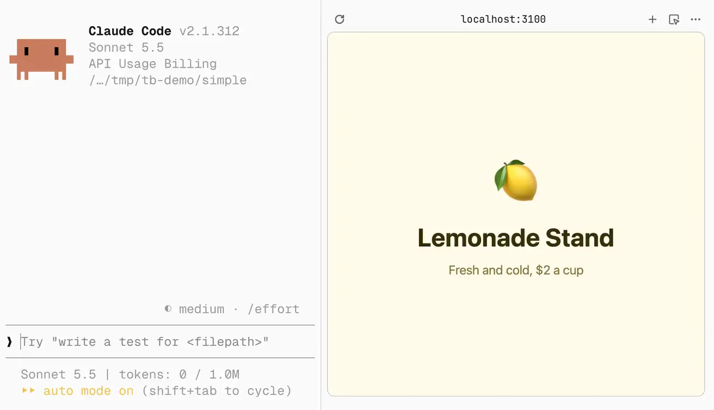
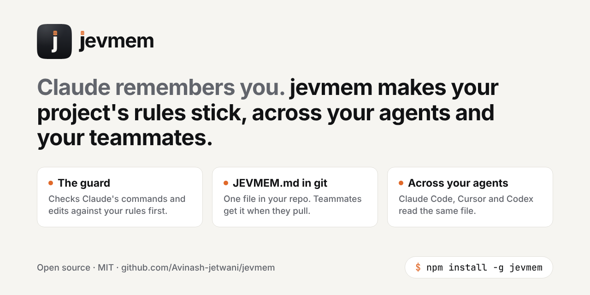

# Лучшие моды Claude Code

[English](https://github.com/claude-code-mods/best-claude-code-mods) · [简体中文](https://github.com/claude-code-mods/claude-code-mods-zh) · [繁體中文](https://github.com/claude-code-mods/claude-code-mods-zh-tw) · [日本語](https://github.com/claude-code-mods/claude-code-mods-ja) · [한국어](https://github.com/claude-code-mods/claude-code-mods-ko) · [Español](https://github.com/claude-code-mods/claude-code-mods-es) · [Français](https://github.com/claude-code-mods/claude-code-mods-fr) · [Deutsch](https://github.com/claude-code-mods/claude-code-mods-de) · [Português (Brasil)](https://github.com/claude-code-mods/claude-code-mods-pt-br) · **Русский**

**Отобраны вручную, проверены, зафиксированы по версии. Добавьте один раз — 40 модов.**

> **Все 40 модов полностью локализованы на русский язык.** Переведены каждая подпись, каждая команда, каждая панель, каждый промпт и документация; исходники плагинов включены в этот репозиторий, поэтому после установки интерфейс сразу будет на русском — без дополнительной настройки. Только идентификаторы кода, имена событий хуков, навыки (skills) и инструкции для модели остаются на английском, чтобы поведение не изменилось.

Моды — это плагины Claude Code на функциях-хуках: они могут наблюдать за тем, что делает Claude Code, изменять или перехватывать его действия, а также рисовать собственный интерфейс. Этот маркетплейс собирает лучшие моды сообщества. Каждый проверен с помощью `claude plugin validate` и зафиксирован на проверенном коммите, поэтому последующие изменения автора никогда не попадут к вам без проверки.

Требуется Claude Code 2.1.287 или новее.

## Установка

В терминальной сессии Claude Code введите:

```
/plugin marketplace add claude-code-mods/claude-code-mods-ru
/plugin install <имя-мода>@claude-code-mods-ru
```

Например, `/plugin install terminal-browser@claude-code-mods-ru`. Выполните `/plugin marketplace update claude-code-mods-ru`, чтобы получить новые моды и обновления.

## Каталог

Колонка **Доступ** на каждой карточке показывает, что, по данным валидатора, может делать код мода помимо рисования интерфейса. Перед установкой изучите исходники мода: проверка только читает код, не запускает его и не является аудитом безопасности.

### Панели и потребление

[](https://github.com/alexgreensh/token-optimizer/tree/e3f1a2dcad8d8999096b8a881c4d98cdba4ef1a5/desktop/token-optimizer-desktop)

#### [`token-optimizer`](https://github.com/alexgreensh/token-optimizer/tree/e3f1a2dcad8d8999096b8a881c4d98cdba4ef1a5/desktop/token-optimizer-desktop)

*автор alexgreensh* · Строка состояния оптимизатора токенов: показывает, куда уходят токены и как тратить меньше.

**Доступ:** Запуск команд, Вызов модели, Файлы

`/plugin install token-optimizer@claude-code-mods-ru`

---

[](https://github.com/hex/claude-council/tree/f2f7f42122b288599cef8cea97dcc490acea98a5)

#### [`council`](https://github.com/hex/claude-council/tree/f2f7f42122b288599cef8cea97dcc490acea98a5)

*автор hex* · Одновременный опрос нескольких ИИ-агентов для получения разных точек зрения: потоковая панель и дополнительная фоновая проверка.

**Доступ:** Запуск команд, Вызов модели, Файлы

`/plugin install council@claude-code-mods-ru`

---

[](https://github.com/chipfighter/context-attachment-manager/tree/d68a721b7432059c9056d546ff2a26b11b3c0e0c)

#### [`codex-attachment-manager`](https://github.com/chipfighter/context-attachment-manager/tree/d68a721b7432059c9056d546ff2a26b11b3c0e0c)

*автор chipfighter* · Отправляет ранние изображения короткими заполнителями и получает оригиналы обратно по ID, поэтому длинные сессии с изображениями сохраняют кэш промпта.

**Доступ:** Сеть, MCP

`/plugin install codex-attachment-manager@claude-code-mods-ru`

---

[](https://github.com/karanb192/cache-tax/tree/535ff33225e666e605e731d78f5ac5efe243c7c3)

#### [`cache-tax`](https://github.com/karanb192/cache-tax/tree/535ff33225e666e605e731d78f5ac5efe243c7c3)

*автор karanb192* · Поддерживает кэш промпта в течение часа во время пауз, спрашивает перед холодной отправкой и показывает стоимость перезаписи.

**Доступ:** Вызов модели

`/plugin install cache-tax@claude-code-mods-ru`

---

[](https://github.com/Atoll92/agent-standup/tree/846d5324f7c00f06d598c86e87ed8b51d774b3ac/plugin-band)

#### [`agent-standup-band`](https://github.com/Atoll92/agent-standup/tree/846d5324f7c00f06d598c86e87ed8b51d774b3ac/plugin-band)

*автор Atoll92* · Строка над полем ввода, когда другая локальная сессия ждёт вас, и уведомление о её завершении.

**Доступ:** Запуск команд, Файлы

`/plugin install agent-standup-band@claude-code-mods-ru`

---

[](https://github.com/pleaseai/shunt/tree/57182b328e92d3c70bc9ca5a1fd1ee9104cfbabb/plugins/shunt)

#### [`shunt`](https://github.com/pleaseai/shunt/tree/57182b328e92d3c70bc9ca5a1fd1ee9104cfbabb/plugins/shunt)

*автор pleaseai* · Полоса потребления для шлюза shunt: расходы и время сброса за каждый период, а также подробный отчёт /shunt:usage.

**Доступ:** Сеть, Запуск команд

`/plugin install shunt@claude-code-mods-ru`

---

[](https://github.com/localixai/tokendoctor/tree/051fa9598f0a50ed30974b618f2911381b7dcf90)

#### [`tokendoctor`](https://github.com/localixai/tokendoctor/tree/051fa9598f0a50ed30974b618f2911381b7dcf90)

*автор localixai* · Воспроизводит ваши прошлые сессии, чтобы показать, сколько сэкономило бы каждое изменение, и применяет только выбранное.

**Доступ:** Запуск команд, Вызов модели

`/plugin install tokendoctor@claude-code-mods-ru`

---

[](https://github.com/hellosverre/claude-skins/tree/cf0d39f3785d5c5a4b6189ecc487b1ac479efea0)

#### [`skins`](https://github.com/hellosverre/claude-skins/tree/cf0d39f3785d5c5a4b6189ecc487b1ac479efea0)

*автор hellosverre* · Оформление и пятнадцать тем для транскрипта с насыщенными карточками и полосой потребления; /skin меняет их на лету.

**Доступ:** Сеть, Запуск команд, Вызов модели, Файлы

`/plugin install skins@claude-code-mods-ru`

---

[](https://github.com/cablate/ctx-handoff-mod/tree/a416713a0495be799a31f3650e18458e242270c7)

#### [`ctx-handoff`](https://github.com/cablate/ctx-handoff-mod/tree/a416713a0495be799a31f3650e18458e242270c7)

*автор cablate* · Превращает то, чему вы учите Claude, в заметки проекта, ловит типичные ошибки, поддерживает кэш и возобновляет длинные сессии.

**Доступ:** Вызов модели, Файлы

`/plugin install ctx-handoff@claude-code-mods-ru`

---

[](https://github.com/PBJ-2/clauderipple/tree/c1c6b76a9e4e7a51df2ec5907d6e41d6bf8591e3/packages/mod)

#### [`ripple`](https://github.com/PBJ-2/clauderipple/tree/c1c6b76a9e4e7a51df2ec5907d6e41d6bf8591e3/packages/mod)

*автор PBJ-2* · Выбирает уровень рассуждений для каждого запроса и исполнителя для каждой переданной задачи, поддерживает кэш и показывает, куда ушёл каждый запрос.

**Доступ:** Сеть, Запуск команд, Вызов модели, MCP, Файлы

`/plugin install ripple@claude-code-mods-ru`

---

[](https://github.com/LiarMTTT/TavernWeave/tree/f9863d2b05305457fe9ed8b0c5688d52aca400a5)

#### [`tavernweave-agent-skills`](https://github.com/LiarMTTT/TavernWeave/tree/f9863d2b05305457fe9ed8b0c5688d52aca400a5)

*автор LiarMTTT* · 23 общих навыка для ролевых персонажей, разработки ПО и ограниченных облачных задач, плюс переключатель режима Soul над полем ввода.

**Доступ:** —

`/plugin install tavernweave-agent-skills@claude-code-mods-ru`

---

[](https://github.com/rbartoli/agent-usage-guard/tree/02594c2620be9eb60c32e2f77d9d512d9f61b205)

#### [`agent-usage-guard`](https://github.com/rbartoli/agent-usage-guard/tree/02594c2620be9eb60c32e2f77d9d512d9f61b205)

*автор rbartoli* · Удерживает разветвление субагентов, промпты с большим контекстом и циклы повторов до того, как они потратят вашу квоту.

**Доступ:** Вызов модели, Файлы

`/plugin install agent-usage-guard@claude-code-mods-ru`


### Агенты и субагенты

[](https://github.com/Paradigm-Study/claude-share/tree/9d88f996ac4245c756a89b34e98cfde375028950/plugin)

#### [`shared-session`](https://github.com/Paradigm-Study/claude-share/tree/9d88f996ac4245c756a89b34e98cfde375028950/plugin)

*автор Paradigm-Study* · Поделитесь сессией по ссылке или с командой; коллеги подключаются из своего Claude Code и видят каждый ход в реальном времени.

**Доступ:** —

`/plugin install shared-session@claude-code-mods-ru`

---

[](https://github.com/scasella/claude-flightdeck/tree/626cc0b46d417f81bbff9f5ba3b49abaf8912a85)

#### [`flightdeck`](https://github.com/scasella/claude-flightdeck/tree/626cc0b46d417f81bbff9f5ba3b49abaf8912a85)

*автор scasella* · Живая панель агента: показатели модели, дежурный архитектор, проверка разрешений, карточки субагентов и журнал сессии.

**Доступ:** —

`/plugin install flightdeck@claude-code-mods-ru`

---

[](https://github.com/rsmdt/the-startup/tree/e803d51fdb423271d3dde189f5416f3ec51386a9/plugins/start)

#### [`start`](https://github.com/rsmdt/the-startup/tree/e803d51fdb423271d3dde189f5416f3ec51386a9/plugins/start)

*автор rsmdt* · Команды оркестрации рабочего процесса для агентной разработки ПО.

**Доступ:** Файлы

`/plugin install start@claude-code-mods-ru`

---

[](https://github.com/VKirill/claude-lane-stack/tree/8bac2b876b72053aa445bb9d1c7c6079bfc4ba8c/plugins/lane-stack)

#### [`lane-stack`](https://github.com/VKirill/claude-lane-stack/tree/8bac2b876b72053aa445bb9d1c7c6079bfc4ba8c/plugins/lane-stack)

*автор VKirill* · Конвейер для одного менеджера проекта: агенты-оркестраторы, инструкции по дорожкам, команды ввода и возобновления.

**Доступ:** Сеть, Вызов модели

`/plugin install lane-stack@claude-code-mods-ru`


### Продуктивность и контекст

[](https://github.com/Kuddev/pebrel/tree/ed9b2331340877ba3d775e38c4df6bd1a2abb1fe/pebrel_app/res/prompt-suggestions/claude)

#### [`pebrel-prompt-suggestions`](https://github.com/Kuddev/pebrel/tree/ed9b2331340877ba3d775e38c4df6bd1a2abb1fe/pebrel_app/res/prompt-suggestions/claude)

*автор Kuddev* · Родные подсказки в пустом поле ввода через мост сессий Pebrel.

**Доступ:** Сеть

`/plugin install pebrel-prompt-suggestions@claude-code-mods-ru`

---

[](https://github.com/tamaratran/fast-jev-compaction/tree/e3f262a7f4d42bd8dd32ced30d26176f7cb545b0)

#### [`fast-jev-compaction`](https://github.com/tamaratran/fast-jev-compaction/tree/e3f262a7f4d42bd8dd32ced30d26176f7cb545b0)

*автор tamaratran* · Дословное сжатие сессий Claude Code под управлением Jev.

**Доступ:** Сеть, Вызов модели

`/plugin install fast-jev-compaction@claude-code-mods-ru`

---

[](https://github.com/alexeyw/lot-map/tree/ad60f057902765d778eedde770d337be45fac3af)

#### [`lot-map`](https://github.com/alexeyw/lot-map/tree/ad60f057902765d778eedde770d337be45fac3af)

*автор alexeyw* · Живая карта рядом с чатом: память, файлы, оболочка, веб, модель, агенты, навыки и хуки подсвечиваются при использовании.

**Доступ:** —

`/plugin install lot-map@claude-code-mods-ru`

---

[](https://github.com/Storybloq/storybloq/tree/f0b4c08e3a15ffb9841e5a3058c6b1ca57607154/plugins/storybloq)

#### [`storybloq`](https://github.com/Storybloq/storybloq/tree/f0b4c08e3a15ffb9841e5a3058c6b1ca57607154/plugins/storybloq)

*автор Storybloq* · Память проекта: тикеты, задачи, передачи и выводы в папке .story/ вашего репозитория.

**Доступ:** Файлы

`/plugin install storybloq@claude-code-mods-ru`

---

[](https://github.com/Lifecycle-Innovations-Limited/claude-ops/tree/e434ef7e612f2ff5769def6101fc9d984888d377/claude-ops/skills/ops-jdi/plugin)

#### [`just-do-it`](https://github.com/Lifecycle-Innovations-Limited/claude-ops/tree/e434ef7e612f2ff5769def6101fc9d984888d377/claude-ops/skills/ops-jdi/plugin)

*автор Lifecycle-Innovations-Limited* · Продолжает разрешённую работу через проверку и сдачу, а также выявляет проблемы настройки, которые нужно исправить.

**Доступ:** Запуск команд, Вызов модели

`/plugin install just-do-it@claude-code-mods-ru`

---

[](https://github.com/data-goblin/claude-code-filetree/tree/1fdc3a963f2dc22a939f661ff0ff5a76646c9112)

#### [`filetree`](https://github.com/data-goblin/claude-code-filetree/tree/1fdc3a963f2dc22a939f661ff0ff5a76646c9112)

*автор data-goblin* · Дерево файлов в стиле IDE: показывает, что делает Claude и в каких файлах.

**Доступ:** Запуск команд, Вызов модели, Файлы

`/plugin install filetree@claude-code-mods-ru`

---

[](https://github.com/notque/vexjoy-agent/tree/c68ac1fea2a03e437ccc95112d1e56e467a9bd00/plugins/jev-auto-compact)

#### [`jev-auto-compact`](https://github.com/notque/vexjoy-agent/tree/c68ac1fea2a03e437ccc95112d1e56e467a9bd00/plugins/jev-auto-compact)

*автор notque* · При 60% контекста удаляет устаревшие вызовы инструментов без генерации; вместо перехода к LLM-сводке просто пропускает их.

**Доступ:** Сеть, Вызов модели

`/plugin install jev-auto-compact@claude-code-mods-ru`

---

[](https://github.com/caliber-ai-org/ai-setup/tree/f5dbc002022a8a10acad25c1cce23ddefdc19d0d/plugin/caliber-jev-compaction)

#### [`caliber-jev-compaction`](https://github.com/caliber-ai-org/ai-setup/tree/f5dbc002022a8a10acad25c1cce23ddefdc19d0d/plugin/caliber-jev-compaction)

*автор caliber-ai-org* · Дословное сжатие сессий Claude Code под управлением Jev.

**Доступ:** Сеть, Вызов модели

`/plugin install caliber-jev-compaction@claude-code-mods-ru`

---

[](https://github.com/aerovato/operator-memory/tree/93c3fce64f0a72adeb89fa868600eb418548ec07/packages/claude-code)

#### [`operator`](https://github.com/aerovato/operator-memory/tree/93c3fce64f0a72adeb89fa868600eb418548ec07/packages/claude-code)

*автор aerovato* · Устойчивая память проекта и пользователя для разработки с помощью агентов.

**Доступ:** —

`/plugin install operator@claude-code-mods-ru`

---

[](https://github.com/gwittebolle/claude-carbon/tree/9ad53f1dd07fb0e11fcdb94d294ed794d660cf4b)

#### [`carbon`](https://github.com/gwittebolle/claude-carbon/tree/9ad53f1dd07fb0e11fcdb94d294ed794d660cf4b)

*автор gwittebolle* · Отслеживает углеродный след ваших сессий Claude Code в терминале и настольном приложении.

**Доступ:** Файлы

`/plugin install carbon@claude-code-mods-ru`

---

[](https://github.com/danyuchn/claude-work-mode/tree/e19eda1e8465308bd79a74fad295cf9b6d9cdf71/plugins/work-mode)

#### [`work-mode`](https://github.com/danyuchn/claude-work-mode/tree/e19eda1e8465308bd79a74fad295cf9b6d9cdf71/plugins/work-mode)

*автор danyuchn* · Режимы сессии: auto (без вопросов посреди задачи), out (передача пакетной работы) и wrap (свёртывание и завершение).

**Доступ:** Запуск команд, Файлы

`/plugin install work-mode@claude-code-mods-ru`

---

[](https://github.com/iamumeransari/claude-show-your-work/tree/71e546044e3ba61b98a6938a03270da791f9ca2e)

#### [`show-your-work`](https://github.com/iamumeransari/claude-show-your-work/tree/71e546044e3ba61b98a6938a03270da791f9ca2e)

*автор iamumeransari* · Показывает готовую работу в терминале: снимки экрана, видео с переходами по клику и синхронизированное сравнение «до/после» при проверке.

**Доступ:** Сеть, Запуск команд, Вызов модели, Файлы

`/plugin install show-your-work@claude-code-mods-ru`

---

[](https://github.com/petekp/inbox/tree/02e441cd447edf86fc30fbd03e9117a8ead9da7a)

#### [`inbox`](https://github.com/petekp/inbox/tree/02e441cd447edf86fc30fbd03e9117a8ead9da7a)

*автор petekp* · Собирает вопросы, задачи, находки и пулл-реквесты, ожидающие вас в сессии.

**Доступ:** —

`/plugin install inbox@claude-code-mods-ru`

---

[](https://github.com/kunchenguid/compact-adviser/tree/37fa1a665b8933de68c90014312060e862cf121a/packages/claude-mod)

#### [`compact-adviser`](https://github.com/kunchenguid/compact-adviser/tree/37fa1a665b8933de68c90014312060e862cf121a/packages/claude-mod)

*автор kunchenguid* · Предлагает или выполняет /compact на завершённой контрольной точке, оценённой с помощью TypeSafe Jev.

**Доступ:** Сеть, Вызов модели, Файлы

`/plugin install compact-adviser@claude-code-mods-ru`


### Отображение и предпросмотр

[](https://github.com/zenbu-labs/terminal-browser/tree/fa9e5eb053d2a1da11f7ccba720a0d3d389c05a6/claude-code-plugin)

#### [`terminal-browser`](https://github.com/zenbu-labs/terminal-browser/tree/fa9e5eb053d2a1da11f7ccba720a0d3d389c05a6/claude-code-plugin)

*автор zenbu-labs* · Браузер внутри Claude Code: предпросмотр сайтов и HTML, а также управление встроенным браузером агентом.

**Доступ:** Сеть, Запуск команд, Вызов модели, Файлы

`/plugin install terminal-browser@claude-code-mods-ru`

---

[](https://github.com/NahumLitvin/prismantis/tree/3718a40abc57b836108a65bd9f01d06d3237e52d/plugin)

#### [`prismantis`](https://github.com/NahumLitvin/prismantis/tree/3718a40abc57b836108a65bd9f01d06d3237e52d/plugin)

*автор NahumLitvin* · Яркая настраиваемая визуализация ответов: таблицы, заголовки, код, числа, пути и ссылки.

**Доступ:** Запуск команд, Файлы

`/plugin install prismantis@claude-code-mods-ru`


### Безопасность и защита

[](https://github.com/amontlabs/lcu/tree/1bd45b304295c7665b559fcc32f7b3a8f1b1d859/adapters/claude-mod/lcu-approve)

#### [`lcu-approve`](https://github.com/amontlabs/lcu/tree/1bd45b304295c7665b559fcc32f7b3a8f1b1d859/adapters/claude-mod/lcu-approve)

*автор amontlabs* · Разрешение на использование компьютера для каждого приложения: разрешить для этой беседы, всегда разрешить или запретить, плюс панель разрешённых приложений.

**Доступ:** Запуск команд, MCP, Файлы

`/plugin install lcu-approve@claude-code-mods-ru`

---

[](https://github.com/sd0xdev/sd0x-harness/tree/b0206637edd2e44c993da12b6b30858f96bc3cdc/mods/agentctl)

#### [`agentctl`](https://github.com/sd0xdev/sd0x-harness/tree/b0206637edd2e44c993da12b6b30858f96bc3cdc/mods/agentctl)

*автор sd0xdev* · Панель управления агентом для сессии: границы задач, доказательства и передача.

**Доступ:** Запуск команд, Вызов модели, Файлы

`/plugin install agentctl@claude-code-mods-ru`

---

[](https://github.com/greenpolo/cc-multi-cli-plugin/tree/66d9b0a6b06b25fd648ecd53311a647bb57e2fb4/plugins/multi-core)

#### [`multi-core`](https://github.com/greenpolo/cc-multi-cli-plugin/tree/66d9b0a6b06b25fd648ecd53311a647bb57e2fb4/plugins/multi-core)

*автор greenpolo* · Используйте модели ChatGPT, Cursor, OpenCode и Antigravity в одной сессии, переключаясь через /model.

**Доступ:** Сеть, Вызов модели

`/plugin install multi-core@claude-code-mods-ru`

---

[](https://github.com/Avinash-jetwani/jevmem/tree/c29753ccb2c9706e417fda25efa422682358955b/pane)

#### [`jevmem-pane`](https://github.com/Avinash-jetwani/jevmem/tree/c29753ccb2c9706e417fda25efa422682358955b/pane)

*автор Avinash-jetwani* · Боковая панель: что вспомнил jevmem, что решил его страж и что сохранил последний ход.

**Доступ:** Запуск команд, Файлы

`/plugin install jevmem-pane@claude-code-mods-ru`


### Git, PR и развёртывание

[](https://github.com/kunchenguid/firstmate/tree/427056c4181c41074ad24f051f79919330df0fa5/.claude/mods/firstmate-calm)

#### [`fm`](https://github.com/kunchenguid/firstmate/tree/427056c4181c41074ad24f051f79919330df0fa5/.claude/mods/firstmate-calm)

*автор kunchenguid* · Анимация парусника во время работы и транскрипт только для беседы; настройка спокойного режима сохраняется между сессиями.

**Доступ:** Файлы

`/plugin install fm@claude-code-mods-ru`

---

[](https://github.com/tobihagemann/turbo/tree/3bc6b4436d96be22497109e16e68fe4dfa323531/claude)

#### [`turbo`](https://github.com/tobihagemann/turbo/tree/3bc6b4436d96be22497109e16e68fe4dfa323531/claude)

*автор tobihagemann* · Управляемая человеком фабрика разработки ПО с агентами: вы решаете, что строить, и оцениваете результат, а навыки собирают и выпускают его.

**Доступ:** Вызов модели, Файлы

`/plugin install turbo@claude-code-mods-ru`

---

[](https://github.com/Mazzeo-Marketing/MazyOS/tree/d2b65b392f1ee230afb088d155fc734def5f105d)

#### [`mazyos`](https://github.com/Mazzeo-Marketing/MazyOS/tree/d2b65b392f1ee230afb088d155fc734def5f105d)

*автор Mazzeo-Marketing* · Плагин-операционная система для португалоязычного бизнеса: память компании в каждой сессии, фирменный стиль в результатах и 17 маркетинговых и SEO-навыков.

**Доступ:** Файлы

`/plugin install mazyos@claude-code-mods-ru`

---

[](https://github.com/swingerman/engineer/tree/ae4cb5fe32007dd6a3d717c9998dcfb12b1f348e/engineer)

#### [`engineer`](https://github.com/swingerman/engineer/tree/ae4cb5fe32007dd6a3d717c9998dcfb12b1f348e/engineer)

*автор swingerman* · Набор методик дисциплинированной агентной разработки: приём задач, поиск критериев приёмки, спецификация, планирование, реализация, проверка и укрепление.

**Доступ:** Запуск команд, Вызов модели

`/plugin install engineer@claude-code-mods-ru`

## Предложить мод

Откройте issue со ссылкой на репозиторий мода. Чтобы добавить его самостоятельно, добавьте запись в `community.json` (репозиторий, папка, проверенный коммит, категория, лицензия), напишите однострочное описание в `readme/summaries.json`, запустите `python3 scripts/build-catalog.py` и откройте pull request.

## Благодарности и локализация

Каждый мод принадлежит своему исходному автору и сохраняет свою лицензию. Помимо сбора модов, этот репозиторий предоставляет **русскую локализацию**: плагины включены в папку `mods/`, их подписи, описания команд, панели и промпты переведены, а документация каждого мода тоже переведена (оригинал сохранён как `README.en.md`). Исходный автор и лицензия указаны в конце каждого документа. Если вы хотите удалить локализованную копию или изменить указание авторства, откройте issue.

Неофициальный проект, не связанный с Anthropic.
