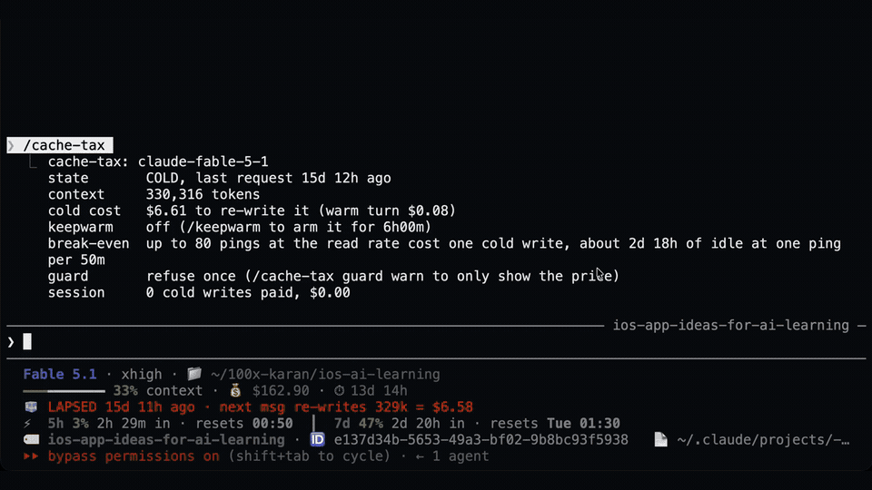

<picture>
  <source media="(prefers-color-scheme: dark)" srcset="site/assets/cache-tax-dark.svg">
  
</picture>

# Cache Tax для Claude Code

**Держите кэш запросов Claude Code тёплым во время перерывов.**

Cache Tax — это мод Claude Code, который обновляет кэш запросов, пока вы отсутствуете, и показывает оценку стоимости перезаписи перед холодной отправкой. Выполните `/keepwarm 90m` перед перерывом. Пинги расходуют токены; выбирайте окно, в которое рассчитываете вернуться.

**[Установка](#install)** · [Сайт](https://cachetax.aidojo.si/) · [Как это работает](#how-it-works) · [Стоимость и ограничения](#cost-and-the-plan-limit-question) · [Команды](#commands)



Краткое резюме из двух строк в сессии на 330k токенов дало **оценку $6.61**. После повторной отправки записанная запись в кэш составила **$6.28**. Записано на версии 2.1.1; сейчас формулировка говорит «до» оценочного числа токенов. Это стоимость, эквивалентная API, а не дополнительные списания по подписке.

## Установка

Нужны [Claude Code 2.1.287 или новее](https://code.claude.com/docs/en/plugins/mods/overview#turn-mods-on-or-off), часовой кэш и работающий Claude Code. Моды включены по умолчанию. Пинги расходуют токены, включая неограниченный вывод.

```sh
claude plugin marketplace add karanb192/claude-code-mods
claude plugin install cache-tax@claude-code-mods
```

Перезапустите Claude Code или выполните `/reload-plugins` в открытой сессии. Флаг раннего доступа не нужен. Если вы ранее задавали `CLAUDE_CODE_ENABLE_FUNCTION_HOOKS`, удалите его; текущий Claude Code его игнорирует.

В тёплой сессии выполните `/keepwarm`, чтобы включить шесть часов. Используйте `/keepwarm 90m` для более короткого окна или `/keepwarm off` для остановки.

**Проверьте основное время жизни кэша.** Включённое использование по подписке по умолчанию длится час. Сессии с API-ключом, usage-кредитами и облачными провайдерами по умолчанию имеют пять минут, поэтому для этих путей биллинга задайте [`promptCacheTtl`](https://code.claude.com/docs/en/prompt-caching#choose-the-ttl-yourself) равным `"1h"`. 50-минутный таймер не защитит пятиминутный основной кэш. Доказательства для ветвления см. в [Ограничениях](#limits).

**Предпочитаете хук в настройках?** [Версия-хук](https://github.com/karanb192/claude-code-hooks/tree/main/plugins/cache-tax) по умолчанию предупреждает, один раз отказывает при `CACHE_TAX_BLOCK=1` и предоставляет отдельный обратный отсчёт в строке состояния. Поддержание тепла — часть этого мода.

Создал [Karan Bansal](https://karanbansal.in/). Прочитайте [историю Cache Tax и записанные расходы кэша](https://karanbansal.in/blog/cache-tax/).

## Параметры

В `/config`, в разделе cache-tax:

    Auto keepwarm:    on | off
    Display:          band | status
    Ping floor:       2 (число, 0 или больше)
    Headless prompts: guard | send

`on` (по умолчанию) сохраняет текущее поведение: после оплаты холодной записи кэша keepwarm включается на три часа. `off` оставляет keepwarm выключенным, пока вы не включите его через `/keepwarm`; тогда формулировка защиты говорит, что keepwarm выключен, или называет оставшееся время включённого окна. `/keepwarm always` всё равно включает его в любом случае.

Ping floor делит оценочную стоимость холодной перезаписи на бюджет расходов во время простоя: 2 допускает оценочные расходы на пинги ниже половины перезаписи; 0 отключает лимит. Перед пингом уже观察到的 расходы в этом перерыве плюс оценка следующего пинга должны быть ниже бюджета. Оценка использует самую дешёвую из пяти последних тёплых квитанций, переоценённую для текущей модели и контекста, включая её ценовую категорию. Новый основной ход сбрасывает расходы; продление или остановка с повторным включением окна — нет. Пропущенный пинг оставляет кэш остыть. Журнал и статус объясняют причину, а `$.cacheTax.status()` показывает `pingSkipped` и `idlePingUsd`.

У первого пинга нет квитанции, поэтому он отправляется. Поздний ответ может стоить больше оценки, поэтому это лимит на основе оценки, а не гарантированный максимум счёта. Без цены модели, контекста или оценённых квитанций сравнение невозможно. Квитанции и расходы живут в памяти: перезапуск или новая беседа их очищают. Пинги могут закончиться раньше запрошенного окна прогрева.

Display выбирает, где показывать состояние, пока keepwarm включён. `band` (по умолчанию) — строка над запросом, с текстовым значком в терминалах и кубиком на Desktop. `status` помещает тот же текст в запись состояния под запросом и не рисует строку: используйте его, когда другое владеет пространством над запросом. Настройки, скрывающей индикатор, нет: пинги расходуют токены, поэтому экран всегда говорит, когда они работают.

## Как это работает

**Перед перерывом:** `/keepwarm` включает ограниченное окно. После 50 минут простоя таймер внутри Claude Code отправляет один форк без инструментов по транскрипту сессии. Он читает использование после каждого пинга и останавливается, если чтения нулевые или записи достигают 10% от чтений. Лимит расходов во время простоя может пропустить последующие пинги до конца окна. Фонового цикла опроса транскрипта нет.

**Когда вы возвращаетесь к холодному кэшу:** для контекста не менее 50 000 токенов защитник спрашивает перед отправкой вашего обычного сообщения, если его часовой таймер говорит «холодно». Вопрос показывает оценочную стоимость перезаписи и рекомендации по прогреву. **Отправить всё равно** отправляет сообщение; **Не отправлять** отбрасывает его. Если диалог закрыт или хост не может ответить, защитник один раз отказывает, и повторная отправка проходит. Хосты на SDK, которые могут ответить на диалог, сохраняют этот выбор. `/cache-tax guard refuse 5` спрашивает при $5 и выше, включая модель без строки цены; более дешёвые отправки записывают цену и продолжаются.

`Headless prompts: send` включает для неинтерактивных запросов с источником `sdk` немедленную отправку при стандартной настройке защиты. Claude Code использует те же поля и для `claude -p`, и для ходов Agent SDK, поэтому параметр покрывает оба; он не различает CLI и SDK-хост. Значение по умолчанию, `guard`, продолжает спрашивать или один раз отказывает, где ответить некому. Явное `/cache-tax guard refuse`, с порогом в долларах или без него, действует и при `send`; `/cache-tax guard default` сбрасывает это явное предпочтение. Удалённые сообщения от людей (`composer`, `bridge`, `unclassified` и источники каналов) сохраняют защиту даже в неинтерактивном хосте. Фоновые уведомления и запросы по расписанию отправляются с записью цены, поскольку повторить их некому.

Отказ в headless-режиме возвращает причину и записывает её в журнал транскрипта/отладки. Используйте `--debug-file` Claude Code при диагностике скрипта. API модов не может задать код выхода процесса или записать отказ в stderr; отказ не обязан давать ненулевой код или причину в stdout. Запуск с согласием, который упёрся в долларовый порог, всё равно требует осознанной повторной попытки.

По умолчанию обнаруженная холодная запись автоматически включает минимум три часа keepwarm, окно always (шесть часов, если не задано другое) при включённом `always` и печатает, сколько это стоило; параметр Auto keepwarm [опции](#options) выключает автоматическую часть. `/cache-tax` показывает текущую оценку кэша, окно прогрева и счётчик холодных записей этой сессии.

Счётчик следует за квитанциями кэша. Для каждого запроса он оценивает повторно записанный старый контекст как минимум из сообщённой записи и предыдущего контекста минус сообщённое чтение. Отсутствующий хвост меньше 10% от чтения считается попаданием в кэш. Новый контент при попадании не учитывается и не включает keepwarm; существенная частичная перезапись всё равно может. Каждая перезапись использует модель и ценовую категорию этого запроса.

Если хост сообщает только суммарное использование хода, оценка может пропустить перезапись, скрытую последующими чтениями кэша, а сжатый ход останется без оценки без по квитанциям для отдельных запросов.

Когда разрешённая защитой отправка не обнаружила перезаписи, заметка о завершении объясняет, что автоматическое окно холодной записи не открыто, или называет текущее состояние прогрева. Это не подтверждает состояние кэша сервера по суммарному использованию. Завершение холодной записи, прерванное `/clear`, не может открыть автоматическое окно в новой беседе.

Подготовка или пропуск сжатия оставляют прогрев в покое. Применённое сжатие приостанавливает его, пока основной запрос не прочитает или не запишет новый префикс. После этого окно может возобновить пинги, пока ход ждёт инструмент или ответ пользователя. Записи сводки не идут в счётчик холодных записей; перезапись, оплаченная до сжатия, сохраняет исходный контекст и цену.

Окна принадлежат отдельным сессиям. Уже холодная сессия ждёт вашего следующего хода перед пингом, как и окно, восстановленное после перезапуска Claude Code, пока новый процесс не получит ход для форка. Если пинг не нашёл что форкнуть, одна строка один раз говорит об этом, и пинги начнутся после вашего следующего сообщения. Пинг, отклонённый занятым API (429, 529, 5xx), повторяется через 1, 2 и 4 минуты, пока ещё может попасть до остывания кэша. При включённом `always` каждый ваш ход, дошедший до кэша, оставляет хотя бы always-окно (по умолчанию шесть часов) с стандартным периодом, с учётом лимита расходов в простое и успешного чтения после прогрева. `/keepwarm always 24h` делает этот минимум 24 часами для каждой сессии (1ч–168ч; обычный `/keepwarm always` возвращает шесть). Тот же ход возвращает остановившееся окно, растягивает более короткое до always-окна и сбрасывает тестовый период; заданное вами более длинное окно остаётся. `/keepwarm off` в любой сессии останавливает все сессии, считая со следующего хода. Окно заканчивается в свой срок; `/keepwarm off` также отменяет его и сбрасывает настройку always.

### Записанный пинг прогрева


Sonnet 5, 16 сентября 2026: статус сообщил **75k токенов прочитано за $0.02**. Во время записи в беседе ничего не появлялось. Запись использовала тестовый интервал одной минуты на версии 2.0.0; оценка перезаписи $0.45 в её карточке использовала старую строку цены Sonnet против $0.30 за тот же контекст по текущей строке. Двухцентовый пинг — квитанция именно этой сессии, не фиксированная цена.

## Почему короткое сообщение может стоить так дорого

Когда кэшированный префикс истёкает, даже «сделай краткое резюме» может вызвать перезапись старого контекста перед ответом. Строка цен Fable 5.1 в Cache Tax сравнивает часовую запись за $20 с чтением кэша $0.25 за миллион токенов: в 80 раз дороже за токен, а не в 80 раз больше суммарной экономии. См. [допущения по ценам](#cost-and-the-plan-limit-question) и [таблицу цен Anthropic](https://platform.claude.com/docs/en/about-claude/pricing).

[Посмотрите 23-секундный обзор](docs/assets/cache-cost-explainer.mp4). Его специально поставленные сцены подписывают прайс Fable 5.1; каждый пиксель терминала и строки состояния взят из реальной записи отказа и квитанции прогрева выше. Отказ записан на 2.1.1, фрагмент прогрева — на 2.0.0.

Впервые с кэшированием? [Anthropic объясняет, как его использует Claude Code](https://code.claude.com/docs/en/prompt-caching).

## Команды

    /keepwarm               держать кэш тёплым шесть часов
    /keepwarm 90m           держать кэш тёплым выбранное окно от 1m до 168h (также 2h30m, 6h)
    /keepwarm always        держать каждую сессию тёплой до шести часов после её последнего хода, запоминается между сессиями
    /keepwarm always 24h    то же, до 24 часов после последнего хода (1h до 168h)
    /keepwarm 6h every 2m   пинги каждые две минуты; тестовый параметр от 1m до 59m, забывается после этого окна (при always — на вашем следующем ходе)
    /keepwarm status        окно прогрева, следующий пинг и последняя квитанция
    /keepwarm off           остановить, забыть окно и выключить always
    /cache-tax              карточка
    /cache-tax guard warn   показать цену и отправить (поведение хука по умолчанию)
    /cache-tax guard default
                            восстановить защиту по умолчанию и разрешить Headless prompts управлять неинтерактивными отправками SDK
    /cache-tax guard refuse спрашивать перед холодной отправкой, перекрывает Headless prompts: send
    /cache-tax guard refuse 5
                            спрашивать только при $5 и выше; ниже — показать цену и отправить
    /cache-tax guard test   один раз спросить на следующем отправляемом вами запросе, как будто кэш холодный, по цене контекста этой сессии; тест ничего не оценивает, отправка в действительно холодный кэш оценивается обычно

`/keepwarm` отклоняет лишние слова, некорректные длительности и окна вне границ, не меняя текущее окно прогрева. При запуске он также отбрасывает некорректные и слишком длинные сохранённые сроки. Окно, которое заканчивается до первого пинга, говорит об этом в ответе.

Вопрос дословно, с кнопками **Отправить всё равно ($4.01)** и **Не отправлять** под ним:

    cache-tax: кэш запросов остыл 2h00m назад. Эта отправка перезапишет до 200,502 токенов по $20/MTok = $4.01 (тёплый ход стоил бы $0.05). «Не отправлять» экономит $4.01; после «Отправить всё равно» keepwarm включён до 3h00m. Одно чтение кэша стоит около $0.05 за пинг. Пинги могут закончиться раньше из-за лимита расходов в простое, оставив кэш остыть. Всё равно отправить?

Когда диалог закрыт или защищённый headless-запуск не может его показать, вместо него появляется отказ, и повторная отправка проходит:

    cache-tax: кэш запросов остыл 2h00m назад. Эта отправка перезапишет до 200,502 токенов по $20/MTok = $4.01 (тёплый ход стоил бы $0.05). Отправьте снова, чтобы оплатить это, и keepwarm будет включён до 3h00m, но может закончиться раньше из-за лимита расходов в простое. Или /clear и начните с заметки.

Цифра — верхняя граница. Число контекста, которое движок сообщает для возобновлённой сессии, — это ввод, чтение кэша, запись кэша и вывод последнего ответа вместе, а в полезной нагрузке возобновления нет отдельного числа вывода, которое можно вычесть; на одной 15-дневной сессии защитник говорил 330,316 токенов и $6.61, а следующая запись составила 314k токенов, $6.28.

Пока keepwarm включён, терминал и вкладка Code Desktop показывают строку над запросом, если Display не `status`. Терминалы используют жирный текстовый значок `[>]` с цветом состояния. Desktop показывает кубик Cache Tax: зелёная крышка для тёплого, оранжевая для холодного, серая до первого хода или после сжатия. Жирная подпись состояния совпадает; таймер и текст квитанции обычной жирности. Непустой `NO_COLOR` выбирает жирный текстовый значок на обеих поверхностях и убирает цвет состояния. Оба варианта отображения говорят `warm`, `cold` или `unknown`, поэтому цвет никогда не единственный сигнал. Эти состояния используют те же часы, что и `/cache-tax`; это оценки, а не живая проверка кэша сервера.

Строка и обычный статус обновляются раз в минуту, пока keepwarm включён, в том числе во время простоя. Обновление только меняет отображение; оно не отправляет запрос модели.

Строка содержит окно прогрева, следующий пинг и последнее чтение после прогрева. Остановленный цикл показывает нейтральный символ и причину. `/keepwarm off` или истёкшее окно убирают строку. Опросы временно имеют приоритет, а содержимое других модов остаётся в полосе. Display `status` показывает тот же текст с подписью в записи состояния; поверхности без полосы сохраняют обычный текст статуса, когда Display остаётся `band`.

Кубик Desktop и цвет холодного состояния в терминале следуют светлой или тёмной теме Claude. Встроенные SVG берутся из официальных ресурсов сайта; разработчики могут пересоздать их командой `python3 tools/generate-status-icons.py`. Во время работы файлы изображений не читаются и не загружаются.

Мод читает тему и `NO_COLOR` один раз при начале сессии. Принятые изменения темы сразу обновляют значок; обычные перерисовки эти настройки не перечитывают. Задайте `NO_COLOR` до запуска сессии.

## Установлены обе формы

Хук и мод называются одинаково и делают одно, поэтому при наличии обоих на каждой холодной отправке работает два защитника. Мод при начале сессии проверяет, существует ли команда хука `/cache-tax:status`, и один раз говорит об этом. Оставьте одного защитника. Хук остаётся вариантом для тех, кто предпочитает хуки в настройках. Перед удалением проверьте строку состояния: строка 🧊, привязанная к `cache-tax.js`, идёт из файлов хука. Этот мод рисует над запросом, пока keepwarm включён; он не заменяет вашу строку состояния в оболочке.

## До чего он может добраться

Проверено на Claude Code 2.1.312:

    ❯ ./register.ts hooks: config.set{key=theme}, ui.render{component=AbovePrompt}, session.start, session.end, classic.SessionStart, command.run{command=keepwarm}, command.run{command=cache-tax}, prompt.submit, turn.step, turn.complete, session.compact
    ❯ ./register.ts calls: $.clock.after (via arm, ping), $.clock.every (via updateStatus), $.clock.now, $.command.list, $.command.register, $.config.list, $.env.get, $.model.fork (via ping), $.session.id (via reseat, seat), $.session.model, $.session.usage, $.store.delete, $.store.get, $.store.set, $.ui.ask (via ask), $.ui.invalidate, $.ui.log, $.ui.resolve, $.ui.status
    ❯ ./register.ts env reads: NO_COLOR

Уровень доступа L2, управляет Claude. Видит каждый введённый вами запрос, время каждого запроса модели и счётчики токенов каждого ответа.

Тот же сканер — на [странице cache-tax в Awesome Claude Code Mods](https://mods.aidojo.si/mods/karanb192--cache-tax--cache-tax/), где записано, к чему могут добраться тысячи других модов.

    Модель угроз для cache-tax (уровень L2, управляет Claude)
     1. Читает: из каждого запроса — начинается ли он только со слеша (текст передаётся без изменений, никогда не сохраняется и не заносится в журнал); время; счётчики токенов и id модели, которые движок уже держит на turn.complete и в ответе форка; поля возобновления, которые Claude Code вычисляет для хуков в настройках; список команд; id сессии, модель сессии и собственное число контекста и время начала движка — один раз за беседу в процессе, и модель снова перед оценкой цены холодной отправки и перед каждым пингом; причину и id сессии при завершении беседы через /clear или возобновление в процессе; число сообщений каждого основного запроса; из собственного $.store — срок keepwarm и период пингов по id сессии, плюс глобальный переключатель always (и его окно) и режим защиты с долларовым порогом; при загрузке — параметры Auto keepwarm, Display, Ping floor и Headless prompts; интерактивна ли сессия в начале
     2. Запускает: по одному $.model.fork за каждый период простоя внутри окна keepwarm, по одному за период пинга (50 минут, если тестовый параметр не задал иное, минимум 1 минута), никогда вне окна, никогда на кэш, о котором мод уже знает, что он холодный, никогда после чтения, ничего не прочитавшего или записавшего хотя бы десятую часть прочитанного, когда цены и квитанции известны, только пока наблюдаемые расходы в простое плюс оценка следующего пинга ниже стоимости перезаписи, делённой на Ping floor (0 отключает лимит); один вопрос в собственном диалоге Claude Code перед холодной отправкой или на следующем запросе после /cache-tax guard test
     3. Отправляет: с компьютера не уходит ничего, кроме форка — API-запроса по транскрипту сессии с фиксированным однострочным запросом
     4. Сохраняет: в $.store — срок keepwarm и период пингов под id этой сессии (при always перезаписывается после каждого хода), а также переключатель always (true или его окно в миллисекундах) и режим защиты (вместо него хранится долларовый порог) для всех сессий; после отказа — время последнего ответа под id этой сессии, чтобы повторная отправка из нового процесса (claude -p запускает по одному на ход) прошла; удаляется этой повторной отправкой или /clear; закончившееся окно удаляется при остановке и при следующем начале этой сессии вместе с голыми ключами хранилища 2.1.0; ключи другой сессии здесь никогда не удаляются, поскольку чтение с последующим удалением нельзя сделать атомарным относительно обновления окна этой сессией, поэтому сессия, включившая keepwarm и не вернувшаяся, оставляет два маленьких ключа; счётчик холодных записей сессии, до пяти квитанций тёплых пингов и расходы на пинги в простое живут в памяти и умирают вместе с процессом
     5. Враждебный ввод: единственный текст, который он разбирает, — аргументы двух своих команд, сопоставляемые с регулярным выражением длительности, суммой в долларах и несколькими литералами; ответ диалога сравнивается только с его собственными двумя подписями; из текста запроса проверяется лишь первый непробельный символ на предмет слеша; результаты инструментов и файлы никогда не попадают в ветку; запрос форка — константа, поэтому через него нельзя отправить ничего специально составленного ; защитник всегда отбрасывает только собственное сообщение пользователя: после «Не отправлять» повторная отправка снова попадает под вопрос, а после закрытого или безответного диалога повторная отправка безусловна; если хук выбрасывает исключение, движок пропускает его, и сообщение входит без защиты, с одной тусклой строкой

## Стоимость и вопрос лимита тарифа

Цены — из прайс-таблицы: Fable 5.1 читает за $0.25, пишет в категории 1h за $20 и отвечает за $50 за миллион токенов; у Fable 5.2 ($0.20, $16, $40) и Sonnet 5 ($0.20, $4, $10) свои строки. Оценены только перечисленные версии: модель новее таблицы показывает `n/a` вместо долларов и одну строку о том, что у неё ещё нет цены, и никогда не берёт ставку более старой модели. С API-ключом арифметика проста. Пинг тарифицирует чтение кэша, собственные несколько некэшированных токенов по базовой ставке и всё, что модель ответила, по ставке вывода; показанная стоимость пинга учитывает всё это, поскольку форк не имеет ограничения вывода, а модель с высоким усилием может подумать, прежде чем сказать «тёплый». Возврат после перерыва — это запись. Карточка печатает оценку только для чтения для вашей модели, 80 пингов на Fable 5.1, с простоем, покрывающим её при текущем периоде пингов; реальный пинг стоит немного больше чтения, поэтому истинная точка безубыточности ниже этого числа. По подписке доллары — ориентир, а не счёт, и как чтение кэша учитывается в пятичасовом и недельном лимитах, нигде, где я искал, не задокументировано. Следите за строкой ограничения скорости в своей строке состояния во время первого окна.

## Ограничения

- Моды требуют Claude Code 2.1.287+. Они включены по умолчанию, но локальные настройки, безопасный режим или политика организации могут помешать их загрузке. См. [управление модами](https://code.claude.com/docs/en/plugins/mods/overview#turn-mods-on-or-off).
- Расписание на 50 минут требует основного кэша на час. Включённое использование по подписке имеет его по умолчанию. Другие пути биллинга требуют [`promptCacheTtl`](https://code.claude.com/docs/en/prompt-caching#choose-the-ttl-yourself) равным `"1h"`.
- Одно возвращение с подтверждённым по транскрипту чтением при стандартном интервале, Fable 5.1 по подписке, 19 сентября 2026: `/keepwarm` включён на 42-й минуте перерыва, пинг сработал на 50-й и прочитал 157k, а сообщение, отправленное на 62-й минуте, прочитало 156,886 токенов из кэша и записало 2,255. Собственный обратный отсчёт Claude Code после пинга сбросился до 58 минут, значит форк нёс часовой TTL. Один прогон, одна конфигурация: это показывает, что пинг сохранил кэш дольше часа, а не чистую экономию для каждой настройки. Claude Code относит форки к неосновной корзине запросов, обычно пятиминутной. В этом прогоне форк всё же прочитал часовой префикс сессии и сбросил нативный отсчёт. Это наблюдаемое поведение в одной конфигурации, не доказательство, что все провайдеры обрабатывают корзины одинаково.
- Пинг, который прочитал тёплый кэш, доказывает, что он тогда был тёплым. Изменения префикса могут сделать кэш недействительным независимо от времени. Точный эффект зависит от модели и того, когда Claude Code применяет изменение; см. [поведение кэша Claude Code](https://code.claude.com/docs/en/prompt-caching).
- Поля возобновления позволяют защитнику проверить первую обычную отправку после возврата. Если их нет, первый ход задаёт его часы и контекст.
- На аккаунтах Team и Enterprise управляемый плагин, расположенный выше этого мода, обрабатывает классические события и сжатие и продолжает работать ниже него, поэтому они никогда не доходят до мода. Тогда он узнаёт `/clear` из завершения сессии, и keepwarm останавливается, а новая беседа получает своё окно; контекст возобновлённого транскрипта из показаний движка, без времени последнего ответа, поэтому через час после первого запуска этого транскрипта первое сообщение записывает, сколько стоила бы холодная отправка, вместо отказа; и сжатие по запросу с менее чем половиной сообщений предыдущего (откат убирает немного, сводка заменяет десятки), поэтому пинг или отправка между сжатием и этим запросом всё ещё видят старый контекст. Сводка, записанная после сжатия, никогда не оценивается как холодная запись; холодная запись, оплаченная в том же ходе до него, оценивается, когда хост сообщает использование по запросам. Окно, перенесённое через возобновление в процессе, переходит на ключи новой сессии.
- Счётчик токенов защитника — верхняя граница: это контекст, который движок сообщает для последнего ответа, включая вывод этого ответа при возврате, и отдельного числа вывода для вычитания у мода нет.
- Счётчик холодных записей — на сессию и в памяти; /clear его очищает.
- Размер контекста — текущее число окна движка. Использование самого хода — сумма его ответов, так что на десятишаговом ходе это десять чтений контекста; поэтому оно лишь резервный вариант там, где хост не сообщает текущее число.

## Локальная разработка

Из локального чекаута загрузите его на одну сессию:

    claude --plugin-dir .

Чтобы оставить установленным, используйте [команды маркетплейса](#install).

Отправляете изменение? [CONTRIBUTING.md](CONTRIBUTING.md) говорит, какие доказательства нужен PR.

## Проверьте на своей сессии

Тесты с мок-часами доказывают таймер, защитник и оценку, а не то, что форк попадает в основной кэш. Один пинг доказывает это и стоит чтения кэша плюс ответ. В любой тёплой сессии:

    > Reply with one word: ready
    > /keepwarm 1h every 1m

Смотрите строку над запросом через минуту или запись состояния, когда Display равен `status` или поверхность не имеет полосы. `last ping read 20k $0.01` сообщает чтение после форка. `keepwarm stopped: the ping read ... and wrote ...` означает, что чтение не достигло порога тёплого состояния; цикл остановился. `API busy, ping retry 1 of 3` означает повтор после 429, 529 или 5xx; цикл останавливается, если API занят после трёх попыток или за минуту до остывания кэша. `nothing to fork yet` означает, что у процесса нет беседы для форка, как после перезапуска; окно ждёт вашего следующего сообщения. Любая другая ошибка API, прерывание или пустой ответ останавливают цикл с причиной. Старые движки, возвращающие null, показывают совмещённое сообщение о холодном снимке или сбое API. Завершите `/keepwarm off`. Эта короткая проверка устанавливает чтение кэша, а не сохранение в течение стандартного 50-минутного интервала.

## Тесты и проверка типов

Запускайте из корня репозитория:

```sh
claude plugin validate .claude-plugin/plugin.json
claude plugin test .
```

[366 тестов](tests/register.test.ts) используют мок-часы и движок. Они покрывают:

- **Параметр Auto keepwarm:** выключение оценивает оплаченную холодную запись без включения keepwarm и говорит об этом в отказе и вопросе; окно, включённое вручную, обещано до срока и продолжает пинги; always всё равно продлевается на шесть часов.
- **Параметр Ping floor:** накопленные расходы останавливают длинный перерыв, основной ход их сбрасывает, повторное включение не сбрасывает, недавняя дешёвая квитанция переживает дорогой выброс, смена модели оценивается до следующего пинга, а команда off во время чтения модели отменяет этот пинг. Пинг, тарифицированный через остановку, всё ещё учитывается, завершившийся после хода — нет, а ошибочный ход сохраняет пропуск. Сохранённое покрытие пропусков, сжатия, очистки, неизвестного контекста и отключённого лимита остаётся.
- **Параметр Headless prompts:** согласие для неинтерактивных запросов SDK, ответы диалога SDK, интерактивный SDK и удалённые человеческие защиты, явный отказ и долларовые пороги, сброс к по умолчанию и запрос, пришедший, пока сохранённые предпочтения ещё загружаются.
- **Защитник:** вопрос «Отправить всё равно / Не отправлять», его запасной вариант при закрытии и тест защиты, отказ один раз и повторная отправка, включая из нового процесса и после ошибки API без ответа, режим warn, долларовый порог (ниже, на уровне, модель без цены, модель, сменённая с прошлого хода), слэш-команды, маленькие контексты, запросы, которые никто не вводил, задание часов при возврате и оценку холодной записи.
- **Прогрев:** значения команд по умолчанию и отклонённые окна и периоды, always/off, always со своим окном и отклоняемые им окна, always после `/clear`, always с продолжением от последнего хода, сбросы при простое, остановка по использованию, истечение холодного окна и задержанные таймеры после сна.
- **Состояние сессии:** изолированные ключи хранилища, восстановленные окна, очистка устаревших ключей, сбросы при clear/сжатии и изоляция субагентов. Clear во время хода автоматического окна или ожидания хранилища не может включить окно следующей беседы или стереть её ручное окно.
- **Готовность к сжатию:** подготовка или пропуск сводки оставляют прогрев в покое. После применённого сжатия основной ответ, читающий или пишущий кэш, позволяет прогреву возобновиться, пока ход ждёт инструменты или ответ пользователя. Записи сводки не идут в счётчик холодных записей; неудачные запросы и устаревшие ответы после clear, остановки или более нового сжатия не могут перезапустить пинги.
- **Управляемые плагины выше мода:** `/clear`, возврат, восстановленное окно и сжатие при классических событиях и событиях сжатия, продолженных ниже пользовательского уровня, те же события, доставленные дважды или не по порядку без второго окна, предупреждения или сброса, окно и смена модели, перенесённые через возобновление в процессе, транскрипт, который к моменту возврата стал достаточно старым, чтобы считаться холодным, откат, отличный от сжатия, запись сводки, не являющаяся холодной записью, рядом с холодной записью (защищённая отправка сжалась до первого запроса, два сжатия в одном ходе), конец старой беседы, который пересекается с классическим возвратом или длится дольше него, и `/keepwarm`, выполненный до того, как хост сообщит id следующей беседы.
- **Цены и отображение:** строка для каждой перечисленной модели в её датированном написании, с написанием провайдера и отображаемым именем, отсутствие заимствованной строки для версии, которой нет в таблице, холодная запись без ценовой строки, учитываемая отдельно от долларовой суммы, категория длинных запросов Haiku 5.5, тарифицируемая за запрос, длинный тёплый ход, чьи запросы вместе записывают половину контекста, отдельно от холодной записи, защищённые попадания в кэш и большие вставки без оценки, частичные перезаписи отдельно от нового контента, последующие чтения, которые не могут скрыть промах отдельного запроса, старые квитанции, отброшенные через удерживаемый запрос или чтение контекста во время clear, Opus 4 и 4.1 отдельно от Opus 4.5, стоимость вывода и некэшированного ввода, числа контекста, форматирование длительности и оценка точки безубыточности только для чтения.
- **Индикатор:** текстовые значки терминала без элементов изображения, SVG Desktop, выбор темы, переходы тёплый/холодный, возврат, сжатие, clear, истечение, опросы, содержимое других модов и резервный вариант `NO_COLOR`.
- **Параметр Display:** `band` рисует строку; `status` переносит текст, включая подпись cache-tax и состояния, в запись состояния на терминале и Desktop без строки. Любое другое значение, например старое `off`, откатывается к строке.
- **Предпочтения:** одно чтение за сессию, немедленные обновления темы, отклонённые изменения и действующая тема, возвращаемая средством записи настроек.
- **Сбои форка:** занятый API повторяется, пока кэш тёплый, слишком поздно проснувшаяся попытка отбрасывается, «нечего форкнуть» ждёт следующего хода, одновременно только один пинг, ответ, пришедший после запроса, /clear или сжатия, отбрасывается, а другие сбои и нулевой результат, возвращаемый старыми выпусками, останавливаются без повтора.

Тесты рендера проверяют дерево элементов, а не нативные пиксели терминала или рабочего стола. Они не подтверждают сохранение кэша на стороне сервера. См. [живую проверку](#prove-it-on-your-own-session).

### Проверка типов

Загрузите этот чекаут командой `claude --plugin-dir .`, чтобы создать объявления рядом с плагином. Затем из корня репозитория:

```sh
npx -p typescript tsc -p .
```

Сгенерированные объявления живут в `.claude-plugin/types/`. Держите их неотслеживаемыми.

## Чтение состояния из другого мода

cache-tax добавляет доступный только для чтения `$.cacheTax.status()` в API модов, чтобы полоса состояния могла показывать keepwarm без разбора `/cache-tax`. До 3.0 он экспериментален: поля могут меняться в минорном выпуске. `cold` — та же часовая оценка, что показывает `/cache-tax`, а не проверка кэша сервера. Он разрешается в `{ keepwarm: 'on' | 'off' | 'stopped', leftMs, always, alwaysMs, autoWarm, guard, guardFloorUsd, cold, stopped, coldWrites, pingSkipped, idlePingUsd }`; типы — в `types/index.d.ts`. Там, где cache-tax не установлен, `$.cacheTax` нет, поэтому вызывающий оборачивает вызов в `try`/`catch`.

## Другие моды Claude Code

cache-tax — один из [модов кэша запросов для Claude Code](https://mods.aidojo.si/topics/prompt-cache/), перечисленных в [Awesome Claude Code Mods](https://github.com/karanb192/awesome-claude-code-mods). Просмотрите весь каталог на [mods.aidojo.si](https://mods.aidojo.si/), чтобы найти мод по задаче и увидеть, к чему он может добраться, до установки.

## Источник и лицензия

- Оригинальный автор: karanb192
- Оригинальный репозиторий: https://github.com/karanb192/cache-tax
- Лицензия: MIT
- Русский перевод и локализация интерфейса: проект claude-code-mods-ru
