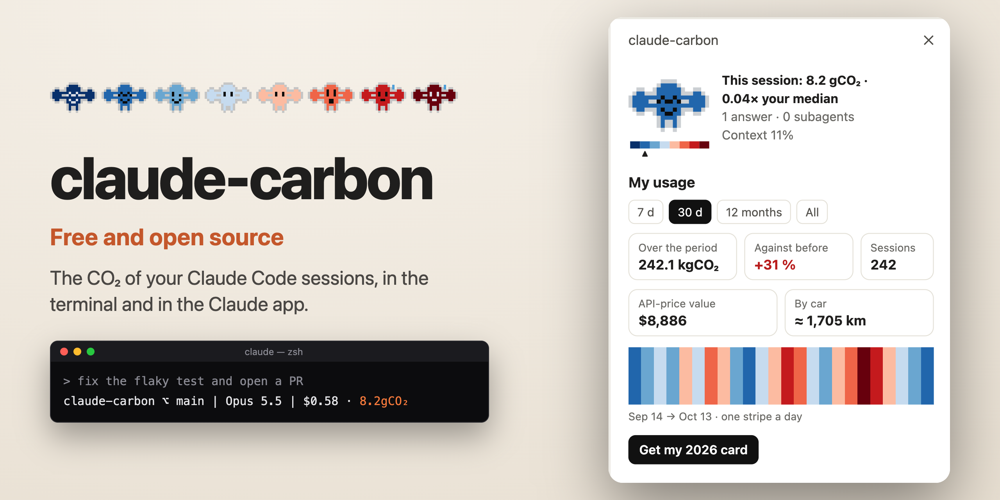
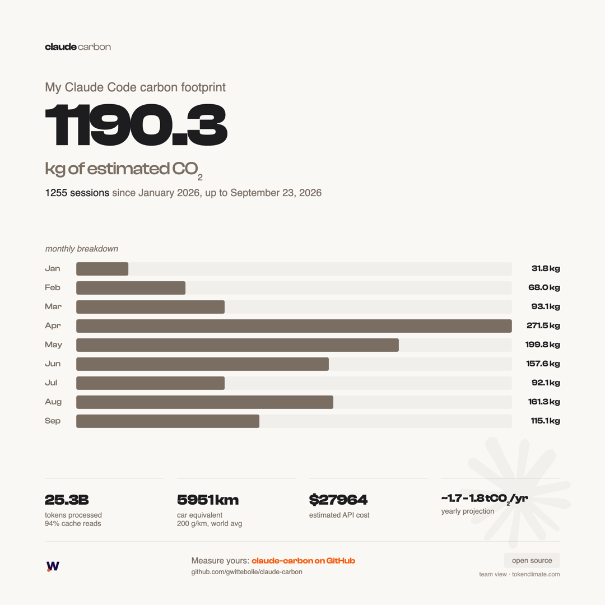
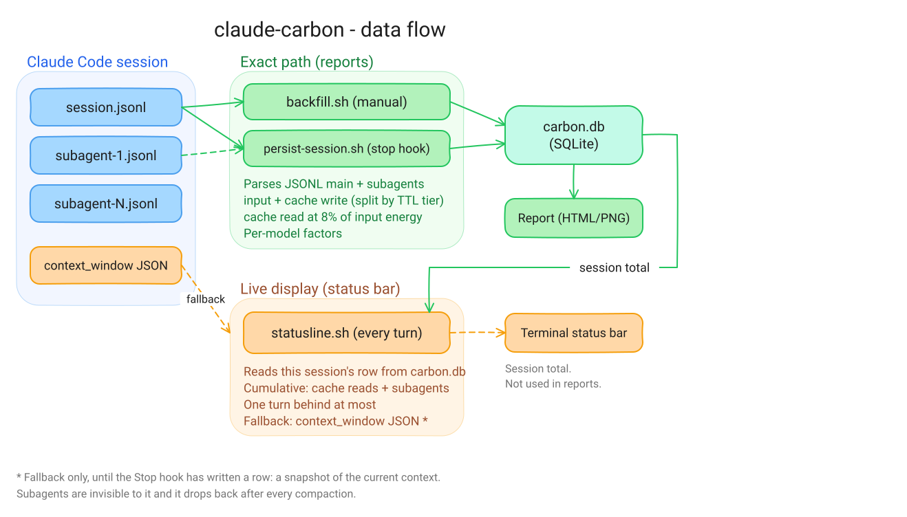

<p></p>

[](https://github.com/gwittebolle/claude-carbon/stargazers)
[](LICENSE)
[](https://github.com/gwittebolle/claude-carbon/releases)
[](https://www.npmjs.com/package/claude-carbon)
[](https://github.com/gwittebolle/claude-carbon/actions/workflows/ci.yml)

claude-carbon — плагин Claude Code с открытым кодом, который отслеживает углеродный след ваших сессий: оценка CO2 в реальном времени, вычисляемая локально из расхода токенов, в строке состояния терминала и во вкладке Code приложения Claude Desktop, рядом с эквивалентной по API стоимостью сессии. В приложении Desktop `/carbon-panel` открывает панель с пиксельной молекулой, окрашенной по CO2 этой сессии относительно медианы ваших прошлых сессий, вашим Usage за выбранный период, полосами потепления и кнопкой годовой карточки.

<p align="center"></p>

## Что делает claude-carbon

- `/carbon-panel`: панель в приложении Claude Desktop с вашей молекулой CO2, вашим Usage и полосами потепления ваших сессий (в терминале — сессия в полосе над запросом). См. [мод](#the-mod-carbon-panel-and-the-co2-of-each-answer)
- Добавляет оценку CO2 в реальном времени в строку состояния Claude Code и CO2 сессии под запросом в приложении Claude Desktop, каждую рядом с эквивалентной по API стоимостью сессии
- Сохраняет каждую сессию в локальную базу SQLite, так что история переживает 30-дневную очистку транскриптов
- Восстанавливает исторические данные из существующих транскриптов `~/.claude`
- Слэш-команды: `/carbon-report` (текст), `/carbon-card` (PNG), `/carbon-pr` (углеродный след пулл-реквеста)
- Значок README с вашим общим итогом и открытая методика с источником каждого коэффициента

> **О цифре `$`.** Это эквивалент API: сколько стоила бы ваша сессия по ценам Anthropic pay-as-you-go API. По подписке Pro, Max или Ultra вы её не платите; она показывает стоимость использованного рядом с его CO2. См. [Как это работает](#how-it-works).

## Установка

В Claude Code введите:

```text
/plugin install claude-carbon --marketplace gwittebolle/claude-carbon
```

Claude Code попросит подтвердить маркетплейс, покажет, что устанавливает плагин, затем спросит, куда его установить: выберите **Install for you**. Та же строка работает на macOS, Linux и Windows. Во вкладке **Code** приложения Claude Desktop, если строка не срабатывает, вставьте вместо неё это сообщение и согласитесь, когда Claude спросит:

```text
Install the claude-carbon plugin for me: claude plugin install claude-carbon --marketplace gwittebolle/claude-carbon
```

Затем полностью закройте Claude Code, откройте снова и начните новую сессию. Ваш CO2 теперь показывается рядом со стоимостью сессии:

- в терминале, в строке состояния: `$0.50 · 65gCO₂`
- в приложении Desktop, под запросом: `This session: 3.6 gCO₂ · $0.12`

Плагин задаёт эту строку состояния один раз, при первом запуске сессии, и только если у вас её нет: строка состояния другого инструмента остаётся как есть (чтобы добавить к ней CO2, см. [ccstatusline](#using-with-ccstatusline)). `/carbon-report` даёт ваши итоги, а `/carbon-panel` открывает панель в приложении Desktop. `$` — стоимость-эквивалент API, а то, что списывает ваша подписка. Для обновления позже выполните `/carbon-update`.

<p align="center"></p>

<details>
<summary><b>Если установка останавливается</b></summary>

- **macOS открывает окно про «инструменты разработчика командной строки».** Это `git`, который Claude Code нужен для загрузки плагина, а на Mac без инструментов разработчика его ещё нет. Нажмите **Install**, дождитесь окончания (несколько минут), затем установите снова.
- **«jq is not installed» или «sqlite3 is not installed».** Скажите Claude: «Установи недостающее.», затем перезапустите Claude Code. На каждом Mac есть `sqlite3`, а на macOS 15 и новее есть и `jq`. На более старом Mac Claude может поставить `jq` через Homebrew, а установщик (в разделе Другие способы установки) скачает официальный `jq` сам, с проверкой по опубликованной контрольной сумме. В Windows `/carbon-panel` назовёт недостающее, и Claude сможет поставить его через `winget`. Если `winget` отвечает «Access is denied», его блокирует защитное ПО на ПК: разрешите `winget` там и попробуйте снова.
- **Windows говорит, что нет Git Bash.** Установите [Git for Windows](https://git-scm.com/downloads/win) (Claude Code всё равно нуждается в нём на Windows), полностью закройте приложение и откройте снова, затем установите заново в новой сессии. Claude Code ищет Git Bash при начале сессии, поэтому сессия, открытая во время установки Git, всё равно работает без него.
- **Установлено из сообщества маркетплейса Anthropic, и плагин не загружается?** Запись `co2-tracker@claude-community` привязана к выпуску августа 2026, который текущий Claude Code отвергает («Обнаружен дублирующийся файл хуков»). Выполните `/plugin uninstall co2-tracker@claude-community`, затем установите как описано выше.

</details>

<details>
<summary><b>Другие способы установки</b></summary>

- **Установщик** — сценарий, который клонирует этот репозиторий и сам вносит всё в `~/.claude/settings.json`. Вставьте это сообщение в Claude Code или выполните команду после двоеточия сами в терминале:

  ```text
  Install claude-carbon for me by running this command:
  curl -fsSL https://raw.githubusercontent.com/gwittebolle/claude-carbon/main/install.sh | bash
  ```

  В Windows, в PowerShell (нужны [Git for Windows](https://git-scm.com/downloads/win) и два пакета сначала, см. [Windows](#windows)):

  ```text
  Install claude-carbon for me by running this command in PowerShell:
  irm https://raw.githubusercontent.com/gwittebolle/claude-carbon/main/install.ps1 | iex
  ```

  Если селектор режима под запросом показывает **Auto**, сначала выберите **Manual**: авторежим блокирует команду, которая скачивает сценарий и запускает его. Вы можете прочесть [install.sh](install.sh) перед запуском.
- **С Node.js:** `npx claude-carbon` запускает тот же установщик.

Используйте только один способ: плагин и установщик вместе запускали бы каждый хук дважды. Уже установили через установщик? Ничего менять не нужно, `/carbon-update` keeps его актуальным.

</details>

Не охвачено: чат и вкладки Cowork, а также веб-приложение (claude.ai/code). Их сессии работают на серверах Anthropic, поэтому до вашего компьютера ничего не доходит для подсчёта.

## Пример отчёта

<p align="center">
  
</p>

Создайте свою через `/carbon-card` в Claude Code. Сводные и подробные PNG-карточки попадают в
`~/Downloads/claude-carbon/` (папка Загрузки в Windows следует системной настройке, так что
перенаправленная в OneDrive папка учитывается), и папка открывается в вашем файловом менеджере, с
выделенной карточкой на macOS. `CLAUDE_CARBON_EXPORT_DIR` задаёт другую папку;
`CLAUDE_CARBON_NO_OPEN=1` пропускает открытие.

Без Playwright или Chromium PNG не будет, но команда всё равно завершается: сводная
карточка сохраняется как HTML-страница в той же папке и открывается в браузере, масштабированная по
окну, и её скриншот подходит.
Число токенов на карточке — все токены, которые обработал Claude, включая чтения кэша, как их считает `ccusage`; серая строка под ним даёт долю чтений кэша. Внизу карточки сказано, где найти инструмент: `claude-carbon sur GitHub` / `claude-carbon on GitHub`, с адресом ниже.

С 1 по 10 число каждого месяца строка состояния заканчивается на `📊 September: 84.2kgCO₂ · /carbon-card`:
итог только что закрывшегося месяца, столбец, который картинка для него рисует, в том же формате, что и
число сессии. Он читается из carbon.db раз в день, пока напоминание показано, и хранится в
`~/.claude/claude-carbon/last-month-total`. Месяц с менее чем 7 днями сессий не получает
напоминания, так что свежую установку не подталкивают поделиться почти пустой карточкой. Создание карточки
сбрасывает напоминание на месяц; после 10 числа оно умолкает само. В декабре вместо него даётся год
на сегодня, `📊 2026: 1444.4kgCO₂ · /carbon-card`, и держится весь месяц, поскольку карточка покрывает
календарный год. С 1 по 10 января даётся только что закончившийся год, и в эти
дни `/carbon-card` покрывает тот год целиком, если вы не передали период или у того года нет сессий (карточка сохраняет эти десять дней даже при выключенном напоминании). `CLAUDE_CARBON_CARD_NUDGE_UNTIL_DAY`
Ничего никуда не публикуется:
обмен остаётся решением человека.

<details>
<summary>Дополнительные параметры (CLI)</summary>

```bash
# Since a specific date
bash ~/code/claude-carbon/scripts/generate-report.sh --since 2026-03-01

# All time
bash ~/code/claude-carbon/scripts/generate-report.sh --all

# A closed period (--until is an exclusive upper bound: this one stops at June 30th)
bash ~/code/claude-carbon/scripts/generate-report.sh --since 2026-01-01 --until 2026-07-01
```

</details>

<details>
<summary>Свой каталог установки</summary>

```bash
curl -fsSL https://raw.githubusercontent.com/gwittebolle/claude-carbon/main/install.sh | CLAUDE_CARBON_DIR=~/my-path/claude-carbon bash
```

Переменная окружения должна стоять на стороне `bash` конвейера, а не `curl`, иначе установщик её не увидит.

</details>

<details>
<summary>Второе окружение Claude (CLAUDE_CONFIG_DIR)</summary>

Если вы запускаете второе окружение Claude Code из собственного каталога конфигурации, например

```bash
alias claude-work="CLAUDE_CONFIG_DIR=~/.claude-work claude"
```

установите claude-carbon в тот же каталог, передав `CLAUDE_CONFIG_DIR` установщику:

```bash
curl -fsSL https://raw.githubusercontent.com/gwittebolle/claude-carbon/main/install.sh | CLAUDE_CONFIG_DIR=~/.claude-work bash
```

Строка состояния, хуки, база и команды `/carbon-*` живут под этим каталогом конфигурации, так что каждое окружение учитывает свои сессии независимо. Когда `CLAUDE_CONFIG_DIR` не задан, всё по-прежнему откатывается к `~/.claude`.

</details>

<details>
<summary>Ручная установка</summary>

```bash
git clone https://github.com/gwittebolle/claude-carbon.git ~/code/claude-carbon
bash ~/code/claude-carbon/scripts/setup.sh
bash ~/code/claude-carbon/scripts/configure-settings.sh
```

Второй сценарий объединяет блок ниже с `~/.claude/settings.json` (аддитивно: существующая строка состояния или хуки третьих лиц не трогаются) и создаёт символические ссылки на команды `/carbon-*`. Чтобы подключить вручную, пропустите его и добавьте:

```json
{
  "statusLine": {
    "type": "command",
    "command": "~/code/claude-carbon/scripts/statusline.sh"
  },
  "hooks": {
    "Stop": [
      {
        "matcher": "",
        "hooks": [
          {
            "type": "command",
            "command": "~/code/claude-carbon/scripts/persist-session.sh"
          }
        ]
      }
    ],
    "SessionEnd": [
      {
        "matcher": "",
        "hooks": [
          {
            "type": "command",
            "command": "~/code/claude-carbon/scripts/persist-on-exit.sh"
          }
        ]
      }
    ],
    "SessionStart": [
      {
        "matcher": "",
        "hooks": [
          {
            "type": "command",
            "command": "~/code/claude-carbon/scripts/safety-rescan.sh"
          }
        ]
      }
    ],
    "SubagentStop": [
      {
        "matcher": ".+",
        "hooks": [
          {
            "type": "command",
            "command": "~/code/claude-carbon/scripts/agent-stop.sh"
          }
        ]
      }
    ]
  }
}
```

Хук `Stop` записывает сессию после каждого хода, а `SessionEnd` записывает её ещё раз при закрытии, так что последний ход, прерванный до срабатывания `Stop`, всё равно учитывается. `SessionStart` повторно сканирует пропущенные сессии (сбой, kill) и ведёт ежедневную проверку обновлений, которую читает строка состояния; без него вы никогда не узнаете о новой версии. `SubagentStop` записывает ветку, над которой работал агент, для `/carbon-pr`.

Перезапустите Claude Code.

</details>

## Для команд

claude-carbon измеряет сессии одного разработчика, локально. Если вопрос пришёл от CTO, в RFP клиента или из комитета по CSR, та же методика существует как размещённый слой:

- [Бесплатный калькулятор](https://tokenclimate.com/en/calculator?ref=github) и [таблицы коэффициентов по моделям](https://tokenclimate.com/en/models?ref=github) — те же версионированные коэффициенты этого репозитория, которые можно посмотреть.
- [TokenClimate](https://tokenclimate.com/en?ref=github) — размещённые панели для команд. Обе стороны используют золотые векторы этого репозитория, проверяемые еженедельно в CI.

OSS указывает туда из пяти мест: однострочный футер в `/carbon-report`, небольшая благодарность на PNG `/carbon-card`, последняя строка комментария `/carbon-pr`, низ панели `/carbon-panel` и поле `url` в `CITATION.cff`. Ни рекламы в строке состояния, ни сбора почт: с компьютера ничего не уходит.

### След разработки PR (/carbon-pr)

Число, которое ревьюеры видят редко, — сколько стоила разработка PR: ваши локальные сессии Claude Code во время сборки ветки. `/carbon-pr` (или `scripts/generate-pr-report.sh`) суммирует записанные сессии текущей ветки и оставляет один закреплённый комментарий на её открытом PR через вашу собственную авторизацию `gh`. Запускайте после push; повторный запуск обновляет тот же комментарий.

```
**Claude Code carbon report** · developing this PR

| CO2e | Cost* | Tokens (in + cache write + out) | Cache reads | Sessions |
|---|---|---|---|---|
| **124 g** | $3.00 | 180k | 1.5M | 2 |
```

Под таблицей идут автомобильный эквивалент, сворачиваемые подробности по токенам для каждой модели и однострочный футер.

Как атрибутируются сессии: хук Stop сохраняет git-ветку каждой сессии (прочитанную из транскрипта), а отчёт выбирает `проект + ветка`. Сессии, записанные до появления этой колонки, не имеют ветки; `scripts/backfill.sh` чинит их, пока их транскрипты ещё на диске (около 30 дней). Сессия, последняя папка которой — подкаталог репозитория, хранится под именем подкаталога и не входит в сумму. Сессия, закончившаяся на другой ветке, чем началась, относится к ветке завершения.

Как атрибутируются агенты: агент считается со своей сессией, если не работал в собственной ветке. Сессия на `main`, отправляющая агентов собирать PR в worktree, относит их долю к ветке PR, и комментарий говорит, сколько сессий, записанных в других местах, он включает. Хук `SubagentStop` (`agent-stop.sh`) читает ветку по завершении каждого агента, пока его worktree ещё существует:

- агент, работавший в собственном worktree (изолированные и воркфлоу-агенты Claude Code), считается по ветке, которую тот worktree имеет в этот момент, если Claude Code не дал ему имя (`worktree-agent-*`, `worktree-wf_*`) и он не отсоединён;
- агент, работавший в папке сессии, считается по worktree, который его вызовы инструментов называют минимум в половине случаев, где указано место (команда, путь файла), и ни другой так же часто: абсолютные пути, `~/`, `../` из папки репозитория, когда worktree рядом, `./`, когда внутри. Никогда основная папка репозитория или сама сессия. Это вывод из команд агента.

Хук сохраняет токены, CO2 и стоимость этого агента по моделям в таблице `agent_usage`, вместе с репозиторием и папкой worktree; собственная строка сессии не меняется. Отчёт убирает этих агентов из ветки их сессии и добавляет к их ветке, при условии что строка сессии содержит всех её агентов (`agents_collected = 2`: хук Stop или повторное сканирование прочитали каждый транскрипт агента), была записана после завершения агента (в более позднюю секунду) и записана текущим методом (не строка v1). Агент, работавший в другом репозитории, чем его сессия, не записывается, а записанный до перемещения своего репозитория остаётся со своей сессией. Ответвления исключаются (они проигрывают сообщения родителя), как и работа, которую сессия делает сама в worktree. Атрибутируются только агенты, завершившиеся с установленной этой версией: прошедшие сессии не пересчитываются.

Хуку нужен Claude Code 2.1.69 или новее — первая версия, передающая `SubagentStop` тип агента (его id и транскрипт пришли в 2.0.42); со старой он ничего не записывает. Собственные агенты Claude Code (подсказки запросов, `/btw`) исключаются. В сессии, запущенной без `--agent`, их тип пуст: матчер хука пропускает их с 2.1.275, сам сценарий — раньше. С `--agent` они несут имя этого агента и проходят матчер; сценарий пропускает их, потому что их транскрипт не тот, который читает строка сессии.

Хук работает синхронно, до того как результат агента дойдёт до сессии: на Mac около 0.1–0.3 с для большинства агентов, до 1–2 с для того, чей транскрипт превышает 100 MB, поскольку он читает его целиком. Claude Code пишет транскрипты асинхронно: когда последнего сообщения агента там ещё нет, хук читает его снова каждые 0.2 с, не более 1 с, затем считает то, что есть. База, занятая более примерно 10 с (долгое чтение где-то ещё), теряет запись, и агент считается со своей сессией.

#### Для каждого PR репозитория

Репозиторий может запросить отчёт на свои пулл-реквесты. Его разработчики фиксируют это в `.claude/settings.json`, и команда проверяет изменение как любое другое:

```json
{ "env": { "CLAUDE_CARBON_PR": "1" } }
```

Само по себе это ничего не публикует. Когда разработчик с плагином впервые открывает там PR через Claude Code (`gh pr create`), Claude один раз спрашивает его, публиковать ли отчёт по его собственным сессиям под его собственным GitHub-аккаунтом. Ответ остаётся на его компьютере, для каждого репозитория (`pr-consent.tsv` в папке данных):

- **да**: комментарий публикуется по завершении этого ответа, затем обновляется на месте после каждого `git push` или `gh pr create`, которые Claude там запускает, когда записан вызвавший их ответ и пока запушенная ветка всё ещё checkout-нута. Push, который вы набрали сами в терминале, ничего не вызывает. Один комментарий на PR и никогда сам по себе на PR, чья ветка живёт в форке.
- **нет** или отсутствие ответа: ничего не публикуется, и вопрос не возвращается. `/carbon-pr` продолжает работать, когда его запускают.

Измените ответ из репозитория через `scripts/generate-pr-report.sh --consent yes` или `--consent never` (после «да», набранного в терминале, первый комментарий появится со следующим push или `gh pr create` в Claude Code); «да» принимается только если вопрос был там задан, что покрывает и вопрос, который не показался из-за прерванного хода. Ответ хранится под URL `origin` репозитория (без учётных данных): переименуйте remote — вопрос вернётся один раз. Репозиторий не может ответить за вас: ответы никогда не читаются из папки конфигурации или базы, положенной внутрь репозитория, а самый комментарий публикуется только в репозиторий, который называет `origin`, что бы ни говорил `GH_REPO`. `CLAUDE_CARBON_NO_PR_AUTO=1` в вашем окружении выключает вопрос и публикацию везде. Чтобы остановить для репозитория, уберите строку `CLAUDE_CARBON_PR`. Нужны хуки плагина (установка из маркетплейса): клон через установщик не спрашивает и ничего не публикует сам. Это для командного репозитория; в публичном проекте внешние участники увидят комментарии, которых не просили.

#### Итог репозитория

`scripts/generate-pr-report.sh --summary` читает через `gh` уже опубликованные на слитых PR репозитория отчёты и суммирует их по месяцу слияния и по автору. `--since 2026-10-01` сужает выборку. Он печатает только в вашем терминале, ничего не публикует и не читает вашу базу: цифры — те, что опубликовал каждый автор.

```
Month merged             PRs  Sessions       CO2e       Cost
2026-09                    2         4     1.8 kg     $57.26
2026-10                    1         1       69 g      $1.92

Author                   PRs  Sessions       CO2e       Cost
alice                      2         2      644 g     $19.18
bob-dev                    1         3     1.2 kg     $40.00

Total: 3 PRs, 5 sessions, 1.8 kg CO2e, $59.18 at API list price.
```

Комментарий в старом однострочном формате или отредактированный вручную считается непрочитанным и исключается. Отчёт покрывает PR с отчётом, а не весь след репозитория, и читает максимум 100 за раз.

Вне такого репозитория по умолчанию выключено: ничего не публикуется, пока вы не запустите. `--dry-run` показывает комментарий, `--pr <number>` указывает конкретный PR репозитория (открытый из форка отклоняется: запустите команду из клона форка), а удаление комментария на GitHub — полная уборка. Когда агенты репозитория уже записаны, отчёт считает, из любой папки он запущен, сессии основной папки репозитория, worktree, где checkout-нута ветка, и worktree, где работали его агенты, даже удалённые с тех пор. Ветка, нигде не checkout-нутая, но носящая имя, есть и у сессий других папок, отклоняется: лучше ничего не публиковать, чем цифру, которой может не хватать.

## Как это работает



**Три пути данных, два уровня точности:**

| Сценарий            | Срабатывание            | Источник данных       | Субагенты    | Чтения кэша         | Точность      |
| -------------------- | ----------------------- | --------------------- | ------------ | ------------------- | ------------- |
| `backfill.sh`        | Вручную / настройка          | Файлы JSONL           | Включены     | Учтены (8% энергии) | Лучшая оценка |
| `persist-session.sh` | Хуки Stop + SessionEnd | Файлы JSONL           | Включены     | Учтены (8% энергии) | Лучшая оценка |
| `statusline.sh`      | Каждый ход (в реальном времени)       | Строка `carbon.db`       | Включены     | Учтены (8% энергии) | На один ход позже |

**backfill** и **persist-session** разбирают сырые JSONL-транскрипты (основная сессия, файлы субагентов и транскрипты агентов, запущенных воркфлоу), применяя коэффициенты выбросов по моделям. Они дедуплицируют сообщения ассистента по `(message.id, requestId)`, так что возобновлённые и сжатые сессии не считаются дважды (это совпадает с `ccusage`; без этого сумма токенов раздувается примерно в 3 раза). Каждая сессия хранит свой сырой разбор токенов (ввод, запись кэша, чтение кэша, вывод), который питает базу SQLite для отчётов.

Транскрипт агента перестаёт меняться, когда агент завершён, поэтому его итоги хранятся в `~/.claude/claude-carbon/usage-cache/` (по одному маленькому файлу на сессию, удаляются ежедневным повторным сканированием через 45 дней после последней записи) и читаются снова, только если изменились размер файла, время модификации или изменения или inode (файл, на который указывает символическая ссылка). Строка агента с ещё не разбираемой линией, обрезанной во время записи, никогда не сохраняется. Основной транскрипт всегда читается целиком. `CLAUDE_CARBON_NO_USAGE_CACHE=1` читает всё каждый раз и не пишет кэш.

**Стоимость** — теоретическая цена API по прайс-листу (pay-as-you-go), а не цена вашей подписки: ввод, вывод, запись кэша и чтение кэша (0.1× ввода) по текущим ставкам Anthropic, заданным в `data/prices.json`. Записи кэша тарифицируются по категориям TTL, 1.25× ввода для 5 минут и 2× для часа; разбиение каждой сессии читается из её транскрипта, а не предполагается (Claude Code пишет в категории 1 час). На дедуплицированных данных совпадает с `ccusage`.

**statusline** читает строку этой сессии из `carbon.db` на каждом ходу, поэтому показываемый CO2 — итог сессии на том же основании, что и отчёты, максимум на один ход позже. Пока строки нет (первый ход или базы ещё нет), он откатывается к оценке из `context_window.total_input_tokens`, который представляет размер текущего контекста, а не накопительный итог: субагенты для него невидимы, и каждое сжатие уменьшает число. В любом случае строка состояния только отображает, но никогда не питает отчёты.

### Строка состояния

Сегменты слева направо: проект + git-ветка, модель + % окна контекста, стоимость сессии-эквивалент API + CO2, % квоты подписки + время сброса. Квота — пятичасовое окно или недельное, когда пятичасовое не открыто (всегда на проверенном аккаунте Ultra; на Pro и Max — между сбросом пятичасового окна и вашим следующим запросом): `Use 41% 7d ↻Thu`, сброс днём недели, если до него больше суток. Префикс 🔥 появляется, когда устойчивый темп расхода превысит 100% лимита к концу окна (при использовании от 15%, после отсрочки 15 минут для пятичасового окна и суток для недельного).

> **Где показывается CO2.** Строка состояния — функция терминального UI Claude Code. Она показывается только когда вы запускаете `claude` в терминале, включая встроенный терминал VS Code или JetBrains. Чат-панель расширений IDE не имеет строки состояния вообще, поэтому там ничего не отображается, хотя хуки работают и ваши сессии записываются: их покрывает `/carbon-report`. Если вы пользуетесь панелью VS Code и хотите живой CO2, откройте в VS Code терминал (`` Ctrl+` ``) и запустите `claude` оттуда. Веб-приложение (claude.ai/code) не запускает ни строку состояния, ни хуки, так что там ничего не отображается и не записывается. Приложение Desktop тоже не показывает строку состояния; [мод](#the-mod-carbon-panel-and-the-co2-of-each-answer) плагина рисует CO2 во вкладке Code.

**Источник квоты.** Процент берётся у самого Anthropic, те же данные, что Claude Code показывает в `/usage`. Никакой эвристики и файла лимита токенов. Два источника по порядку:

1. **stdin** (предпочтительно): `rate_limits`, которые Claude Code передаёт в JSON строки состояния, сначала `five_hour`, иначе `seven_day`. Когда `rate_limits` есть, отсутствующее в нём окно не существует, и больше ничего не запрашивается.
2. **Резерв OAuth API**, только когда в stdin нет `rate_limits` (до первого ответа в сессии или со старым Claude Code): `GET https://api.anthropic.com/api/oauth/usage` с bearer-токеном из Keychain macOS, `CLAUDE_CODE_OAUTH_TOKEN` или `~/.claude/.credentials.json`, не чаще раза в минуту независимо от ответа. Ответ кэшируется в `~/.claude/claude-carbon/oauth-usage.json`; окно без времени сброса или с прошедшим сбросом исключается.

Точно на Pro, Max и Ultra.

### Как пережить 30-дневную очистку транскриптов

Claude Code удаляет JSONL-транскрипты примерно через 30 дней, поэтому постоянная запись — база SQLite. Хуки `Stop` и `SessionEnd` захватывают каждую сессию до того, как её транскрипт устареет, а ежедневное фоновое повторное сканирование (хук `SessionStart`, `safety-rescan.sh`) ловит то, что они пропустили, пока транскрипт ещё есть, в том числе сессию, чей транскрипт продолжал расти после записи её строки. Поскольку каждая строка хранит сырые счётчики токенов, `recompute.sh` в любое время воссоздаёт стоимость и CO2 из `data/factors.json` + `data/prices.json`, без транскрипта. Когда Anthropic меняет цену или пересматривается коэффициент, отредактируйте конфиг и выполните:

```bash
bash scripts/recompute.sh
```

Сессии, записанные с сентября 2026, пересчитываются модель за моделью точно. Более старые сессии без разбиения по моделям сохраняют свои значения; `--include-unsplit` пересчитывает их по доминирующей модели, приблизительно (см. METHODOLOGY.md, «Переживая 30-дневную очистку транскриптов»).

## Команды

| Команда          | Что делает                                        |
| ---------------- | --------------------------------------------------- |
| `/carbon-report` | Текстовый отчёт с итогами, автомобильным эквивалентом, долей бюджета 2 т и лучшими сессиями |
| `/carbon-card`   | Создать карточки PNG для обмена                 |
| `/carbon-badge`  | Значок shields.io с вашим общим следом для README |
| `/carbon-pr`     | Опубликовать след разработки текущей ветки на её PR |
| `/carbon-update` | Обновиться до последней версии, независимо от способа установки |

<details>
<summary>Сценарии (запускаются автоматически, вручную нужны редко)</summary>

| Сценарий               | Что делает                                                                              |
| -------------------- | ----------------------------------------------------------------------------------------- |
| `setup.sh`           | Инициализирует базу, восстанавливает исторические сессии, показывает итог                                   |
| `statusline.sh`      | Сценарий строки состояния (вызывается автоматически Claude Code)                                  |
| `persist-session.sh` | Хук Stop (сохраняет данные сессии после каждого хода)                                            |
| `persist-on-exit.sh` | Хук SessionEnd (ещё раз сохраняет сессию при закрытии, в фоне)             |
| `safety-rescan.sh`   | Хук SessionStart (регулируемое фоновое повторное сканирование, ловит пропущенные сессии)                 |
| `agent-stop.sh`      | Хук SubagentStop (ветка, над которой работал агент, для `/carbon-pr`)                       |
| `backfill.sh`        | Повторно разобрать все исторические JSONL-транскрипты (включая субагентов)                               |
| `recompute.sh`       | Пересчитать стоимость/CO2 из сохранённых токенов после смены цены/коэффициента (транскрипты не нужны) |
| `generate-report.sh` | Экспорт карточек PNG (CLI, с `--since` / `--until` / `--all`)                                   |
| `generate-badge.sh`  | Печатать markdown значка shields.io + URL (CLI)                                           |
| `generate-pr-report.sh` | Опубликовать след разработки ветки на её PR (CLI, `--dry-run` / `--pr`)                  |

Примечание: теперь backfill выводит имена проектов из `cwd` транскрипта (как живой хук). Сессии, восстановленные до этого изменения, сохраняют старые, возможно обрезанные имена; удалите эти строки и снова запустите `backfill.sh`, чтобы привести их к виду.

</details>

## Значок

`carbon-badge` печатает готовый к вставке значок shields.io с вашим измеренным общим следом и месяцем измерения, кликабельный к методике:

[](https://github.com/gwittebolle/claude-carbon/blob/main/METHODOLOGY.md)

<sub>Этот значок живой, не макет: собственный итог автора, 1 208 сессий, измеренных с 15 января 2026 по 16 сентября 2026. Это след одного разработчика, не проекта.</sub>

```markdown
[](https://github.com/gwittebolle/claude-carbon/blob/main/METHODOLOGY.md)
```

Значок — статическая картинка, собранная из вашей локальной базы, так что число измерено, а не оценено на лету, и ничего никуда не отправляется. Месяц в сообщении говорит, насколько число устарело; перезапустите `/carbon-badge`, когда захотите обновить и то, и другое.

Это итог одного разработчика, так что он уместен в README вашего профиля или личного проекта. В репозитории команды или организации ревьюеры спросят, что произвело число и почему оно ссылается наружу организации, — и будут правы.

Числа следуют локали отчёта (`fr` печатает `12,4 kg`, `us` и мировой умолчательный вариант — `12.4 kg`); `CLAUDE_CARBON_LOCALE` задаёт нужную принудительно.

## Мод: /carbon-panel и CO2 каждого ответа

Плагин claude-carbon также содержит [мод Claude Code](https://code.claude.com/docs/en/plugins/mods/overview), который показывает CO2 каждого ответа по его завершении, вычисляя его локально по той же формуле и коэффициентам, что и строка состояния, а также итог сессии со стоимостью по ценам API.

- **Терминал**, включая встроенный терминал редактора и плагин JetBrains: в правом конце строки, закрывающей каждый ответ, `✻ Worked for 38s · done 10:32 PM          16 gCO₂`. Строка сохраняет число своего ответа при повторной отрисовке (изменение размера, прокрутка, ctrl+o); строка, нарисованная впервые позже, например только через ctrl+o, числа не получает.
- **Приложение Desktop, вкладка Code**: строка под ответом, только для необычного ответа.
- **Необычный ответ** показывает отношение и долю субагентов, если они на него повлияли: `230 gCO₂ · 14× your median`. Ответ необычен, если он выше 97-го перцентиля ваших последних 200 ответов, более чем в 3 раза превышает их медиану и составляет не менее 10 g — примерно один ответ из 27; до 50 записанных ответов ничего не помечается.
- **Итог сессии** закреплён под запросом, CO2 и стоимость по ценам API: `This session: 142 gCO₂ · $3.41`, по-французски `Cette session : 142 gCO₂ · 3,41 $`. Показывается, если только строка состояния claude-carbon уже даёт его или выключена настройка `showSessionTotal` (оба варианта только в терминале, см. [ccstatusline](#using-with-ccstatusline)). Стоимость — цена pay-as-you-go API для тех же запросов, что и CO2, из `data/prices.json` по формуле `/carbon-report`, запись кэша по часовой категории Claude Code; меньше цента читается как `< $0.01`, а при недоступном прайс-листе число убирается до тех пор, пока итог не начнётся заново, чтобы стоимость никогда не покрывала лишь часть запросов. Это стоимость Usage на API, а не счёт подписки. По подписке запись заканчивается квотой, как её показывает строка состояния, `Use 23% ↻14:00` (`Usage 23 % ↻14:00`): доля использованного пятичасового окна и местное время его сброса, а без пятичасового окна — недельного, `Use 41% 7d ↻Sat` (`Usage 41 % 7j ↻sam.`), читается у самого Claude Code после каждого ответа, без сетевого вызова. Далее идут две подсказки строки состояния: `⬆ 1.18.0 /carbon-update`, когда есть новая версия, и с 1 по 10 число месяца только что закрывшийся месяц с итогом, `📊 September: 84.2 kgCO₂ · /carbon-card`, пока вы не сделали карточку. Фоновые субагенты, которыми Claude Code запускает большинство из них, учитываются только в итоге сессии: никогда в ответе и в вашей медиане. Приоритетный субагент учитывается в вызвавшем его ответе, а не в следующем.
- **`/carbon-panel` открывает панель** с маскотом, пиксельной молекулой CO2. Её цвет сравнивает эту сессию с медианой ваших прошлых сессий, от тёмно-синего (меньше восьмой доли) до тёмно-красного (более чем в восемь раз больше). Пока не записано 10 сессий, сравнение идёт с начальным значением 0.5 kgCO₂, так что цвет есть с первого ответа. Она подпрыгивает на пиксель вверх-вниз, пока Claude работает, быстрее по мере покраснения, и строит рожицы: оглядывается перед первым ответом, моргает и смотрит в сторону во время работы, улыбается на лёгкой сессии и потеет на тяжёлой, реагирует на каждый ответ, подмигивает в покое и засыпает через пять минут без хода.

  <p align="center"></p>

  - **В приложении Desktop** панель открывается справа, её вкладка называется «claude-carbon», в двух блоках. Под молекулой — шкала цвета, восемь оттенков от синего к красному, с меткой под этой сессией. *Эта сессия*: её CO2, ответы, субагенты и модель, заполненность окна контекста и стоимость по ценам API, а также маленькая молекула на каждого субагента, окрашенная по его собственному CO2. *Моё использование*: выбранный период (последние 7 или 30 дней, 12 месяцев, всё или две введённые вами даты, `01/05/2026`), его числа плитками (CO2, как его суммируют отчёты, изменение относительно такого же прежнего периода, сессии, стоимость по ценам API, автомобильный эквивалент), затем полосы потепления этого периода, полоса на день, неделю или месяц согласно её длительности, каждая окрашена относительно медианы показанных периодов. Полоса под указателем подсвечивается, а её дата, итог и число сессий показываются под полосами. У плитки с (i) появляется заметка по клику на (i) и скрывается по второму клику: стоимость по ценам API — это сколько стоило бы это Usage при биллинге через API, а подписка Pro, Max или Ultra покрывает часть или всё (как именно оплачена каждая сессия, не записывается, поэтому панель никогда не говорит, что вы заплатили). Шестерёнка рядом с «Моим использованием» включает или выключает изменение, стоимость по ценам API, автомобиль, разбиение по проектам (выключено, пока не включите; каждая папка со своей долей и kgCO2) и подробности; панель сохраняет ваш выбор в следующей сессии. Подробности (выключены, пока не включите) разбивают период по видам токенов: некэшированный ввод, записи кэша, чтения кэша и вывод; две цветные полосы дают долю каждого вида в токенах и в CO2 (часть под указателем подсвечивается и её числа показываются под полосой), затем по строке на вид с его токенами, энергией и CO2 с долями. CO2 каждой сессии — сохранённый, распределённый с весами, которые коэффициенты дают каждому виду (чтения кэша 0.08 ввода, вывод примерно в 21 раз больше), так что части складываются в сохранённое значение; сессия, сохранённая со старыми коэффициентами (до июля 2026), чей CO2 больше не совпадает с её токенами, исключается, и блок говорит, по скольким сессиям он распределён; энергия — та, с которой коэффициенты начинают (энергия на токен с учётом PUE, переведённая в CO2 по сети AWS us-east при 287 gCO2/kWh), и находится обратным делением того CO2 на ту же интенсивность. Нужны токены по видам в `sessions-history.tsv`, которые хуки пишут начиная с этой версии: после обновления подробности показываются с следующего ответа. Кнопка «Получить мою карточку 2026» кладёт `/carbon-card` в пустой запрос для вашей отправки (карточка покрывает текущий календарный год, независимо от периода на панели); она никогда не отправляет его и оставляет в покое начатый вами черновик. Несколько коротких строк внизу ведут в этот репозиторий, на LinkedIn автора и в TokenClimate, бизнес-версию.
  - **В терминале** `/carbon-panel`, введённый в запросе, показывает эту сессию в полосе прямо над ним, и в классической, и в полноэкранной отрисовке (отправленная из приложения Desktop или с телефона в сессию, работающую в терминале, через Remote Control, она открывает там боковую панель): маленькая молекула 13 столбцов на 4 строки полублоками, а рядом CO2 сессии, ответы, субагенты (по точке в своём цвете), модель, окно контекста и стоимость по ценам API. Период и полосы живут в приложении Desktop.
  - Запустите `/carbon-panel` снова, чтобы закрыть панель или убрать полосу. Команда также является навыком плагина, поэтому приложение Desktop её перечисляет; где мод не работает (чат-панель VS Code, облачная сессия), она только говорит, где панель открывается.
- **История полос** — `sessions-history.tsv`, который хук Stop пишет рядом с `carbon.db` после каждого ответа, только для чтения базы. В нём есть каждая записанная сессия, старые строки как они сохранены (они хранят коэффициенты своего времени и никогда не пересчитываются), так что полосы, медиана и итоги считают то, что считает `/carbon-report`. Другая сессия, работающая одновременно, учитывается со своим текущим итогом. Пока базы ещё нет (до первого запуска сессии плагина, установленного отдельно, или при отсутствии `jq` или `sqlite3`), панель показывает молекулу и говорит, чего ждёт история.

Claude Code рисует моды только в терминале и во вкладке Code приложения Desktop: ничего не появляется в чат-панели расширения VS Code, в облачных сессиях или при `claude -p`. Модам нужен Claude Code 2.1.287 или новее (2.1.286 в приложении Desktop).

Мод поставляется с плагином. Уже установили из маркетплейса: выполните `/plugin marketplace update claude-carbon` и `/plugin update claude-carbon@claude-carbon`, затем перезапустите Claude Code.

Сам плагин записывает ваши сессии и задаёт строку состояния в терминале, если у вас её нет (см. [Установка](#install)):

```
/plugin install claude-carbon --marketplace gwittebolle/claude-carbon
```

При первом запуске сессии после установки плагин создаёт свою базу в `~/.claude/claude-carbon/` и заполняет её сессиями, чьи транскрипты ещё на диске (примерно последние 30 дней, все проекты), затем записывает каждую сессию по мере работы. Одноразовое сообщение об этом появится при одном из следующих запусков сессии. Нужны `jq` и `sqlite3`: если чего-то нет, ничего не создаётся, и `/carbon-panel` называет недостающее. Это происходит один раз: удалённая база не восстанавливается (удалите файл `auto-setup` рядом с ней, чтобы запросить новую), путь базы, заданный `CLAUDE_CARBON_DB`, никогда не создаётся за вас, а `CLAUDE_CARBON_NO_AUTOSETUP=1` выключает это. С этого момента ежедневная фоновая проверка новой версии работает так же, как для установщика (`CLAUDE_CARBON_NO_UPDATE_NOTIFIER=1` чтобы отказаться).

#### В командном репозитории

Чтобы предложить плагин всем, кто работает в репозитории, зафиксируйте это в его `.claude/settings.json`:

```json
{
  "extraKnownMarketplaces": {
    "claude-carbon": { "source": { "source": "github", "repo": "gwittebolle/claude-carbon" } }
  },
  "enabledPlugins": { "claude-carbon@claude-carbon": true }
}
```

Включение в репозитории не скачивает плагин ни на чей компьютер, поскольку он приходит из удалённого маркетплейса: каждый участник один раз выполняет `claude plugin install claude-carbon@claude-carbon --scope project` в своём клоне, после доверия папке. Кто не хочет, задаёт `"claude-carbon@claude-carbon": false` под `enabledPlugins` в своём `.claude/settings.local.json`. Цифры каждого остаются на его компьютере.

Установщики curl, PowerShell и npm настраивают строку состояния, базу и хуки, а мод копируют отдельно в `~/.claude/skills/claude-carbon/`, где Claude Code загружает его как `claude-carbon@skills-dir`. `/carbon-update` держит эту копию актуальной. В копии нет хука, поэтому ничего не работает дважды. Перезапустите Claude Code после установки; мод загружается, когда папка, которую вы открыли, пользуется доверием. Его медиана начинается с нуля: ответы, записанные другой установкой мода, не переносятся. С этой копией мод показывается в терминале, во встроенном терминале редактора и во вкладке Code приложения Desktop.

Чтобы выключить, выполните `claude plugin disable claude-carbon@skills-dir`. Чтобы удалить, запустите установщик с `CLAUDE_CARBON_NO_MOD=1` на стороне `bash` (`curl … | CLAUDE_CARBON_NO_MOD=1 bash`); держите переменную заданной в оболочке или в блоке `env` `settings.json`, иначе следующий `/carbon-update` вернёт копию. Установщик не трогает папку `skills/claude-carbon/`, которую не создавал, и пропускает копию, пока включён плагин claude-carbon. Выберите что-то одно: плагин поверх установщика запускает хуки дважды.

Выключите число на каждый ответ настройкой `showPerTurn` в `/config`. Мод не пишет базу, не запускает процессов, не делает сетевых вызовов и никогда не меняет поведение Claude; помимо собственных файлов данных он читает только `sessions-history.tsv`, два флага выпуска ежедневной проверки (`plugin-update-check.json`, `update-check.json`), `last-card-month` и два файла, которые оставляет хук SessionStart, когда не нашёл базу (`setup-needed`, `auto-setup`). Текст на французском, если первая из заданных переменных `CLAUDE_CARBON_LOCALE`, `LC_ALL`, `LC_MESSAGES` и `LANG` начинается с `fr`, иначе на английском. Когда не задана ни одна, как в приложении Desktop и часто в Windows, решает настройка `language` (`Français`, `English`), а затем французский.

Собственные тесты мода запускаются `bash tests/run-mod-kit.sh` под `claude plugin test`, который подменяет движок: вход в аккаунт не нужен. CI гоняет их при каждом push на Claude Code 2.1.296.

## Использование с ccstatusline

Claude Code принимает одну команду `statusLine`, поэтому полная строка состояния claude-carbon и [ccstatusline](https://github.com/sirmalloc/ccstatusline) не могут работать вместе. Если строкой состояния управляет ccstatusline, встройте сегмент CO2: в TUI ccstatusline добавьте виджет `Custom Command`, указывающий на

```
~/code/claude-carbon/scripts/statusline.sh --segment
```

(подправьте путь, если установили с `CLAUDE_CARBON_DIR`). Виджет получает тот же JSON состояния на stdin и печатает только пару стоимость + CO2, например `$0.68 · 35gCO₂`. Режим сегмента никогда не обращается к сети. Запись в локальную базу от этого не зависит: сохранение идёт через хуки, а не через строку состояния.

С сегментом в ccstatusline запись мода [мод](#the-mod-carbon-panel-and-the-co2-of-each-answer) под запросом показывает итог второй раз. Выключите её настройкой `showSessionTotal` в `/config`; приложение Desktop, у которого нет строки состояния, сохраняет её.

## Коэффициенты выбросов

Коэффициенты из [Jegham et al. 2025](https://arxiv.org/abs/2505.09598), препринта arXiv, который оценивает энергопотребление вывода LLM на инфраструктуре AWS по публичным данным API (задержка, пропускная способность) при предполагаемых конфигурациях оборудования.

| Модель  | Читается впервые (ввод, запись кэша) | Перечитывается (чтение кэша) | Записывается (вывод) | Основа                       |
| ------ | -------------------------------------------- | -------------------- | ---------------- | --------------------------- |
| Fable  | 156                                          | 12.5                 | 3304             | Экстраполяция (2× Opus)      |
| Opus   | 78                                           | 6.2                  | 1652             | Экстраполяция (2× Sonnet)    |
| Sonnet | 39                                           | 3.1                  | 826              | Аппроксимация по 3 точкам (Jegham v6)     |
| Haiku  | 10                                           | 0.8                  | 207              | Экстраполяция (0.25× Sonnet) |

В гCO2e на миллион токенов. В сессии Claude Code около 98% токенов — контекст, который Claude перечитывает на каждом шаге. Каждый весит мало, но вместе они дают около 60% CO2; текст, который пишет Claude, — менее 1% токенов и около 30% CO2 (30 дней сессий автора, октябрь 2026).

**Важно: это оценки порядка величины, а не точные измерения.**

- Коэффициенты Sonnet — аппроксимация методом наименьших квадратов по трём точкам для трёх энергий на запрос Claude 3.7 Sonnet, оценённых в Jegham et al. v6 (0.950 / 2.989 / 5.671 Wh), что даёт отношение вывода к вводупримерно 21:1; независимые публичные оценки попадают в тот же порядок величины. Fable, Opus и Haiku экстраполированы (публичных данных Anthropic об энергопотреблении по моделям нет): Opus = 2× Sonnet (честный диапазон 2×–5×), Haiku = 0.25×, Fable = 2× Opus. См. [METHODOLOGY.md](METHODOLOGY.md).
- Сессии на не-Anthropic моделях (например, локальные за `ANTHROPIC_BASE_URL`) сохраняются с сырыми токенами, но нулевой стоимостью/CO2 и исключаются из отчётов — коэффициент датацентра к ним неприменим. Добавьте шаблоны в `exclude_models` в `data/factors.json`, чтобы исключить больше моделей по имени.
- Токены чтения кэша считаются с пониженным коэффициентом (по умолчанию 0.08 ввода, задаётся в `data/factors.json`). Кэшированный токен пропускает большую часть вычислений prefill; коэффициент — остаток. Это инженерная оценка, выведенная из литературы, а не биллинговое отношение Anthropic 0.1×. Перечитывание кэша на фазе декодирования растёт как длина контекста × сгенерированные токены и пока не моделируется; каждая сессия сохраняет это произведение (`output_context_sum`), чтобы позже применить откалиброванный член к истории. См. [METHODOLOGY.md](METHODOLOGY.md).
- Проверено по литературе апреля–сентября 2026 (измерительные статьи, раскрытия провайдеров, фреймворк Watershed) с чувствительным прогоном на 30 днях реальных транскриптов: ни один коэффициент не сдвинулся, показываемое число скорее занижено, чем завышено, следующий пересмотр в марте 2027. См. [Где находится оценка](METHODOLOGY.md#where-the-estimate-stands-september-2026).
- Интенсивность углерода использует сеть региона AWS (по местоположению, 0.287 kgCO2e/kWh), а не данные сети в реальном времени. Это нижний конец диапазона по местоположению; среднее по США — около 380 g/kWh.
- Anthropic не публикует выбросы Scope 1, 2 и 3. Эти оценки независимы и основаны на академических исследованиях, а не на данных провайдера.

Автомобильный эквивалент в отчётах и карточках следует вашей локали, поскольку километр на машине выбрасывает до ~1.7 раза больше в одной стране, чем в другой: 142 gCO2e/km ADEME для французской или неопределённой локали, 393 gCO2e/милю EPA для американской, мировое среднее 200 gCO2/km иначе. Задайте принудительно через `CLAUDE_CARBON_LOCALE` (`fr`, `us`, `world` или любую строку локали). Коэффициенты лежат в `data/factors.json` под `equivalences`.

`/carbon-report` также даёт итог этого календарного года как долю от 2 тCO2e — цели на 2050 год на человека по полному следу (ADEME, [Nos Gestes Climat](https://nosgestesclimat.fr/blog/environnement/reduire-empreinte-carbone-objectif-deux-tonnes), из сценариев МГЭИК 1.5 °C; также Carbone 4, *Faire sa part ?*, 2019). Это для масштаба: 2 т покрывают всё, что человек выбрасывает за год, включая ИИ. Источники и оговорки: [METHODOLOGY.md](METHODOLOGY.md#annual-budget-line).

Коэффициенты редактируются в `data/factors.json`. Полное научное обоснование, формула и эквиваленты — в [METHODOLOGY.md](METHODOLOGY.md).

### Золотые векторы

Методика закреплена золотыми тестовыми векторами в [`tests/methodology-vectors.json`](tests/methodology-vectors.json): вручную посчитанные ожидаемые значения CO2/стоимости для известных разборов токенов, которые проигрывает `bash tests/run-vectors.sh` в CI при каждом push. Потребители ниже по потоку (например, TokenClimate) держат копиюэтот файл и еженедельно проверяют, что их реализация даёт те же числа. Если вы правите `data/factors.json` или `data/prices.json`, обновите векторы в том же коммите, иначе CI упадёт.

## Обновление

Когда есть новая версия, строка состояния показывает ненавязчивую подсказку `⬆ /carbon-update`. Проверка идёт в фоне (не чаще раза в день, никогда не на горячем пути строки состояния); отказ — `CLAUDE_CARBON_NO_UPDATE_NOTIFIER=1`.

- **В терминале с установкой из git-клона** эта подсказка появляется в конце строки состояния с именем новой версии.
- **Везде, где работает мод** (приложение Desktop и терминал без строки claude-carbon), та же подсказка завершает запись сессии под запросом, а панель `/carbon-panel` называет версию вверху футера. Для установки из плагина та же ежедневная фоновая проверка запрашивает у GitHub только теги выпусков и никогда не трогает кэш плагинов Claude Code.
- **Установлено до лета 2026** (версия 1.0, подсказки нет вовсе)? Запустите установку снова, из приложения или терминала, как в [Установке](#install).

Для обновления выполните `/carbon-update` в Claude Code, независимо от способа установки: для плагина он запускает `claude plugin marketplace update claude-carbon` и `claude plugin update claude-carbon@claude-carbon`, для клона установщика — собственный обновлятор. Затем перезапустите Claude Code. При обеих установках, например когда строка состояния идёт из клона, обновляется только плагин, а команда даёт `git pull` для клона. Можно также перезапустить установщик:

```bash
curl -fsSL https://raw.githubusercontent.com/gwittebolle/claude-carbon/main/install.sh | bash
```

- Обновление клона установщика автоматически переоценивает сохранённую историю по новым коэффициентам (только CO2; стоимость остаётся); обновление плагина — нет. Запускайте `scripts/recompute.sh --with-cost` сами только после смены цены.
- Если вы правили `data/factors.json` или `data/prices.json` локально, обновление сохраняет ваши правки; при конфликте с upstream оно сохраняет ваши в `*.local.bak` и говорит вам.
- Обновление также освежает копию [мода](#the-mod-carbon-panel-and-the-co2-of-each-answer). Когда он просит перезапустить (в Windows занятую копию нельзя заменить), перезапустите Claude Code и запустите снова; до этого остаётся прежняя копия.
- Установленный из маркетплейса плагин можно обновить и средствами Claude Code: в `/plugin`, вкладка **Marketplaces**, выберите `claude-carbon`, затем **Enable auto-update**. Новая версия загрузится в следующей сессии.

## Удаление

Для установки через установщик curl, PowerShell или npm:

```bash
bash ~/code/claude-carbon/scripts/configure-settings.sh --remove
```

(подправьте путь, если установили с `CLAUDE_CARBON_DIR`). Он убирает строку состояния, хуки, команды `/carbon-*` и копию мода из `~/.claude` и ничего, что принадлежит другому инструменту: строка состояния, вызывающая `statusline.sh --segment`, остаётся, как и любой другой хук общей группы. Ваша история остаётся в `~/.claude/claude-carbon/`. Чтобы удалить всё, удалите эту папку и затем клон.

Для плагина: `claude plugin uninstall claude-carbon@claude-carbon`, затем уберите из `~/.claude/settings.json` запись `statusLine`, называющую `claude-carbon/statusline.sh`: плагин не может сделать это при удалении, а когда его нет, эта строка состояния ничего не печатает. Плагин выключенный, а не удалённый, продолжает её рисовать, пока вы не уберёте запись. `CLAUDE_CARBON_NO_STATUSLINE=1` не даёт плагину вообще задавать строку состояния. Плагин задаёт её один раз: чтобы он задал её снова после того, как вы её удалили, удалите `~/.claude/claude-carbon/statusline-set`.

Установка второй копии поверх первой (другая папка или установщик после клона плагина) запустит каждый хук дважды. Установщик останавливается, когда находит другую установку, подключённую в `settings.json`, называет её и даёт команду, которая её заменяет (`configure-settings.sh --replace`). Хуки, оставшиеся от установки, чья папка была удалена, заменяются без запроса.

## Зависимости

- `jq` — разбор JSON
- `sqlite3` — локальная база
- `git` — определение ветки в строке состояния (необязательно)
- `curl` — квота подписки через эндпоинт Anthropic `/api/oauth/usage`, когда Claude Code её не передаёт (необязательно, не чаще раза в минуту)
- `node` + Google Chrome, Microsoft Edge, Chromium или Brave (или `playwright-core` и его Chromium) — экспорт PNG для `/carbon-card` (необязательно)

`sqlite3` предустановлен на каждом Mac, `jq` — начиная с macOS 15 (Sequoia). На более старом Mac без `jq` установщик скачивает официальный бинарник jq 1.8.1 для процессора Mac, проверяет его по SHA-256, опубликованному проектом jq, и кладёт в `~/.claude/claude-carbon/bin/`, где сценарии и слэш-команды его находят; `jq`, установленный позже (например, через Homebrew), имеет приоритет. На Linux: `apt install jq sqlite3`. В Windows — ниже.

`/carbon-card` рисует PNG через браузер семейства Chromium в headless-режиме, в одноразовом профиле. Он использует Chromium Playwright, если установлен `playwright-core` (ищется в разрешении Node, глобальном npm root, `~/node_modules` и node-модулях Homebrew), иначе первый найденный на обычном месте браузер: Google Chrome, Microsoft Edge, Chromium или Brave на macOS, Chrome или Edge в Windows, а в Linux — первый из них в `PATH`. `CLAUDE_CARBON_BROWSER` называет другой, по пути или по команде, либо `none`, чтобы пропустить поиск. Браузер, который ничего не нарисовал за 60 секунд, останавливается и больше не пробуется. Без браузера карточка открывается в браузере по умолчанию страницей, и её скриншот служит карточкой.

## Windows

claude-carbon написан на bash и остаётся bash на Windows. Это осознанный выбор, а не
упрощение: в собственном Windows Claude Code запускает команды строки состояния и хуков через
bash, поставляемый с [Git for Windows](https://git-scm.com/downloads/win), и откатывается к PowerShell, только если Git Bash отсутствует
([документация по строке состояния](https://code.claude.com/docs/en/statusline#windows-configuration),
[документация по хукам](https://code.claude.com/docs/en/hooks)). Плагин говорит на том языке оболочки, который
уже порождает его хост.

**Собственный Windows.** Сначала установите Git for Windows, затем перезапустите Claude Code, чтобы он нашёл Git Bash:

```powershell
winget install Git.Git --source winget
```

Затем в том же терминале установите `jq` и `sqlite3` — две команды, которых нет в Git for Windows — и запустите установщик:

```powershell
winget install jqlang.jq --source winget
winget install SQLite.SQLite --source winget
irm https://raw.githubusercontent.com/gwittebolle/claude-carbon/main/install.ps1 | iex
```

Установщик проверяет оба и печатает команду `winget` для недостающих; сам он `winget` не запускает.

Всё остальное, что нужно плагину — `bash`, `awk`, `sed`, `grep`, `date`, `curl`,
`git`, `cygpath` — поставляется с Git for Windows.

**WSL 2.** Ничего особенного: запустите установщик `curl | bash` внутри своего дистрибутива.
Claude Code, его транскрипты и claude-carbon живут на Linux-стороне. Это
путь, если ваши проекты уже в WSL. VS Code доходит до него через расширение
Remote - WSL.

**Установка из маркетплейса.** `/plugin install claude-carbon@claude-carbon` ведёт себя
так же, как на macOS, когда есть Git for Windows, `jq` и `sqlite3`.

### Особенности Windows

- **Git Bash обязателен.** Без него Claude Code направляет команды в PowerShell,
  который не может запустить `.sh`. `claude doctor` скажет, какую оболочку он выбрал. Если
  Git стоит в необычном месте, укажите его Claude Code в `settings.json`:
  `{"env": {"CLAUDE_CODE_GIT_BASH_PATH": "C:\\Program Files\\Git\\bin\\bash.exe"}}`.
- **Пути в `settings.json` используют прямой слеш** (`C:/Users/you/code/claude-carbon/...`).
  Git Bash съедает некавыченные обратные слеши, и команда потом падает без видимой ошибки.
  Установщик пишет их правильно; осторожность нужна только при ручном редактировании.
- **Слэш-команды копируются, а не линкуются.** Git Bash не может создать настоящую символическую ссылку
  без режима разработчика, поэтому `/carbon-report` и остальные копируются в
  `~/.claude/commands/` и обновляются при каждом обновлении.
- **Песочница недоступна** в собственном Windows (ограничение Claude Code, не
  этого плагина). Если она нужна, используйте WSL 2.
- **`/carbon-card` дополнительно нужен Node.js**: `winget install OpenJS.NodeJS --source winget`.
- **`winget` отвечает «Access is denied» (`0x80070005`)**: защитное ПО на ПК
  блокирует его, например защита поведения антивируса. Разрешите `winget` там и запустите
  команду снова.
- **За TLS-инспектирующим прокси или антивирусом** клонирование падает с
  `SSL certificate problem: unable to get local issuer certificate`. Git for Windows
  проверяет сертификаты по собственному списку CA, который не знает корень, которым такие
  инструменты переподписывают трафик; а хранилище сертификатов Windows его знает. Переключите git
  на него (проверка остаётся включённой) и запустите установщик снова:
  `git config --global http.sslBackend schannel`. Установщик печатает эту подсказку
  когда обнаруживает такой случай. Та же перехватная проверка — причина, почему `winget` нуждается
  в `--source winget` на таких машинах: источник Microsoft Store не проходит проверку
  сертификата и без явного источника winget прерывается вместо переключения.

CI гоняет полный набор тестов на `windows-latest` под Git Bash, наряду с Ubuntu,
плюс два набора только для Windows: `tests/run-windows-e2e.sh` (собственные пути через хук Stop
и строку состояния, манифесты хуков запущены так, как их запускает Claude Code) и
`tests/run-install-ps1-tests.ps1`.

## Уменьшите свой след

Измерение — первый шаг. Рычаги ниже упорядочены по тому, что литература измерений 2026 и собственный чувствительный прогон инструмента на реальных транскриптах называют наиболее важным. Ни один из них не идёт с процентом: коэффициенты выбросов имеют более широкий диапазон неопределённости, чем любая цифра выигрыша. `/carbon-report` до и после изменения, на нескольких сессиях, — вот измерение, которое относится к вам. Механизм, направление и источники каждого рычага — в [docs/reduce.md](docs/reduce.md).

- **Держите контекст коротким, пока модель генерирует.** Почти каждый токен сессии — чтение кэша, а энергия сгенерированного токена растёт с контекстом, в котором он создаётся. Одна сессия на задачу, `/clear` при смене темы, `/btw` для побочных вопросов, субагенты для исследования и многословных операций.
- **Сжимайте на своих условиях.** `/compact <instructions>` на естественной границе, `/rewind` при отказе от пути, `/autocompact 150k`, чтобы ограничить окно, `CLAUDE_CODE_DISABLE_1M_CONTEXT=1` на моделях, которые по умолчанию работают с 1M.
- **Урежьте то, что несёт каждый ход.** `/context` показывает это. Короткий `CLAUDE.md` с остальным в навыках, неиспользуемые серверы MCP отключены через `/mcp`, CLI вместо сервера MCP, где есть оба.
- **Не ломайте кэш посреди сессии.** Выберите модель и уровень усилий в начале; `/usage` показывает долю попаданий и вероятную причину последнего промаха.
- **Меньше ходов, меньше неудачных циклов.** Спецификация и тест, которые агент может запустить, детерминированный инструмент вместо повтора, `/clear` после двух неудачных исправлений, не оставляйте `/loop` работающим в простаивающей сессии.
- **Спрашивайте агента только о том, что требует агента.** Агентская задача расходует примерно в тысячу раз больше токенов, чем обмен в чате. `--help` ничего не стоит.
- **Соответствуйте задаче уровнем рассуждений и моделью.** `/effort low` на рутинной работе, задаётся в начале сессии; Haiku для субагентов через `CLAUDE_CODE_SUBAGENT_MODEL`.

Там же документ описывает, что не выдерживает проверки (фильтры вывода shell, компрессоры подсказок, суммирование процентов), харнесс как рычаг и то, что пока от вас не зависит.

### Связанные проекты

- [EcoLogits](https://ecologits.ai) — библиотека Python, оценивающая след вызовов GenAI API у разных провайдеров.
- [CodeCarbon](https://github.com/mlco2/codecarbon) — измеряет выбросы вычислений, которые вы запускаете сами (обучение, локальный вывод).
- [ImpactIA](https://github.com/SNCFdevelopers/ImpactIA) — калькулятор и руководство по воздействию ИИ от SNCF, Wavestone и Resilio.
- [green-claude](https://github.com/Institut-du-Numerique-Responsable/green-claude) — навык Claude Code, направляющий генерируемый код к правилам эко-дизайна (RGESN, GR491).

### Дополнительное чтение

- [IEA — Energy and AI (2025)](https://www.iea.org/reports/energy-and-ai/) — прогнозы по дата-центрам
- [Jegham et al. — How Hungry is AI?](https://arxiv.org/abs/2505.09598) — оценки энергии по моделям
- [UCL/UNESCO — снижение энергии ИИ на 90%](https://www.ucl.ac.uk/news/2025/jul/practical-changes-could-reduce-ai-energy-demand-90) — бережные подходы к ИИ
- [GreenIT.fr — воздействие ИИ 2025–2030](https://www.greenit.fr/impacts-ia-monde-2025-2030-rapport/) — французские данные

## Зачем

Каждая сессия Claude Code использует реальные вычисления, реальную энергию, реальные выбросы. Число невелико на запрос, но накапливается. Сделать его видимым — первый шаг к тому, чтобы взять его под контроль.

## Как цитировать

Если числа или методика claude-carbon попали в вашу статью, доклад или продукт, ссылка приветствуется. Кнопка GitHub «Cite this repository» создаёт BibTeX/APA из [CITATION.cff](CITATION.cff). Короткая форма:

> Wittebolle, G. (2026). claude-carbon: carbon footprint tracker for Claude Code sessions. https://github.com/gwittebolle/claude-carbon

Карточки отчёта для обмена уже несут это указание в футере, так что перепубликование карточки как есть указывает на инструмент.

## Открытый код

claude-carbon бесплатен и имеет открытый код по [лицензии MIT](LICENSE). Вклад приветствуется.

<p align="center"></p>

Полосы баннера и `/carbon-panel` вдохновлены [полосами потепления](https://showyourstripes.info) Эда Хокинса, здесь они нарисованы из ваших собственных сессий.

Создал [Gaëtan Wittebolle](https://gaetanwittebolle.com), консультант по углероду, ставший одиночным разработчиком в Бордо, Франция. Командная версия: [TokenClimate](https://tokenclimate.com).

## Источник и лицензия

- Оригинальный автор: gwittebolle
- Оригинальный репозиторий: https://github.com/gwittebolle/claude-carbon
- Лицензия: MIT
- Русский перевод и локализация интерфейса: проект claude-code-mods-ru
