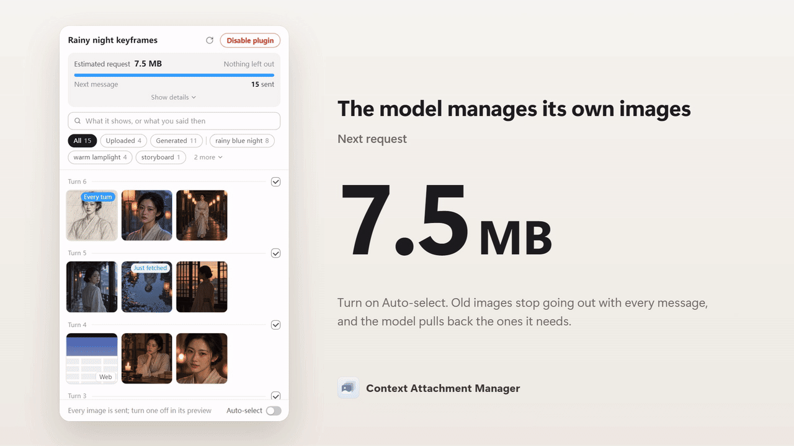
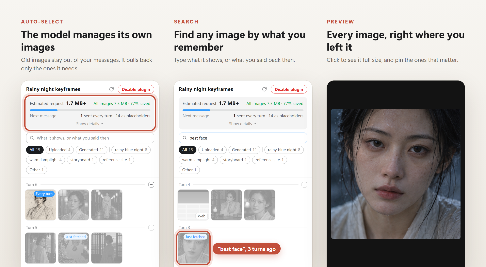

<p align="center">
  
</p>

<h1 align="center">Context Attachment Manager</h1>

<p align="center"><b>Локальный плагин для чатов с множеством изображений в Codex, Claude Code и других агентах.</b><br>Ранние изображения больше не отправляются с каждым сообщением. Модель получает оригинал по его идентификатору, когда он ей нужен.

<p align="center">
  <a href="https://github.com/chipfighter/context-attachment-manager/releases"></a>
  
  <a href="LICENSE"></a>
</p>

<p align="center"><b>Английский</b> · <a href="README_CN.md">Китайский (упрощённый)</a> · <a href="README_JA.md">Японский</a> · <a href="README_KO.md">Корейский</a> · <a href="README_RU.md">Русский</a></p>

<p align="center">
  
</p>

## Что он делает

Обычно агент отправляет каждое раннее изображение снова с каждым сообщением, поэтому длинный чат со множеством изображений тормозит и может перестать проходить. Этот плагин нумерует каждое изображение (`IMG-001`, `IMG-002`, …) и отправляет предыдущие как короткие заполнители:

- **Модель берёт то, что нужно**: когда ей нужно снова посмотреть на раннее изображение, она получает оригинал по его ID.
- **Она различает изображения**: модель делает одну заметку о том, что показано на каждом изображении, плюс ваши комментарии к нему. Они остаются в заполнителях, даже после сжатия чата.
- **Кэш продолжает работать**: заполнитель записывается один раз и потом не меняется, поэтому ранний чат по-прежнему читается из кэша подсказок модели. См. [принципе работы](#design-keep-the-cache-working).
- **Ничего не удаляется**: ваши оригинальные изображения и история чата остаются как есть.

Плагин включён по умолчанию; открывать панель не обязательно. Типичное применение: создание изображений и видео, отсканированные документы, работа с компьютером и браузером.

## Установка

Отправьте это агенту. Он определит свою платформу и установит нужную настройку:

```text
Install Context Attachment Manager for me, following https://github.com/chipfighter/context-attachment-manager/blob/main/INSTALL.md
```

Затем перезапустите агента (в Claude Desktop начните новую Code-сессию). См. [поддерживаемых агентов](#works-with) и [установку, обновление и удаление](INSTALL.md).

## Панель, когда нужен контроль

<p align="center">
  
</p>

- **Найти изображение** по детали или комментарию, который вы помните, например «дождливая ночь» или «лучшее лицо».
- **Держать образец перед глазами**: откройте изображение и отметьте **Отправлять каждый ход**.
- **Выбирать изображения самим**: выключите **Автоотбор** и выберите, что отправить со следующим сообщением.

В **Codex** откройте **Context Assets** в боковой панели задачи. Во **вкладке Code приложения Claude Desktop** панель открывается автоматически, когда есть изображения; введите `/cam`, чтобы вернуть её.

## Конфиденциальность

Плагин работает локально. Ваши оригинальные изображения и история чата остаются на компьютере; запросы идут в сервис, которым агент уже пользуется.

## Как мы проверяли

В Codex чат с девятью ключевыми кадрами вырос до 42.4 MB и не отправлялся после перезапуска или сжатия; с плагином те же запросы занимали 0.12 MB. Результаты и шаги воспроизведения — в [сравнении для Codex](eval/README.md) и [сравнении длинных задач в Claude Code](eval/long-task/README.md).

## Принцип: кэш продолжает работать

Сервисы моделей кэшируют начало чата. Когда запрос начинается точно так же, как предыдущий, эта часть читается из кэша — быстрее и намного дешевле. Когда что-то в начале чата меняется, всё после изменения обрабатывается заново.

Любой способ уменьшить длинный чат должен что-то менять. Плагин меняет как можно более позднюю его часть:

<p align="center">
  
</p>

- **Заполнитель записывается один раз**: изображение становится заполнителем в ходе после своего появления, поэтому заново обрабатывается только остаток этого хода. После этого заполнитель не меняется от запроса к запросу.
- **Получение ничего не меняет раньше**: оригинал добавляется в конце текущего хода, а его заполнитель остаётся на месте. Какую бы картинку ни выбрала модель и сколько бы их ни было в чате, всё до текущего хода по-прежнему читается из кэша.
- **Модель получает оригинал**: не уменьшенную копию и не сводку.

<p align="center">
  
</p>

Это не бесплатно. После хода с изображениями остаток этого хода обрабатывается один раз заново, и модель пишет короткую строку для каждого нового изображения. Изменение старого изображения в панели (снятие отметки, повторная отметка, **Отправлять каждый ход**) меняет чат на этом изображении, поэтому всё после него обрабатывается заново. В нашем [сравнении длинных задач в Claude Code](eval/long-task/README.md) с плагином из кэша читалось 87% ввода, без плагина — 91%.

Третий ряд первой картинки — это и то, что делает собственное сжатие агента, и то, что делает очистка старых результатов инструментов на стороне API (например, context editing у Anthropic): раннее содержимое удаляется, а последующее обрабатывается заново.

## С какими агентами работает

Codex и Claude Code проверены; в Codex и Claude Desktop есть и панель. Остальные агенты ниже поддерживаются через адаптеры, написанные по их коду и документации, но мы ещё не проверяли их вживую. Если вы пользуетесь одним из них, пожалуйста [расскажите, как прошло](https://github.com/chipfighter/context-attachment-manager/issues), работало или нет.

| Агент | Что это | Поддержка |
|---|---|---|
| [Codex](https://github.com/openai/codex) | Кодирующий агент OpenAI, desktop и CLI | Автоотбор + панель, проверено |
| [Claude Code](https://github.com/anthropics/claude-code) | Кодирующий агент Anthropic, desktop и CLI | Автоотбор + панель (desktop), проверено |
| [WorkBuddy](https://www.workbuddy.cn) | Настольный ИИ-помощник Tencent с CodeBuddy внутри | Автоотбор, ещё не проверено |
| [OpenCode](https://github.com/anomalyco/opencode) | Открытый терминальный кодирующий агент для любого провайдера моделей | Автоотбор, ещё не проверено |
| [Gemini CLI](https://github.com/google-gemini/gemini-cli) | Открытый терминальный агент Google | Автоотбор, ещё не проверено |
| [pi](https://github.com/earendil-works/pi) | Минималистичный расширяемый терминальный агент | Автоотбор (расширение pi), ещё не проверено |
| [DeepSeek Harness](https://github.com/deepseek-ai/deepseek-harness) | Харнесс агентов DeepSeek, где всё — плагин | Автоотбор (плагин dsh), ещё не проверено |
| [Qwen Code](https://github.com/QwenLM/qwen-code) | Открытый терминальный агент Qwen | Автоотбор, ещё не проверено |
| [Cline](https://github.com/cline/cline) | Открытый кодирующий агент для VS Code, JetBrains и терминала | Автоотбор, ещё не проверено |
| [Kilo Code](https://github.com/Kilo-Org/kilocode) | Открытый кодирующий агент для VS Code, JetBrains и терминала | Автоотбор, ещё не проверено |
| [goose](https://github.com/aaif-goose/goose) | Открытый агент для desktop и терминала с расширениями MCP | Автоотбор, ещё не проверено |
| [Cherry Studio](https://github.com/CherryHQ/cherry-studio) | Открытый десктопный чат-клиент для многих моделей | Автоотбор, ещё не проверено |

Настройка этих агентов: [INSTALL.md](INSTALL.md#other-agents). Чтобы подключить другого агента, см. [ADAPTERS.md](ADAPTERS.md).

## FAQ

### Почему Codex и Claude Code тормозят в длинном чате со множеством изображений?

Агент отправляет каждое раннее изображение снова с каждым сообщением, поэтому длинный чат со множеством изображений тормозит и может перестать проходить. В Codex чат с девятью ключевыми кадрами вырос до 42.4 MB и не отправлялся после перезапуска или сжатия; с Context Attachment Manager те же запросы занимали 0.12 MB.

### Нарушает ли Context Attachment Manager кэш подсказок?

Немного. Заполнитель записывается один раз и не меняется, а полученное изображение добавляется в конец текущего хода, поэтому ранние ходы по-прежнему читаются из кэша. После хода с изображениями остаток этого хода обрабатывается один раз заново. В нашем сравнении длинных задач в Claude Code с плагином из кэша читалось 87% ввода, без плагина — 91%.

### Чем это отличается от сжатия или уменьшения изображений?

Сжатие и отбрасывание ранней истории удаляют раннюю часть чата, а уменьшение изображений меняет её. В любом случае обрабатывается почти весь чат, а модель остаётся со сводкой или уменьшенной копией. С Context Attachment Manager обрабатывается заново только остаток предыдущего хода, а модель получает оригинал изображения по его ID.

### Может ли модель по-прежнему видеть раннее изображение?

Да. У каждого изображения есть ID вроде `IMG-001`, и модель получает оригинал, когда ей нужно снова на него посмотреть, в том числе после сжатия чата.

### Удаляются ли мои изображения или отправляются куда-то ещё?

Нет. Плагин работает на вашем компьютере. Оригинальные изображения и история чата остаются как есть, а запросы идут в сервис, которым агент уже пользуется.

### С какими агентами это работает и бесплатно ли это?

Codex и Claude Code проверены. WorkBuddy, OpenCode, Gemini CLI, pi, DeepSeek Harness, Qwen Code, Cline, Kilo Code, goose и Cherry Studio поддерживаются через адаптеры, которые мы ещё не проверяли вживую. Это бесплатно и с открытым исходным кодом по лицензии MIT.

### Как установить Context Attachment Manager? Нужен ли терминал?

Нет. Отправьте агенту одно предложение из раздела [Установка](#install) выше: он определит платформу и выполнит настройку сам, а вам останется только перезапустить агента (в Claude Desktop начать новую Code-сессию). В Codex можно также установить его со страницы Plugins за пару кликов. Если предпочитаете вручную, в Codex нужна одна команда, в Claude Desktop две команды `claude`; см. [INSTALL.md](INSTALL.md).

<p align="center"><sub><a href="CHANGELOG.md">Журнал изменений</a> · <a href="CONTRIBUTING.md">Участие в разработке</a> · <a href="LICENSE">Лицензия MIT</a></sub></p>

## Источник и лицензия

- Оригинальный автор: chipfighter
- Оригинальный репозиторий: https://github.com/chipfighter/context-attachment-manager
- Лицензия: MIT
- Русский перевод и локализация интерфейса: проект claude-code-mods-ru
