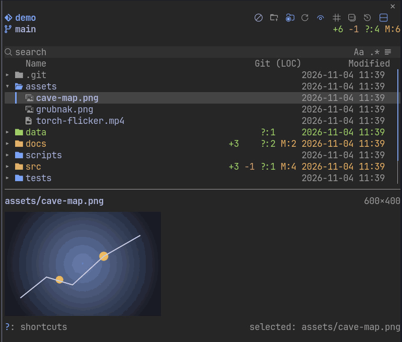

<h1 align="center">Filetree для Claude Code</h1>

<p align="center">
  Дерево файлов в стиле IDE для Claude Code, показывающее, что делает Claude и где именно в файлах
</p>

<p align="center">
  
  
  
  
</p>

<details open>
<summary><b>CLI Claude Code</b></summary>

<p align="center">
  
</p>

</details>

<details>
<summary><b>Claude Code в приложении Desktop</b></summary>

<p align="center">
  
</p>

</details>

**Основные возможности:**

* Показывать и обходить все файлы каталога (с поддержкой статуса Git и привязок nvim)
* Анимация показывает, где Claude читает или работает
* Горячие клавиши:
   * Перемещение по каталогам через `z` (аналог zoxide)
   * Поиск через `s` или `i` (в выделенной папке) либо `q` (по содержимому файлов)
   * Diff файла через `d` или всех изменённых файлов в папке
* Возможности для терминала: предпросмотр файлов, treemap размера каталогов и другое

---

## Установка

Репозиторий сам является маркетплейсом плагинов. Выполните в терминале:

```bash
claude plugin marketplace add data-goblin/claude-code-filetree
claude plugin install filetree@claude-code-filetree
```

Или внутри сессии Claude Code:

```text
/plugin marketplace add data-goblin/claude-code-filetree
/plugin install filetree@claude-code-filetree
```

На Claude Code старше 2.1.287 установка падает с `Unrecognized key: "options"`: выполните `claude update` и установите снова.

## Возможности

- Дерево файлов cwd или закреплённой папки, с колонками Git, размера, числа строк и даты ([tree](docs/tree.md))
- Свернуть всё и развернуть всё до трёх уровней вглубь ([tree](docs/tree.md))
- Стрелки символических ссылок, значок мозга на файлах инструкций агента и глифы Nerd Font, обычные или текстовые ([tree](docs/tree.md))
- Поиск по имени в ещё не открытых папках, с учётом регистра или по регулярному выражению, в рамках одной папки ([search](docs/search.md))
- Поиск внутри файлов через `git grep` или `grep -r` и переход к совпадению по строке ([search](docs/search.md))
- Переход в любую папку в стиле zoxide через `z` ([search](docs/search.md))
- Статус Git по файлам и папкам, число строк у изменённых файлов, ветка с опережением и отставанием ([git](docs/git.md))
- Команды Git и GitHub, которые выполняет Claude, показываются как строка состояния ([git](docs/git.md))
- Чтения, записи и коммиты Claude мерцают в дереве, а автосворачивание закрывает открытые им папки ([activity](docs/activity.md))
- Настройка Activity shimmer выключает мерцание во всех сессиях; кнопка Clawd в заголовке приложения Desktop переключает его ([activity](docs/activity.md))
- Ссылки на файлы с номером строки в ответах Claude становятся ссылками на эту строку ([activity](docs/activity.md))
- Follow work переносит сессию в репозиторий, над которым работает Claude ([activity](docs/activity.md))
- Множественный выбор в стиле IDE; затенённые строки уходят Claude как контекст: выбранная строка или до 100 отмеченных ([context](docs/context.md)):
  - клик выбирает одну строку и сбрасывает отметки
  - при отмеченных строках j / k двигают только курсор, а `v` отмечает или снимает отметку с текущей строки
  - shift+click отмечает диапазон от последнего клика или перемещения j / k в порядке дерева
  - ctrl+click отмечает или снимает отметку с одной строки, не открывая её; на macOS — alt+click
  - двойной клик или Enter открывает файл
  - кнопка очистки выбора сбрасывает все отмеченные и выбранные строки
  - отмеченные строки показывают фон выбора; `y`, `Y` и `u` копируют затенённые строки
  - при отмеченных строках текущая под курсором показывает акцентный оттенок в приложении Desktop и акцентную метку курсора в терминале
- Разделённый предпросмотр кода, Markdown, изображений, видеокадров, страниц PDF и Word ([preview and treemap](docs/preview-treemap.md))
- Treemap папки по байтам или строкам, с подсвеченной активностью Claude ([preview and treemap](docs/preview-treemap.md))
- Diff файла или всех изменённых файлов в папке — в панели или в вашей программе diff ([diff](docs/diff.md))
- Открытие файлов в приложении по умолчанию, редакторе в панели tmux или herdr либо любой командой ([open](docs/open.md))
- Защита файлов и папок от правок Claude и просмотр файлов, записанных вне репозитория ([guards](docs/guards.md))
- Управление с клавиатуры: перемещения в стиле vim, оверлей горячих клавиш и alt+l / alt+h в терминале ([keys](docs/keys.md))
- Команды `/filetree` и где панель появляется в терминале и приложении Desktop ([sidebar](docs/sidebar.md))




## Настройки

Все настройки находятся в `/config` в разделе filetree, с описанием каждой там же.

```yaml
Claude activity:  reads and writes | writes | reads | none
Activity shimmer: on | off
Follow Claude:    on | off
Jump moves Claude: tree and Claude | tree
Right-click copies: relative | absolute
Follow work:      on | off
Open at start:    on | off
Focus on open:    on | off
Right column:     date | age | size | loc | files
Date format:      year-month-day | day-month | month-day
Clock:            24h | 12h
Long file:        500 | a line count | off
Remote branch:    off | on
Hints:            on | off
Search spacing:   on | off
Column headers:   on | off
Auto-collapse:    off | on
Shortcuts:        auto | always | off
Open with:        empty | editor | preview | a command with {path} and {dir}
Binary files:     Open with | default app
Edit with:        empty | a command with {path} and {line}
Diff with:        empty | a command such as "hunk diff --" or "lazygit -f"
Diff groups:      folder | kind | off
Terminal target:  auto | pane right | pane below | tab | workspace
Ignore:           names to hide, such as ".cache .tmp"
Preview pane:     bottom | top
Treemap:          auto | image | cells | off
Palette:          key=#hex pairs over the terminal colors
Glyphs:           auto | nerd | plain | text
```

В терминале акцентный цвет окрашивает папки, корень, курсор, совпадения поиска и верхние ячейки treemap. Это ярко-синий терминала при тёмной теме Claude и синий при светлой. `accent=#hex` в Palette задаёт другой цвет для всех них.

Follow work описан в [активности Claude](docs/activity.md).

Open at start действует на каждую новую сессию, включая `/clear`. Когда вы открываете или закрываете дерево через `/filetree`, выбор действует до следующего `/clear`. После `/clear` дерево открыто или закрыто согласно Open at start.

## Требования

```yaml
required:  Claude Code 2.1.306 or newer, git
optional:
  inotifywait:            live updates on Linux (inotify-tools)
  magick or ffmpeg:       images other than PNG, video frames
  pdftoppm or gs:         PDF pages
  soffice:                Word and office pages
  pandoc, pdftotext:      document text in tmux, herdr and other terminals
  tmux or herdr:          an editor or diff tool in a new pane
  Nerd Fonts 3.2+:        icons for Glyphs auto, which draws plain Unicode without one or with an older one
pictures:  Ghostty or kitty, outside tmux and herdr, on Linux and macOS
```

## Особенности

- В приложении Desktop нет разделённого предпросмотра и treemap
- Приложение Desktop мерцает не более чем четырьмя строками одновременно; остальные подсвеченные строки видны своим цветом без мерцания, а терминал мерцает всеми. Если панель всё равно перегружает, кнопка Clawd в заголовке или настройка Activity shimmer выключает мерцание
- Приложение Desktop рисует не более 150 строк вокруг курсора, а меньше, если строки глубокие, имеют длинные пути или показывают изменения Git; заметка считает пропущенные строки
- GIF и видео показывают один неподвижный кадр
- Windows оценивает размер папок по спискам файлов, а treemap рисует один уровень
- Клики по строкам требуют herdr 0.9.1 или новее; выполните `herdr update`

## Участие в разработке

Открывайте пулл-реквесты против ветки релиза, не `main`:

- Исправления: ветка patch, например `release/0.8.2`
- Возможности: ветка minor, например `release/0.9.0`

Сохраняйте версию этой ветки.

Включите git-хуки один раз на клон. pre-commit за секунды запускает быстрые проверки: правила grep, типы, oxlint и `claude plugin validate` при изменении манифестов. pre-push проверяет версию по ветке релиза и запускает тесты плагина:

```bash
git config core.hooksPath .githooks
```

Те же проверки идут на macOS, Windows и Linux в CI при каждом push, затрагивающем плагин.

## Лицензия

[MIT](LICENSE). Метки treemap используют глифы из [Terminus Font](https://terminus-font.sourceforge.net/) авторства Dimitar Zhekov (Lat2-Terminus16, SIL Open Font License 1.1).

*Этот проект вдохновлён моим приложением Omarchy [FileBlade](https://github.com/data-goblin/fileblade)*

## Источник и лицензия

- Оригинальный автор: data-goblin
- Оригинальный репозиторий: https://github.com/data-goblin/claude-code-filetree
- Лицензия: MIT
- Русский перевод и локализация интерфейса: проект claude-code-mods-ru
