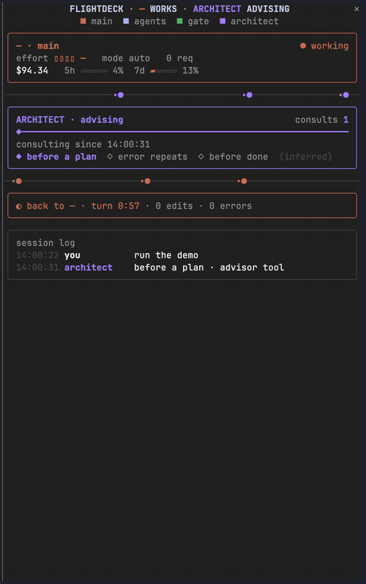
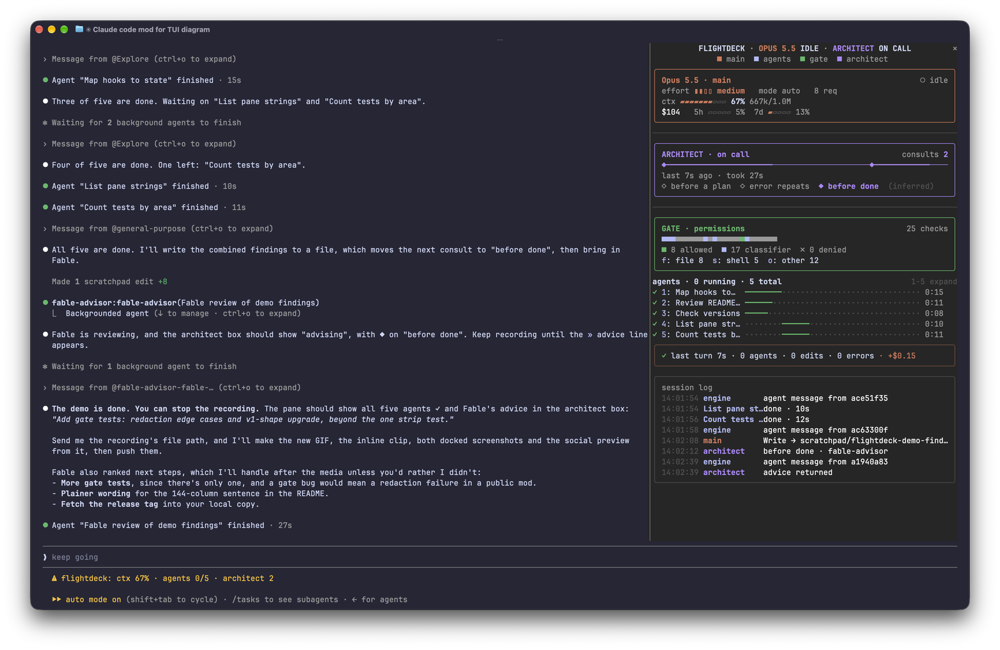
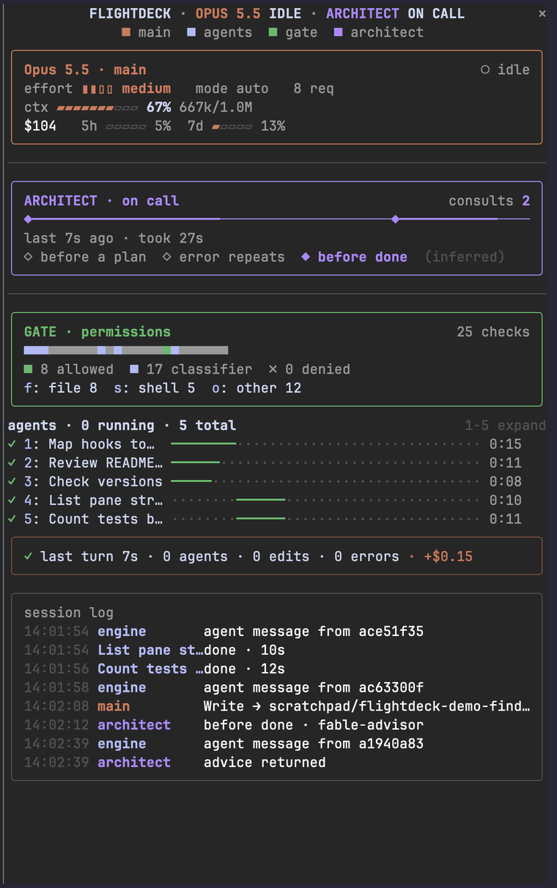

# Flightdeck

[](https://github.com/scasella/claude-flightdeck/releases/latest)
[](LICENSE)
[](https://claude.com/blog/claude-code-mods)
[](https://statuslin.es/mods/flightdeck)

**Мод Claude Code, который размещает живую панель агентов в вашем терминале**: контекст и стоимость, временная шкала советника, каждая проверка разрешений и ваши субагенты в виде карточек или дорожек. Каждое число берётся из реального события сессии, и ничего не покидает ваш компьютер.

<p align="center">
  
</p>

<p align="center">
  <a href="#install">Установка</a> · <a href="#what-you-see">Что вы видите</a> · <a href="#what-it-can-reach">До чего добирается</a> · <a href="#configure">Настройка</a> · <a href="#troubleshooting">Устранение неполадок</a> · <a href="CHANGELOG.md">Что нового</a>
</p>

## Установка

Внутри Claude Code (2.1.289 или новее):

```
/plugin marketplace add scasella/claude-flightdeck
/plugin install flightdeck@claude-flightdeck
/reload-plugins
/flightdeck
```

<details>
<summary><strong>Из терминала или из клона</strong></summary>

```sh
claude plugin marketplace add scasella/claude-flightdeck
claude plugin install flightdeck@claude-flightdeck
```

Или загрузите прямо из клона на одну сессию:

```sh
git clone https://github.com/scasella/claude-flightdeck
claude --plugin-dir ./claude-flightdeck
```

</details>

Установщик может сказать, что параметры конфигурации не заданы; значения по умолчанию подходят, а меняются они через [`/config`](#configure).

Моды — функция Claude Code раннего доступа, и их API может меняться между выпусками. Если что-то сломалось, см. [Устранение неполадок](#troubleshooting).

## Что вы видите

https://github.com/user-attachments/assets/9ad0fcc3-c81c-427a-a743-f7b6c49f5885

<p align="center">
  
</p>

| Пристыкована рядом с транскриптом | Встроена над запросом |
| --- | --- |
|  | <br><br>На основном экране без полноэкранного режима панель — сводка не более чем на 8 строк; до 3 агентов присоединяются к ней, когда в сессии есть субагенты. |

| Панель | Показывает | Источник |
| --- | --- | --- |
| **main** | модель, усилие, режим разрешений, число запросов; шкала контекста со сжатиями (⟲, или ⟲~ при [оценке](#what-is-inferred-not-measured)), измеренная относительно окна сжатия, если сессия сжимает в меньшем окне, чем модель (`autoCompactWindow` или собственное Claude Code); стоимость и первые два окна ограничения скорости, если тариф их сообщает, со временем до сброса (↻) из 56 столбцов; время до первого токена последнего запроса основного цикла | `turn.step`, `session.measure`, `session.compact`, `$.session.usage()` (при каждом запросе основного цикла и его локальная разбивка `summary` — один раз на модель для окна сжатия); режим разрешений из `classic.UserPromptSubmit` и `agent.spawn` |
| **architect** | консультации на временной шкале, идёт ли одна сейчас, сколько заняла последняя; по желанию момент каждой консультации; первая строка совета субагента-архитектора | запуск агента подходящего типа или подходящий серверный инструмент в строках ассистента |
| **gate** | одна ячейка на каждую проверку разрешений: зелёная — разрешено без вопроса, синяя — решено классификатором авторежима или вами и затем выполнено, янтарная — ожидает, красная ✗ — отказано, тусклая — решение внутри субагента. Итоги и детализация по семействам инструментов с маскированием учётных данных | `tool.check`, завершённое через окружающий его `tool.call` |
| **agents** | карточки бок о бок, пока помещаются: задача, тип, живой контекст и токены вывода, шаги, идущие часы, `max_tokens` красным. Дальше — дорожки на одной временной оси | `agent.spawn`, `turn.step`, `tool.call`, `turn.complete` |
| **loops** | модельные циклы, не совпавшие ни с одной карточкой: агенты воркфлоу, сжатия, ответвления памяти | id `turn.step`, которые не заняла ни одна карточка |
| **receipt** | текущий или последний ход: длительность, агенты, правки, ошибки, добавленная стоимость | `turn.start`, `turn.complete` |
| **log** | запросы, запуски, завершения, консультации, правки, ошибки и отказы; фильтруется по одному агенту, пока вы смотрите его транскрипт | всё вышеперечисленное |

Соединители анимируются только когда идёт работа: выполняется ход, работает агент или открыта консультация. Панели нечего показывать — они не занимают места, поэтому сессия без субагентов показывает только главный блок и журнал.

## Использование

| Команда | Что делает |
| --- | --- |
| `/flightdeck` | открыть панель |
| `/flightdeck close` | закрыть её |
| `/flightdeck reset` | очистить агентов, проверки, консультации, журнал и ход (стоимость, лимиты и сжатия остаются) |
| `/flightdeck layout auto\|compact\|wide\|mini` | переопределить макет для этой сессии |

Сфокусируйте панель через `ctrl+x tab`, затем:

| Клавиша | Что делает |
| --- | --- |
| `1`, `2`, … | раскрыть карточку или дорожку агента: полная задача, последние 3 вызова инструментов, начало ответа |
| `f` `s` `o` | открыть детализацию шлюза по файлам / shell / прочему: последние 5 проверок и вердикты |

`/clear` сбрасывает панель вместе с беседой.

## Где работает

- **Терминал на весь экран:** пристыкована рядом с транскриптом; две колонки от ширины 110 столбцов.
- **Терминал в основном экране:** встроена над запросом, в сводке на 8 строк.
- **Приложение Desktop, VS Code, мобильный:** те же панели плюс агенты, нарисованные как SVG-временная ось. VS Code и мобильный не анимируют, поэтому соединители и часы там статичны. (Расширение VS Code может пока не показывать панель вовсе: см. [Устранение неполадок](#troubleshooting).)

При `openOnStart` панель открывается сама при начале сессии в терминалах шириной не менее 144 столбцов; ниже этой ширины её открывает `/flightdeck`. Цвета берутся из вашей темы Claude Code, поэтому светлые, тёмные и цвето-слепые темы читаются одинаково.

## До чего добирается

Flightdeck только наблюдает. Каждый хук передаёт событие без изменений: он никогда не отказывает, не переписывает и не задерживает вызов инструмента, запрос или субагента.

| Что видит | Через |
| --- | --- |
| имя и ввод каждого вызова инструмента, а также его неудачу | `tool.call` |
| каждый вердикт разрешений | `tool.check` |
| запуски субагентов, их запросы к модели и расход токенов, итоговые ответы | `agent.spawn`, `turn.step`, `turn.complete` |
| первые 70 символов ваших запросов для журнала | `turn.start` |
| показания контекста, стоимости и ограничений скорости | `session.measure`, `$.session.usage()` |
| разбивку контекста, которую показывает `/context` (её категории, пути файлов памяти, инструменты MCP, агенты и навыки), оценённую локально один раз на модель; сохраняется только окно сжатия | `$.session.usage({ breakdown: 'summary' })` |
| вызовы инструмента advisor в ответах ассистента (их содержимое зашифровано) | `session.append` |

Что сохраняется: короткие сводки (имя инструмента плюс путь или команда, начало каждого запроса, задача и ответ агента, совет архитектора — всё с маскированием учётных данных) в состоянии сессии, которое заканчивается вместе с ней. Он **не** делает сетевых запросов, не запускает процессов, не читает и не пишет файлы, ничего не хранит между сессиями и не вызывает модель. `claude plugin validate .` печатает ровно то, что он хукирует и вызывает.

## Что выводится, а не измеряется

- **Моменты архитектора.** «Перед планом» означает, что в этом ходе ещё не было правок, «ошибка повторяется» — 2+ ошибки основного цикла подряд, «перед завершением» — правки были. Они помечены `(inferred)`; отключите их через `moments: false`.
- **Сжатия под встроенной защитой.** Там, где защита Claude Code не допускает `session.compact` до Flightdeck (см. [Устранение неполадок](#troubleshooting)), число оценивается. Claude Code не сообщает заполнение контекста до первого ответа после новой сессии, `/clear` или сжатия. Поэтому запрос основного цикла, не нашедший заполнения после ответа, считается сжатием. Главный блок показывает `⟲~1` с `(estimated)` при наличии места, а журнал говорит `context compacted (estimated)`. Откат к вашему первому запросу читается так же и тоже учитывается. Там, где `session.compact` работает, его счёт заменяет оценку.
- **Совет на стороне сервера зашифрован.** Для серверного инструмента вроде `advisor` Claude Code панель считает и временит консультацию, но не может показать, что было сказано.
- **Контекст агента — это весь ввод последнего запроса** (некэшированный + чтение кэша + запись кэша). Он помечен `ctx`, а не стоимостью: в API нет стоимости для отдельного агента.
- **Другие циклы** не отличают агента воркфлоу от ответвления для сжатия: оба — модельные циклы, не занятые карточкой.
- **Первый шаг фонового агента** может прийти до появления его карточки, поэтому его использование может отображаться на один шаг позже.
- **Контекст относительно окна сжатия.** Когда сессия сжимается в окне меньшем, чем у модели, шкала, `tokens/window` и `ctx N%` в строке состояния измеряются относительно этого окна, поэтому читаются выше процента собственной строки состояния Claude Code (и claude-hud), который измеряет относительно окна модели. Автосжатие запускается немного до 100%, на своём пороге внутри этого окна.
- **Время до первого токена.** `ttft` измеряется собственным хуком `turn.step` во Flightdeck, поэтому включает всё ниже: хуки других плагинов, движок, сеть и любые повторы. Когда размышление модели не передаётся потоком, первый кусок приходит после него, значит `ttft` включает размышление. Измеряется, а не выводится, но это не собственная цифра API. Скорости вывода нет: сообщённые токены включают размышление, поэтому скорость по видимому потоку не является реальной.

## Настройка

В `/config` или в `pluginConfigs[<id>].options` вашего пользовательского `settings.json`, где `<id>` — как Claude Code загрузил плагин: `flightdeck@claude-flightdeck` при установке из маркетплейса, `flightdeck` (или `flightdeck@inline`) с `--plugin-dir`. Запись под другим ключом или в проектных настройках (`.claude/settings.json`) игнорируется без предупреждения. Из терминала `claude plugin configure flightdeck@claude-flightdeck` перечисляет параметры и не заданные из них и сохраняет их через `--values-stdin`.

| Параметр | По умолчанию | Смысл |
| --- | --- | --- |
| `architectPattern` | `advisor\|architect` | регистронезависимое регулярное выражение для типов агентов и серверных инструментов, считающихся архитектором |
| `matchDescriptions` | `false` | сопоставлять также описания агентов, не только имена типов |
| `architectLabel` | `ARCHITECT` | имя архитектора в панели |
| `gateLabel` | `GATE` | имя панели разрешений |
| `panels` | `main,architect,gate,agents,loops,receipt,log` | какие панели показывать и в каком порядке |
| `layout` | `auto` | `mini`, `compact`, `wide` или `auto` (mini встроено, wide пристыковано от 110 столбцов) |
| `maxCards` | `3` | карточек бок о бок до перехода на дорожки (1–6); меньше, если панель слишком узкая |
| `paneColumns` | `66` | столбцов запрашивает пристыкованная панель, не менее 40. Claude Code ограничивает док 45% терминала, и ширина, до которой вы его растянули в этой или прошлой сессии, имеет приоритет. Широкий макет начинается со 110, поэтому нужен терминал примерно на 245 столбцов или `layout: wide` |
| `motion` | `while-active` | `off` оставляет соединители неподвижными |
| `moments` | `true` | показывать выводимые моменты консультаций |
| `palette` | `theme` | `pastel` использует фиксированные цвета, подобранные для тёмных терминалов |
| `openOnStart` | `true` | просить открыть панель при начале сессии |
| `statusLine` | `true` | контекст, работающие агенты, консультации и отказы в строке состояния |

## Устранение неполадок

**Панель не появляется.**
- Проверьте, что `claude --version` — 2.1.289 или новее, затем выполните `/reload-plugins` и `/flightdeck`. На более старой версии транскрипт говорит `flightdeck: hooks module did not load: …`.
- При ширине менее 144 столбцов Claude Code не сажает панель, которую никто не просил; `/flightdeck` открывает её при любой ширине.
- Найдите в транскрипте тусклую строку, начинающуюся с `flightdeck:`. Она называет хук, который дал сбой, или причину отказа панели. Пожалуйста, [откройте issue](https://github.com/scasella/claude-flightdeck/issues) с ней.
- Если панель показывает только `draw failed (…)`, её хук отрисовки выбросил исключение; включите эту строку в issue тоже.

**В расширении VS Code ничего не показывается.** В одном отчёте его сборка 2.1.296 запускала хуки Flightdeck, но не показывала панель — и не показывала панель другого мода тоже ([#5](https://github.com/scasella/claude-flightdeck/issues/5)). Вместо этого запустите `claude` во встроенном терминале VS Code, затем `/flightdeck`: встроенный терминал обычно уже 144 столбцов, необходимых для самостоятельного открытия панели.

**При входе Team или Enterprise режим разрешений отсутствует или устарел, а сжатия оцениваются.** На компьютере с управляемыми настройками или в сессии под `/login` Team/Enterprise Claude Code загружает встроенную защиту `cc-plugin-sec-default`, которая никогда не запускает хуки пользовательского плагина на событиях `classic.*` и `session.compact` (см. «Узнайте, какие хуки пользовательского мода не запускаются» в [Управлении модами для вашей организации](https://code.claude.com/docs/en/plugins/mods/admin)). Других событий, которые может хукировать пользовательский плагин и которые несут режим разрешений, кроме запуска субагента, нет. Поэтому главный блок не показывает режим до запуска субагента, а затем показывает режим, бывший в момент запуска. До этого в авторежиме шлюз записывает вызовы, одобренные классификатором, на `you`. Сжатия считаются по контексту, который Claude Code сообщает при каждом запросе, поэтому главный блок помечает их `⟲~`, а журнал говорит `context compacted (estimated)` (см. [Что выводится, а не измеряется](#what-is-inferred-not-measured)). На 2.1.299 и новее `/plugin` показывает заметку с именами этих двух хуков. Остальная панель работает. Администратор может разрешить хуки, установив Flightdeck как один из собственных модов организации ([#23](https://github.com/scasella/claude-flightdeck/issues/23)).

**Параметры будто игнорируются.** Проверьте ключ в пользовательском `settings.json`: `pluginConfigs["flightdeck@claude-flightdeck"]` при установке из маркетплейса, `pluginConfigs["flightdeck"]` с `--plugin-dir`. См. [Настройка](#configure).

**Цвета выглядят не так.** Установите `palette` в `pastel` через `/config`.

**Слишком много анимации.** Установите `motion` в `off`.

**Счётчики выглядят устаревшими после обновления.** Выполните `/flightdeck reset`.

## Как это работает

| Файл | Что содержит |
| --- | --- |
| [`hooks/register.tsx`](hooks/register.tsx) | хуки событий, доступ к состоянию и по одной функции на панель |
| [`hooks/core.ts`](hooks/core.ts) | все редьюсеры, форматтеры и правила макета как чистые функции, чтобы поведение тестировалось напрямую |
| [`hooks/rail.tsx`](hooks/rail.tsx), [`hooks/elapsed.tsx`](hooks/elapsed.tsx) | поверхностные модули: анимированные соединители и живые часы, которые перерисовывают только себя на собственном такте поверхности |
| [`types/index.d.ts`](types/index.d.ts) | контракт состояния |
| [`tests/`](tests) | 65 тестов: чистое поведение плюс отрисовки, смонтированные на каждой поверхности при ширине 24–120 столбцов, причём каждая ширина от 24 до 40 проверяется на выход за пределы блока |

Состояние живёт в атомах `$.state`. Каждое чтение объединяется со значениями по умолчанию, поэтому отсутствующее или старое поле никогда не ломает панель; обновление, меняющее форму состояния, может один раз сбросить счётчики. Впервые с модами? Начните с [Claude Code mods](https://claude.com/blog/claude-code-mods) и [Getting started with Claude Code mods](https://claude.dev/blog/getting-started-with-claude-code-mods/).

## Связанные проекты

Flightdeck работает вместе с этими проектами и заимствует у них идеи:

- [claude-hud](https://github.com/jarrodwatts/claude-hud): контекст, лимиты, инструменты и агенты в строке состояния. Используйте оба: это строка состояния, Flightdeck — панель.
- [zoetrope](https://github.com/furkankly/zoetrope): сессия Claude Code или Codex как живой граф потока.
- [ccusage](https://github.com/ccusage/ccusage): отчёты о стоимости из журналов ваших сессий.
- [awesome-claude-code-mods](https://github.com/karanb192/awesome-claude-code-mods): указатель модов Claude Code.

## Разработка

```sh
claude --plugin-dir .            # load it; edits hot-reload
claude plugin validate .
claude plugin test .
npx -p typescript tsc -p .       # after the first load, which writes .claude-plugin/types/
```

См. [CONTRIBUTING.md](CONTRIBUTING.md). Изменения перечислены в [CHANGELOG.md](CHANGELOG.md).

## Лицензия

[MIT](LICENSE)

## Источник и лицензия

- Оригинальный автор: scasella
- Оригинальный репозиторий: https://github.com/scasella/claude-flightdeck
- Лицензия: MIT
- Русский перевод и локализация интерфейса: проект claude-code-mods-ru
