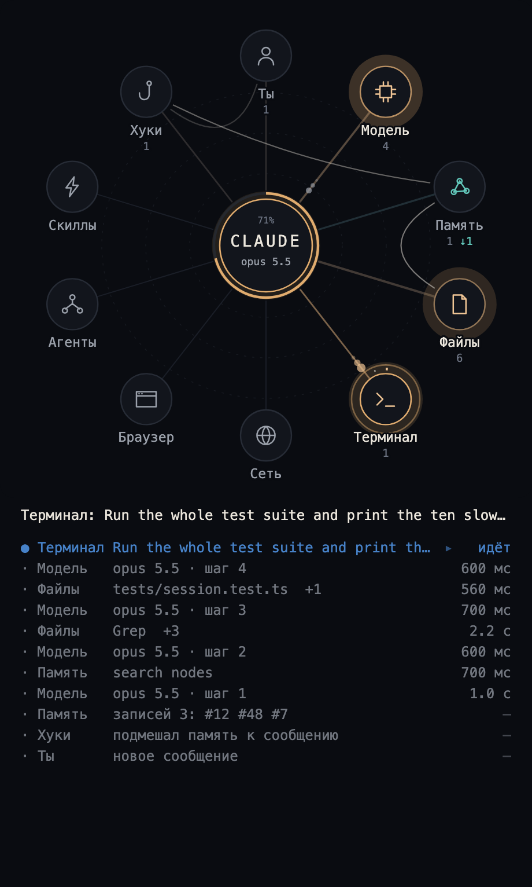

# Lot Map для Claude Code

`lot-map` — мод для Claude Code: живая карта работы в панели рядом с чатом. Каждый вызов инструмента, шаг модели, хук и навык посылает импульс от центра к своей станции, так что вы видите память, файлы, shell, сеть и агентов в работе вместо чтения списка команд.

Он работает на вашем компьютере и ничего никуда не отправляет. Локальность не значит слепота: как любой мод, следующий за вызовами инструментов, он получает каждый вызов целиком и берёт из него только названия. [Что он читает и сохраняет](PRIVACY.md) и [проверки, которые это обеспечивают](PRINCIPLES.md).


*Вымышленная сессия, проигранная через собственный код отрисовки мода. [Видео (MP4)](docs/demo.mp4). Или [откройте в браузере](https://alexeyw.github.io/lot-map/) — страница запускает тот же код и показывает, что каждый вызов передаёт моду и что мод сохраняет.*

## Установка

В поле запроса терминальной сессии:

```
/plugin install lot-map --marketplace alexeyw/lot-map
```

Ответьте `y`, чтобы добавить маркетплейс, затем выберите область. Из оболочки:

```bash
claude plugin install lot-map --marketplace alexeyw/lot-map
```

Если он отвечает, что плагин не найден ни в одном маркетплейсе, сначала добавьте маркетплейс:

```bash
claude plugin marketplace add alexeyw/lot-map
claude plugin install lot-map@lot-map
```

В приложении Desktop: нажмите **+** рядом с полем ввода, затем **Plugins**, **Add marketplace** с `alexeyw/lot-map`, затем **Add plugin**.

Панель открывается сама при начале сессии; при выключенном `openAtStart` она ждёт `/lot-map`. В терминале нужно не менее 144 столбцов, иначе введите `/lot-map`; без запроса карты он рисует только текст — картинкой или точками Брайля см. [В терминале](#in-a-terminal). Создано и проверено на Claude Code 2.1.321 в macOS; пользователи сообщают, что работает и на Windows, и на Linux.

При входе Team или Enterprise в транскрипт могут приходить уведомления вроде `lot-map: its classic.PreToolUse hook was skipped`. Выключите `guardedHooks`, и они прекратятся; [Параметры](#what-it-shows) говорят, что карта при этом теряет.

## Обновление

Из оболочки:

```bash
claude plugin marketplace update lot-map
claude plugin update lot-map@lot-map
```

Затем начните новую сессию. Первая команда нужна: без неё вторая сообщает установленную версию как последнюю.

Что изменилось в каждой версии — в [CHANGELOG.md](CHANGELOG.md).

## Что загорается

| Станция | Когда |
| --- | --- |
| Вы | ваши сообщения, вопросы и присланные вам файлы, список задач, план и то, что просят одобрить |
| Модель | каждый запрос к модели, сжатие контекста |
| Память | папка памяти Claude Code плюс то, что вы назвали в параметрах |
| Файлы | Read, Write, Edit, Grep, Glob, код-интеллект языкового сервера и команды shell, работающие только с файлами: они читают, ищут, перемещают, удаляют или правят на месте (`cat`, `grep`, `mv`, `rm`, `sed`, `tee`, `find … -delete`) |
| Shell | любая другая команда shell |
| Сеть | веб-запросы и поиск, серверы MCP, работа, хранящаяся на claude.ai (artifacts, проекты, дизайны), и команды shell, которые, как известно, выходят в сеть: `curl`, `gh`, `ssh`, `rsync`, `git push`, `npm install`, `docker pull` и подобные, в том числе внутри `$(…)` |
| Браузер | инструменты браузера |
| Агенты | субагенты, воркфлоу, расписания и ожидание фоновой работы; их собственные вызовы стартуют от этой станции |
| Навыки | навыки, поиск инструментов и каталог навыков, плагинов и коннекторов |
| Хуки | хуки настроек, которые отказывают в вызове, запрашивают разрешение, добавляют контекст или берут паузу |

В Windows инструмент PowerShell читается так же, как Bash, с собственными именами: `Get-Content` и `Select-String` зажигают Файлы, `Invoke-WebRequest` — Сеть. Программа, запущенная полным путём, читается по имени, в том числе из пути в кавычках с пробелом, а `CURL.EXE` — это `curl`.

Станции shell определяются по имени команды, а не по тому, что она делает: сценарий, который сам открывает соединение, например `python -c "…"`, показывается как Shell. Команда за `sudo`, `env`, `timeout`, `nohup`, `xargs` и подобными читается как выполняемая ею команда, а `find … -exec` — как команда, которую ей велели запустить. Так же читается команда внутри цикла или условия (`for … do`, `if … then`, `while`, `!`, `{ … }`) и строка, переданная оболочке или `eval` (`bash -c "…"`). Текст here-document не читается, поэтому файл, записанный через него, показывается как Файлы, что бы там ни было. Строка читается до первых 8 000 символов. `npx` считается Сетью только с `-y`, потому что без него он в основном запускает уже установленное.

Импульс вылетает, когда что-то начинается, и возвращается, когда заканчивается. Отказы и ошибки краснеют.

## Чтение карты

- **Маршрут.** Тонкая линия соединяет последние станции, через которые прошёл главный цикл, по порядку, а последний участок рисуется сейчас. Участок держится 40 секунд, затем гаснет за 20, так что через минуту после остановки работы остаются только спицы; их толщина хранит, куда шла работа. Шаги модели не рисуются, иначе все участки проходили бы через Модель.
- **Протёртые спицы.** Спица тем толще и ярче, чем больше пользовались её станцией, поэтому к концу сессии карта показывает, где была работа.
- **Сколько времени.** Пока идёт вызов, вокруг станции растут две стрелки часов: внутренняя делает оборот за минуту, внешняя — за десять.
- **Фоновая работа.** Команда, отправленная в фон, монитор, фоновый субагент или воркфлоу остаются подсвеченными на своей станции после того, как вызвавший их ход завершился, с растущими стрелками, пока задача не сообщит об окончании. Завершившаяся ошибкой задача оставляет красную точку. Само сообщение не показывается как ваше сообщение.
- **Несколько одновременно.** Вызовы, начавшиеся вместе, летят рядом, а станция несёт их число, например `×3`.
- **Что пошло не так.** Красная точка со счётчиком остаётся на станции после ошибки или отказа до вашего следующего сообщения.
- **Память.** У неё свой цвет. Сплошной импульс — память, о которой попросил Claude; полый по пунктирной линии — то, что хук принёс без запроса. Под станцией простое число считает первое, а `↓` — второе.
- **Окно контекста.** Кольцо вокруг центра заполняется по мере сессии, процент — над названием. На 70% оно становится янтарным, на 90% — красным.
- **Смена модели.** Центр и станция Модель звонят несколько секунд, а в ленте появляется строка вроде `opus 5.5 → fable 5.2`. То же происходит, если сессия началась с другой модели, чем предыдущая в той же папке.
- **Субагенты.** Каждый ещё работающий вращается вокруг станции Агенты маленькой точкой, и его вызовы стартуют оттуда.
- **Ответ.** Когда ответ готов, от центра уходит одно широкое кольцо.

Под картой — строка о том, что работает сейчас, и последние 16 строк (при `logRows` в `fill` — сколько влезет в десктопную панель): `●` работает, `·` готово, `✕` ошибка или блокировка, `◆` смена модели. Завершённые вызовы, следующие друг за другом на одной станции, сворачиваются в одну строку с пометкой `+2` для двух, которые она представляет помимо названного. Работающий вызов никогда не вытесняется из списка последующими: он остаётся последней строкой до конца, чтобы список и карта говорили одно и то же. Такие строки занимают не более половины списка; если работающих больше, последняя помечает остальных `+22`.

Каждая строка — одна линия. Слова обрезаются по краю панели; время стоит в правой колонке, с тире для того, что заняло ноль времени, например прибытие сообщения, а в строке ответа — длительность всего хода. У длинной строки перед временем стоит `▸`: нажмите, чтобы прочесть строку целиком, и ещё раз, чтобы закрыть. Открыта одна строка за раз. В терминале в строке «сейчас» также есть процент контекста и модель справа, поскольку рисунка там нет.

### Что каждый вызов добавляет в контекст

Кольцо говорит, насколько заполнено окно контекста, а не что его заполнило. При включённом `contextCost` в строке вызова после времени написано, примерно на сколько токенов вырос контекст с его ответом: `85 ms +42k`. На карте в строке счётчика каждой станции добавляется сумма за сессию: `9 · 180k`. Цифра берёт цвет того, что рядом, — времени в строке или счётчика на карте, поэтому читается везде, где они, и на светлой, и на тёмной теме.

Это оценка. Claude Code сообщает моду, на скольких токенах был отвечен последний ответ, так что мод видит, на сколько вырос контекст от одного шага модели к другому, и относит это к вызовам, чьи ответы шли с этим шагом. Прирост включает и собственные слова модели, и то, что добавили хуки, а в начале хода — ваше сообщение.

- **На один шаг позже.** Цифра вызова появляется, когда отвечен следующий шаг, а не когда вызов закончился. Вызов в последнем шаге хода, перед прерванным ходом или перед сжатием никогда не получает её, а сжатие, уменьшающее контекст, ничего никуда не ставит.
- **Поделённое.** Два-три вызова в одном шаге делят его прирост поровну, и их цифры помечены `~`: `~+14k`. При большом числе вызовов в шаге их строки не получают цифр,因为 поровну вышло бы одинаково для большого чтения и короткой команды; когда все они были на одной станции, сумма этой станции всё равно получает весь прирост. Свёрнутая строка складывает цифры своих вызовов, помечая `~`, если у некоторых их нет.
- **Только главный цикл.** Субагент заполняет собственный контекст, о котором Claude Code не сообщает: его вызовы не получают цифр. Прирост, который принёс его ответ, показывается на вызове главного цикла, который его запустил.

Суммы есть на всех отрисовках карты: в приложении Desktop, в VS Code и в картинке терминала, которые являются одной отрисовкой, и в карте Брайля, где сумма станции пишется после её счётчика, цветом её названия и с плюсом, который несут цифры строк: `Files 9 +180k`. Терминал, показывающий только строки, держит их в строке счётчиков, записанных так же.

Карта Брайля рисует суммы для всех станций или ни для одной. Где в сетке нет места для самой широкой суммы рядом с каждым названием — в узкой панели или с длинными именами и большими счётчиками, — она убирает их все, сохраняет все названия целиком, а в строках цифры остаются. Английские названия со счётчиками до десяти влезают от 50 столбцов; с большими счётчиками на всех станциях нужно до 68.

| В работе | Субагенты | Хук отказывает |
| --- | --- | --- |
|  |  |  |

| Смена модели | После ответа | Светлые цвета |
| --- | --- | --- |
|  |  |  |

## В терминале

Терминал показывает только строки. При `terminalView` в `picture` терминал, умеющий показывать картинки, например kitty или Ghostty, получает карту картинкой над строками, движущуюся так же, как в приложении Desktop. Claude Code должен рисовать на весь экран. Если панель стоит под беседой, а не рядом, Claude Code рисует в основном экране, и строки остаются одни: введите `/tui fullscreen` или запустите как `CLAUDE_CODE_NO_FLICKER=1 claude`. Внутри tmux задайте `allow-passthrough on` и `focus-events on`. Любой другой терминал показывает только строки, как раньше, — и панель уже 24 столбцов.

В iTerm2 картинке нужна версия 3.7.8 или новее. Более ранняя держит каждую присланную картинку до закрытия вкладки: в iTerm2 3.7.7 движущаяся карта занимала около 2 MB на кадр, 17 GB за пять минут (#81). Там картинка выключена, и строка над названиями говорит об этом; обновите iTerm2 или поставьте `terminalView` в `braille`. Мод узнаёт iTerm2 по `TERM_PROGRAM`, а по ssh или внутри tmux — по `LC_TERMINAL`, и версию — по `TERM_PROGRAM_VERSION` или `LC_TERMINAL_VERSION`; где версия не сообщается, картинка остаётся выключенной.

Мод сам рисует картинку, из той же отрисовки, что и в приложении Desktop, буквами из точечных шрифтов X.Org misc-fixed, которые находятся в общественном достоянии; [FONTS.md](FONTS.md) говорит, откуда они. Он рисует до пяти кадров в секунду, пока что-то на карте движется. Ядро «дышит» в картинке только пока что-то работает, плавно в течение десяти минут после последнего изменения карты, затем кадр раз в пять секунд; в покое картинка стоит, когда следы угасли.

При `theme` в `auto` картинка светлая или тёмная по `COLORFGBG` терминала, который задают iTerm2, rxvt и Konsole; где ничего не задано, она тёмная, а на светлом терминале, который ничего не сообщает, поставьте `theme` в `light`. У картинки нет собственного фона, так что фон терминала просвечивает; если он немного отличается от серого панели, вокруг карты остаётся слабый прямоугольник. `paneBackground` в `transparent` убирает серый, так что терминал просвечивает и за картой, и за строками, в том числе когда терминал полупрозрачен; заданный цветом терминала как `#rrggbb` закрашивает панель этим цветом. `colors` с `background=#rrggbb` даёт картинке собственный фон.

Терминал не сообщает и высоту своих ячеек. `cellShape` задаёт её: во сколько раз ячейка выше, чем шире, по умолчанию 2.4, как iTerm2 рисует Monaco 12, и около 2 у Menlo в kitty. Если под картинкой осталась пустая полоса, увеличьте значение; если полоса справа — уменьшите.

### Карта точками Брайля

При `terminalView` в `braille` карта стоит над строками ячейками текста: точки Брайля для спиц, станций и центра, буквы для названий. Картинки не нужны — только шрифт с Брайлем, поэтому она показывается в Windows Terminal и большинстве терминалов Linux, где `picture` ничего не даёт. Это никогда не запасной вариант: терминал, который не может показать картинку, оставляет только строки, пока вы сами не выберете `braille`.


Это та же доска, читаемая так же, с тем, что несёт ячейка:

- **Станции.** Пустое кольцо ещё не использовалось, кольцо с точкой использовалось, а полное сейчас работает и пульсирует. Только что завершившаяся станция остаётся яркой несколько секунд. Красный — ошибка или отказ, и `!1` после названия считает их до вашего следующего сообщения; `x3` — сколько вызовов идут там одновременно. При включённом `contextCost` сумма станции стоит после её счётчика, где в сетке есть место у каждой станции: `Files 9 +180k`.
- **Спицы.** Спица берёт цвет своей станции с первого вызова и вторую линию при частом использовании. Она загорается при начале вызова; по ней летит импульс и возвращается, когда вызов завершается. То, что хук принёс без запроса, прилетает от его станции.
- **Центр.** Его контур — окно контекста, заполняющееся по часовой стрелке сверху, янтарное на 70% и красное на 90%, с процентом над названием и моделью под ним. Имя модели яркое несколько секунд после смены. Когда ответ готов, от центра уходит одно кольцо.
- **Субагенты.** Каждый ещё работающий вращается вокруг станции Агенты точкой.

Что она не рисует, поскольку ячейка держит один цвет, а точка — всё доступное подробностей:

- маршрут между станциями и его гаснущий след;
- часы вокруг работающей станции;
- иконки в станциях, пунктирные контуры и дыхание центра;
- кольца там, где приземляется импульс и где меняется модель;
- импульсы рядом: вызовы, начавшиеся вместе, летят одним, и `x3` говорит, сколько их;
- второй счётчик памяти `↓` для того, что хук принёс без запроса: одно число считает и то, и другое;
- вызов субагента, улетающий от станции Агенты: все вызовы летят от центра;
- затухание свечения: станция яркая, и потом уже нет.

Её цвета — собственные цвета карты, как в приложении Desktop. `theme` и `colors` действуют; при `auto` светлая или тёмная по `COLORFGBG`, как картинка, и тёмная, где ничего не задано, так что на светлом терминале, который ничего не сообщает, поставьте `theme` в `light`. `background` здесь значит то же, что там:

- `solid`, по умолчанию: ячейки стоят на фоне палитры, а слова берут её цвет текста, так что карта читается в любой панели. Собственный грунт панели берётся из темы Claude Code, которую карта не может спросить; где он отличается от терминала, например светлый терминал под тёмной темой, это светлая карта в тёмной панели, как и картинка.
- `transparent`: у ячеек нет грунта, а слова берут собственный цвет терминала. Выбирайте его, где терминал и тема Claude Code согласны: тогда карта лежит в панели без рамки. Где они различаются, слова почти не читаются. При `paneBackground` тоже в `transparent` и карта, и панель показывают терминал позади.

`layout` поворачивает кольцо. При `motion` в `reduced` ничего не летит, не пульсирует и не вращается: вызов зажигает свою станцию и спицу, а субагенты стоят рядом со своей.

Как и картинка, карта показывается только когда панель стоит рядом с беседой. При стандартном отрисовщике Claude Code панель стоит под беседой и слишком коротка для карты, поэтому строки остаются одни: введите `/tui fullscreen` или запустите как `CLAUDE_CODE_NO_FLICKER=1 claude`. Карте нужно тело панели не менее 50 столбцов и 25 строк, а занимает она до 76 на 21; в меньшей панели строки остаются одни. Она перерисовывается только когда будет выглядеть иначе: примерно восемь раз в секунду, пока летит импульс или вращается субагент, при каждом пульсе работающей станции и совсем не в покое. Через десять минут после последнего изменения карты работающее получает кадр раз в пять секунд.

## В VS Code

В расширении VS Code панель низкая, и карта, нарисованная во всю её ширину, не влезает. Там и только там в конце строки «сейчас» стоят три кнопки. **Уменьшить** и **Увеличить** рисуют карту в одной из шести ширин, от 160 до 400 пикселей, или во всю ширину панели. **Скрыть карту** сворачивает панель до этой одной строки, а **Показать карту** возвращает карту. Выбор сохраняется в следующей сессии.

## Параметры

Установка предлагает их на экране. Позже используйте `/config` в терминале или `claude plugin configure`, затем перезапустите сессию. Они делятся на четыре группы ниже. У каждого есть значение по умолчанию, и карта работает без единого заданного.

### Как она выглядит

У каждого из них есть картинка со значениями: [Как выглядят параметры](docs/options.md).

| Параметр | По умолчанию | Смысл |
| --- | --- | --- |
| `language` | `en` | `en`, `ru`, `es`, `fr`, `de`, `it` или `pt` |
| `coreName` | `CLAUDE` | что написано в центре круга, до десяти символов |
| `theme` | `auto` | цвета карты: `dark`, `light` или `auto`, тёмная на тёмной поверхности и светлая на светлой |
| `background` | `solid` | собственный фон карты или `transparent`, который пропускает панель позади. Кант вокруг подписей сохраняет цвет фона, поэтому на поверхности другого оттенка он виден слабым ореолом |
| `paneBackground` | `theme` | чем закрашивается сама панель: `theme`, собственный цвет Claude Code; `transparent`, пропускающий терминал позади, включая обои и размытие; или цвет как `#rrggbb`, чтобы совпасть с непрозрачным терминалом. Поверхность, которая не умеет этого, сохраняет свою. См. [В терминале](#in-a-terminal) |
| `colors` | нет | собственные цвета, каждый как `name=#rrggbb`; см. [Собственные цвета](#colours-of-your-own) |
| `layout` | `you-top` | где вы на карте: `you-top` или `you-bottom`, что поворачивает кольцо на полоборота, так что вы внизу, а сеть и браузер вверху |
| `motion` | `full` | `full` или `reduced`: ничего не летит, не распространяется и не вращается. Вызов всё равно зажигает станцию и мигает спицей, маршрут всё равно получает участок, и только они гаснут; стрелки вокруг работающей станции остаются, идущие как часы |
| `textSize` | `footnote` | размер строк под картой: `caption`, `footnote` или `body`. В терминале один размер, и параметр игнорируется |
| `openAtStart` | `true` | открывается ли панель сама при начале сессии. При `false` она закрыта, пока вы не введёте `/lot-map`; карта всё равно хранится с первого вызова сессии, так что когда вы её откроете, она целая |
| `logRows` | `16` | сколько строк показывает список под картой: `16` или `fill`, сколько влезет в панель под картой, но не меньше 16. Самые старые невлезшие строки обрезаются снизу, над всё ещё работающими вызовами. Только в пристыкованной панели приложения Desktop; терминал, редактор и мобильное приложение держат 16 |

### Что она показывает

| Параметр | По умолчанию | Смысл |
| --- | --- | --- |
| `hookReasons` | `false` | показывать первую строку отказа хука, до 72 символов; при выключенном карта говорит только, какой инструмент остановлен |
| `guardedHooks` | `true` | выключите при входе Team или Enterprise, где в транскрипт приходят уведомления вроде `lot-map: its classic.PreToolUse hook was skipped`. Защита организации не пускает моды к пяти событиям, и при выключении мод не добавляет на них хук. Карта тогда теряет станцию Хуки, записи, которые добавляет хук, строку введённой слэш-команды и отметку сжатия; вызов, который хук отказал, всё равно получает `✕` как неудачный, а не заблокированный |
| `subagentNames` | `false` | шаг модели субагента говорит, какой это субагент, по нескольким словам, с которыми он был запущен, до 40 символов; при выключенном говорится только, что это субагент |
| `contextCost` | `false` | каждая строка говорит, примерно на сколько токенов вырос контекст с ответом её вызова, а карта добавляет сумму каждой станции к её счётчику. Оценка, показываемая на один шаг позже; см. [Что каждый вызов добавляет в контекст](#what-each-call-adds-to-the-context) |
| `contextWindow` | `model` | относительно чего кольцо и его процент измеряют контекст: `model`, всё окно модели, как строка состояния; или `compaction`, окно автосжатия, например заданное `autoCompactWindow`, когда оно меньше окна модели. Без него или при выключенном автосжатии `compaction` показывает то же, что `model`. Окно читается при первом шаге модели в сессии, после сжатия и при смене модели; при выключенном `guardedHooks` — не после сжатия |

### Память и серверы

| Параметр | По умолчанию | Смысл |
| --- | --- | --- |
| `memoryServers` | `memory` | серверы MCP, чьи инструменты зажигают Память |
| `memoryCommands` | нет | команды shell или сценарии, зажигающие Память; имя считается, когда это сама команда или она начинается с неё и `-`, `_` или `.`, так что `recall` называет и `recall-sync.py` |
| `memorySubcommands` | нет | слова после команды памяти, которые карта может показывать, например `add` или `search`; без них команда идёт под собственным именем |
| `memoryPaths` | нет | части пути, делающие файл памятью |
| `memoryLabels` | нет | короткие имена инструментов памяти, каждое как `tool=name` |
| `serverStations` | нет | поместить инструменты сервера MCP на станцию по вашему выбору, каждое как `server=station`, со станциями `files`, `shell`, `web`, `browser`, `agents`, `skills` или `you`; строка по-прежнему читается `server: tool`. Что вы задали, имеет приоритет над собственными маршрутами мода для известных ему серверов. Память сохраняет `memoryServers`, который имеет приоритет, если сервер в обоих; неизвестная станция игнорируется |
| `hookRecords` | `false` | включите, если ваш хук добавляет записи памяти с номерами вроде `[#123]`; они появляются на Памяти только по номеру. Такое число в тексте любого хука считается, не только хука памяти |

### Только в терминале

| Параметр | По умолчанию | Смысл |
| --- | --- | --- |
| `terminalView` | `text` | как карта выглядит в терминале: `text`, только строки; `picture`, карта картинкой над ними в терминале, умеющем показывать картинки, в iTerm2 с 3.7.8; или `braille`, карта над ними точками Брайля в любом терминале, чей шрифт содержит Брайль. См. [В терминале](#in-a-terminal) |
| `cellShape` | `2.4` | для картинки в терминале: во сколько раз ячейка выше, чем шире, от 1.2 до 4, чтобы картинка заполняла свой блок; см. [В терминале](#in-a-terminal) |

Например, русские подписи и собственный сервер памяти:

```bash
echo '{"language":"ru","memoryServers":"my-memory"}' | claude plugin configure lot-map@lot-map --values-stdin
```

Сама карта в терминале, который не показывает картинки:

```bash
echo '{"terminalView":"braille"}' | claude plugin configure lot-map@lot-map --values-stdin
```

Никаких уведомлений о пропущенных хуках при входе Team или Enterprise:

```bash
echo '{"guardedHooks":"false"}' | claude plugin configure lot-map@lot-map --values-stdin
```

Каждое значение пишется строкой, в том числе `"false"` и `"2.4"`, а списки — через запятую.

| Русские подписи | `layout` в `you-bottom` |
| --- | --- |
|  |  |

## Собственные цвета

`colors` заменяет цвета карты один за другим. Задайте один, несколько или все тринадцать; что не задали, остаётся как есть.

```bash
echo '{"theme":"dark","colors":"accent=#7fb4ff,active=#b8d6ff,text=#e6edf7"}' | claude plugin configure lot-map@lot-map --values-stdin
```

| Имя | Что красит |
| --- | --- |
| `background` | грунт карты и кант вокруг подписей |
| `node` | внутренность станций и центра |
| `line`, `spoke` | пунктирные контуры и спящие спицы |
| `text`, `label`, `faint` | название в центре и зажжённые подписи, остальные подписи, счётчики |
| `accent`, `active` | основной цвет и работающая станция |
| `error` | ошибки и отказы |
| `memory`, `memoryActive` | станция Память и её спица |
| `route` | маршрут между станциями |


- Принимаются только `#rgb` и `#rrggbb`. Всё остальное и любое другое имя считается незаданным.
- При `theme` в `auto` собственный цвет держится и на светлой поверхности, а остальное перекрашивается как раньше. С целой собственной палитрой поставьте `theme` в `dark` или `light`.
- При `background` в `transparent` всё равно задайте здесь `background` цветом своей панели: кант вокруг подписей берёт его, и ореола нет.

## Что она показывает и что сохраняет

Мод не делает сетевых запросов, не читает файлы, не запускает процессы, не вызывает модель и ничего не добавляет в беседу. Его строки живут только в рамках сессии. То же на одной странице: [Конфиденциальность](PRIVACY.md).

Как любой мод, следующий за вызовами инструментов, он получает полный ввод каждого вызова, включая командные строки и текст, пишущийся в файлы. Он берёт оттуда только названия; код, который это делает, — `classify` в `hooks/classify.ts`. Маркетплейс, добавленный из этого репозитория, следует за веткой `main`, поэтому обновление приносит всё, что там есть: если это важно, читайте diff перед обновлением.

По умолчанию он запрашивает у Claude Code одно: насколько заполнено окно контекста после каждого шага модели. При включённом `contextCost` он также сохраняет из того же ответа, сколько это токенов, и ставит число на каждую строку и станцию; больше для него он не читает. При `contextWindow` в `compaction` он также запрашивает, как контекст распределён, при первом шаге модели в сессии и снова после сжатия или смены модели, и берёт из ответа только размер окна автосжатия. Между сессиями он сохраняет одну вещь — имя модели, последний раз использованной в каждой папке, чтобы показать смену. Каждое хранится под полным путём папки в собственном хранилище плагина Claude Code.

Что делают его хуки. Мод слушает начало сессии, запросы, ходы, шаги модели, вызовы инструментов, навыки, сжатие, при включённом `subagentNames` — начало субагента, а также три события хуков настроек: `PreToolUse`, где он видит, отказал ли хук в вызове, попросил разрешение или взял паузу, и `UserPromptSubmit` и `SessionStart`, где он видит контекст, добавленный хуком. Каждый его хук передаёт событие как пришло и возвращает полученное как есть: он не меняет ни ввод, ни результат, ни контекст, ни решение о разрешении и не создаёт своих. Его единственная команда `/lot-map` открывает панель.

Подпись держит название, никогда содержимое:

- файл: последние две части его пути;
- веб-адрес: только хост, без логина, пароля, пути и запроса; адрес, который можно прочесть двусмысленно, показывает только схему;
- команду shell или монитор: короткое описание, которое написал Claude, или имя команды, никогда саму командную строку. Описание — собственные слова модели, и мод показывает их как написаны;
- поиск: имя инструмента для `Grep` и `Glob`, слова `web search` для веб-поиска и `loading tools` для поиска инструментов, на языке карты, никогда шаблон или запрос;
- вызов памяти: имя инструмента и номер записи или короткий идентификатор, никогда текст или запрос;
- команду памяти: её имя и слово после неё только если вы перечислили это слово в `memorySubcommands`;
- субагента: короткое описание, с которым он был запущен; при включённом `subagentNames` — его первые 40 символов тоже на шагах модели этого субагента;
- отчёт фоновой задачи: что задача завершилась и завершилась ли ошибкой, никогда её сводку или вывод;
- отказ хука: имя инструмента, который он остановил. Его первая строка показывается только при включённом `hookReasons`, потому что отказ может цитировать найденное хуком.

Управляющие символы убираются из каждой подписи перед отрисовкой.

Сбой карты никогда не доходит до вызова инструмента или хода модели.

## Разработка

```bash
claude plugin test .
claude plugin validate .
```

Слова живут в `hooks/text.ts`; новый язык — ещё одна таблица там и ещё одно значение `language` в `.claude-plugin/plugin.json`.

Картинку в терминале создают три файла: `hooks/scene.ts` читает рисунок, который делает `drawMap`, `hooks/raster.ts` его рисует, а `hooks/png.ts` упаковывает пиксели для терминала. Тест рисует каждый вид отрисовки и падает на том, чего рисовальщик не знает, так что изменение рисунка, которому нужно больше SVG, проявится там первым. Другой тест, «шрифт картинки в терминале содержит каждую букву, которую пишет карта, на всех языках», называет буквы, которые нужно добавить в `hooks/font.ts` для нового языка; [FONTS.md](FONTS.md) говорит, как заново сделать этот файл.

Карту Брайля рисует `hooks/braille.ts`: вторая отрисовка той же доски, которая берёт станции из `STATIONS`, а тайминги — из `hooks/draw.ts`. Тесты в `hooks/braille.test.tsx` проверяют её на всех станциях в обоих макетах, а один в `hooks/lot-map.test.tsx` — на названиях всех языков. Что-то новое на карте либо рисуют и там, либо добавляют в список того, что Брайль не рисует, в [В терминале](#the-map-in-braille-dots): `INVENTORY` в `hooks/braille.test.tsx` содержит строку на каждую вещь, которую показывает первая отрисовка, тест проверяет по ней обе отрисовки, а `scripts/check-surface.mjs` сверяет этот список с теми же строками.

Перед отправкой изменения прочитайте [CONTRIBUTING.md](CONTRIBUTING.md). Чему следует мод и какая проверка стоит за каждым пунктом, — в [PRINCIPLES.md](PRINCIPLES.md).

## Лицензия

[MIT](LICENSE)

## Источник и лицензия

- Оригинальный автор: alexeyw
- Оригинальный репозиторий: https://github.com/alexeyw/lot-map
- Лицензия: MIT
- Русский перевод и локализация интерфейса: проект claude-code-mods-ru
