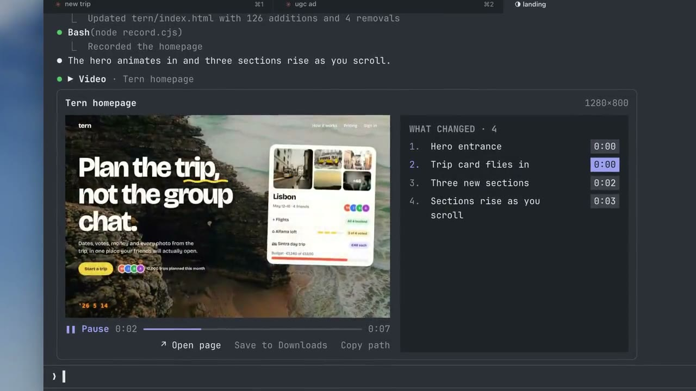
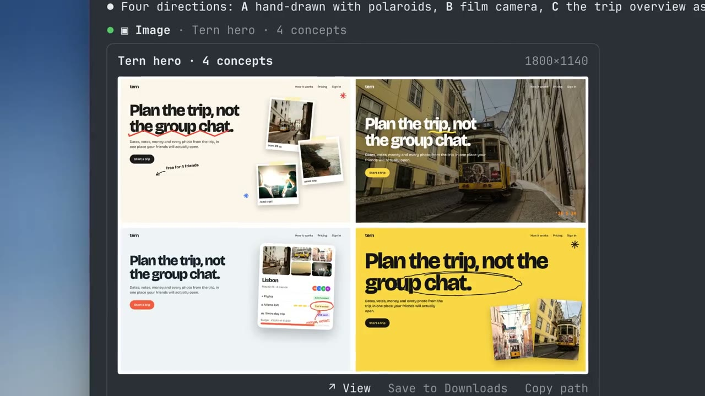
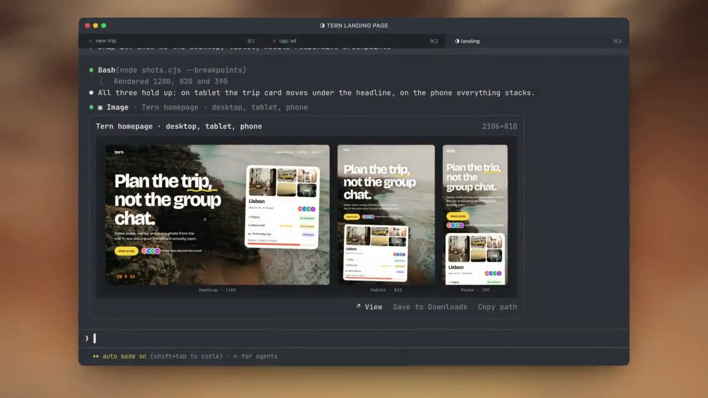

<p align="center">
  
</p>

<h1 align="center">claude-show-your-work</h1>

<p align="center">Смотрите, проверяйте и дорабатывайте работу агента, не покидая терминал.<br>Изображения, видео и визуальная проверка для Claude Code.</p>

<p align="center">
  <a href="https://github.com/iamumeransari/claude-show-your-work/stargazers"></a>
  <a href="#install"></a>
  <a href="#install"></a>
  <a href="LICENSE"></a>
</p>

## Установка

Выполните эти две команды в Claude Code:

```
/plugin marketplace add https://github.com/iamumeransari/claude-show-your-work.git#releases
/plugin install show-your-work@iamumeransari
```

Поддерживаются Ghostty и kitty на macOS и Linux с Claude Code 2.1.286 или новее. Видео и аудио также нуждаются в ffmpeg: установите его менеджером пакетов (`brew install ffmpeg` на macOS) или попросите Claude установить его. HTML-страницам нужен Chrome, Chromium или браузер Playwright, а PDF — poppler (`brew install poppler`).

По завершении установки короткий тур знакомства покажет вам возможности. Выполняйте `/show-your-work` в любое время, чтобы изменить настройки.

## Использование

Claude показывает вам свою работу в чате, когда создаёт или меняет что-то визуальное. Можно также попросить об этом напрямую:

- «Предложи четыре варианта главного экрана и покажи их рядом».
- «Сделай форму регистрации, протестируй её и покажи запись».
- «Исправь переключатель выставления счетов и покажи до и после».

### Визуальная проверка с записями «до и после»

<p align="center"></p>

Когда Claude создаёт функцию или исправляет баг, он тестирует изменение через Playwright, записывает прогон и проигрывает запись в чате — всё необходимое для проверки работы в одном месте:

- **До и после:** для любого изменения, от новой функции до исправления бага, Claude записывает одни и те же шаги на старой и новой версии. Compare проигрывает обе записи синхронно рядом.
- **Метки изменений:** каждое изменение, которое внёс Claude, перечислено рядом с видео с временной меткой, а клик по нему ведёт прямо к моменту, когда оно видно.
- **Проверки в реальном времени:** каждая проверка теста зеленеет или краснеет, когда видео доходит до неё, так что видно, где исправление работает, а где что-то ещё падает.
- **Одно место для проверки:** не нужно открывать браузер, перезапускать тесты или читать логи — запись и её результаты прямо в чате.

### Изображения

<p align="center">
  
  
</p>

Что бы ни спроектировал Claude, вы видите это прямо в чате: посадочные страницы, экраны приложений, компоненты, концепции дизайна, слайды, графики и сгенерированные изображения. Попросите несколько вариантов — и они появятся рядом, после чего можно продолжать дорабатывать понравившийся.

- **Сравнение вариантов:** несколько концепций показываются вместе, так что можно выбрать одну с взгляда, а не открывать файлы по очереди.
- **Сохраняется каждая версия:** каждая новая версия попадает в тот же проигрыватель, а History позволяет вернуться к любому предыдущему черновику.
- **До и после:** переключайтесь между старым и новым дизайном или ставьте их рядом, чтобы точно увидеть, что изменилось.

### Видео

<p align="center">
  
  
</p>

Помимо проверки продукта, Claude может показать видео почти о чём угодно, над чем работает. Делаете сайт и хотите увидеть, как он ощущается при прокрутке сверху вниз? Просто попросите — и запись, со всеми анимациями, пойдёт в чате.

Делаете рекламу, анимацию или видео запуска? Каждый фрагмент проигрывается прямо в чате в полнофункциональном видеоплеере:

- **Управление видео:** воспроизведение, пауза, перемотка по шкале времени, переход вперёд или назад к нужному моменту. Видео со звуком идёт со звуком; Mute выключает звук для сессии.
- **Временные метки:** боковая панель ведёт вас по видео шаг за шагом. У каждого шага есть метка времени, и один клик ведёт прямо к нему.
- **Сравнение версий:** когда Claude делает новую версию видео, она открывается в том же плеере. Можно переключать черновики через History или проигрывать старую и новую версии рядом синхронно.
- **Быстрые функции:** откройте видео в QuickTime Player для большего просмотра или сохраните его прямо в папку Загрузки одним кликом.

## Терминалы

show-your-work поддерживает Ghostty и kitty на macOS и Linux. Картинки работают там сразу.

- **Rex и приложение Herdr:** картинки и видео рисуются, но Claude Code включает их там, только если запущен с `CLAUDE_CODE_FORCE_TERMINAL_IMAGES=1`. Кнопка Turn on pictures в уведомлении добавляет строку в ваш профиль оболочки, задавая её только в этом терминале, и копирует команду для повторного открытия чата.
- **Warp, WezTerm и Konsole:** они поддерживают графический протокол kitty, но не Unicode-заполнители, которыми Claude Code рисует картинки, поэтому картинки в них пока показать нельзя.
- **Другие терминалы на базе Ghostty или kitty:** Claude Code их не распознаёт и оставляет картинки выключенными. Запустите его с `CLAUDE_CODE_FORCE_TERMINAL_IMAGES=1` (уведомление копирует такую команду) или добавьте `export CLAUDE_CODE_FORCE_TERMINAL_IMAGES=1` в профиль оболочки.
- **tmux:** работает внутри Ghostty или kitty. Claude Code оставляет картинки выключенными в tmux, если не запущен с `CLAUDE_CODE_FORCE_TERMINAL_IMAGES=1`, поэтому в первый раз плагин включает это для новых панелей tmux, а уведомление копирует команду повторного открытия чата с этим флагом. Плагин также включает `allow-passthrough` для своей панели и пропускает картинки через неё. В конфиге tmux ничего не меняется.

В версиях 0.6.7–0.6.9 была кнопка Turn on pictures в Warp, WezTerm и Konsole, которая добавляла строку в профиль оболочки. Из-за неё картинки рисовались сеткой квадратов, поэтому теперь плагин убирает эту строку сам.

## FAQ

<details>
<summary><b>Может ли Claude Code показывать изображения в терминале?</b></summary>

Да, с плагином show-your-work Claude Code может показывать изображения в терминале. После установки Claude показывает скриншоты, дизайны, графики и другие изображения прямо в чате. Работает в Ghostty и kitty.

</details>

<details>
<summary><b>Может ли Claude Code воспроизводить видео в терминале?</b></summary>

Да, с плагином show-your-work Claude Code может воспроизводить видео в терминале — записи экрана, анимации, рекламу и видео запуска внутри чата. Есть полнофункциональный плеер с перемоткой, пропуском, кликабельными метками времени и сравнением рядом.

</details>

<details>
<summary><b>Как увидеть, что сделал Claude Code, не открывая браузер?</b></summary>

Установите плагин show-your-work, и вы увидите, что сделал Claude Code. Когда он создаёт или меняет что-то визуальное, он делает скриншот или запись и показывает результат в чате. Переключаться в браузер и искать страницу самостоятельно не нужно.

</details>

<details>
<summary><b>Может ли Claude Code протестировать моё приложение и показать запись?</b></summary>

Да, с плагином show-your-work Claude Code может протестировать ваше приложение и показать запись. Он тестирует созданные функции через Playwright, записывает каждый прогон и проигрывает запись в чате. Шаги перечислены рядом с видео с метками времени. Каждая проверка зеленеет или краснеет, когда видео доходит до неё.

</details>

<details>
<summary><b>Может ли Claude Code показать до и после изменения или исправления?</b></summary>

Да, с плагином show-your-work Claude Code может показать до и после изменения или исправления. Он записывает одни и те же шаги Playwright на старой и новой версиях. Compare проигрывает обе записи синхронно рядом. Каждая проверка зеленеет или краснеет, когда видео доходит до неё.

</details>

<details>
<summary><b>Есть ли плагин Claude Code для визуальной проверки?</b></summary>

Да, show-your-work — плагин Claude Code для визуальной проверки. Он записывает прогоны тестов Claude через Playwright и проигрывает их в чате. К каждой записи прилагаются кликабельные метки изменений и проверки, которые зеленеют или краснеют по мере воспроизведения. Для изменения или исправления бага он проигрывает «до» и «после» синхронно рядом.

</details>

<details>
<summary><b>Как проверить, что Claude Code действительно исправил баг?</b></summary>

Проще всего попросить Claude записать исправление через show-your-work. Попросите его исправить баг и показать до и после. Старая и новая версии идут синхронно рядом, а проверки, которые теперь проходят, отмечены зелёным.

</details>

<details>
<summary><b>Чем show-your-work отличается от простого просмотра картинок в терминале?</b></summary>

show-your-work идёт дальше просмотра изображений в терминале. Его главная сила — визуальная проверка. Он проигрывает синхронные записи Playwright «до и после», перечисляет изменения, по которым можно перейти кликом, и окрашивает каждую проверку в зелёный или красный по мере видео. Вы можете проверить функцию или исправление, не покидая Claude Code.

</details>

<details>
<summary><b>Расходуют ли картинки и видео токены?</b></summary>

Нет, show-your-work почти не расходует дополнительных токенов, поскольку изначально создан экономным и по токенам, и по памяти. Изображения и видео рисуются прямо в вашем терминале по протоколу kitty без расхода токенов токенов. Видео также декодируется и передаётся эффективно, так что памяти расходуется очень мало.

</details>

<details>
<summary><b>В каких терминалах это работает?</b></summary>

Плагин show-your-work поддерживает Ghostty и kitty на macOS и Linux.

</details>

<details>
<summary><b>Это бесплатно?</b></summary>

Да, show-your-work бесплатен и имеет открытый код по лицензии MIT.

</details>

<details>
<summary><b>Нужно ли самому обновлять плагин, когда выходят новые функции и исправления?</b></summary>

Нет, обновляться самому не нужно. Плагин обновляется сам, так что вы не отстанете. Выбрать Stable или Latest можно при первом знакомстве или в любое время через `/show-your-work`.

</details>

<details>
<summary><b>Как снова увидеть тур знакомства?</b></summary>

Запустите `/show-your-work tour`. Он покрывает записи, сравнение до и после, историю версий и настройки.

</details>

<details>
<summary><b>Много ли места он занимает?</b></summary>

Нет, занимает немного. Он хранит недавние картинки и видео, чтобы вы могли вернуться к ним, и удаляет самые старые, когда их суммарный объём достигает примерно примерно 1 GB.

</details>

<details>
<summary><b>Собирает ли он какие-либо данные?</b></summary>

Вы сами решаете, делиться ли анонимными данными использования. Выбор можно сделать при знакомстве или изменить в любое время через `/show-your-work`. Никаких конфиденциальных данных он никогда не собирает. Подробности — в [Политике конфиденциальности](PRIVACY.md).

</details>

<details>
<summary><b>Что он запускает, хранит и к чему подключается на моём компьютере?</b></summary>

Вот всё, что плагин делает на вашем компьютере, чтобы вы точно знали, что устанавливаете. Ваши картинки и видео никогда не покидают компьютер.

Чтобы подготовить картинки и видео, он использует `ffmpeg` и `ffprobe` (превращает видео в кадры и читает его длительность), а на macOS — `sips` (преобразует картинку в PNG). Когда вы проигрываете видео со звуком, `ffplay` (часть ffmpeg) воспроизводит звук, а на macOS `osascript` узнаёт, сколько времени чтобы аудиовыходу нужно на воспроизведение, чтобы картинка ждала звук. Когда вы нажимаете View, Show in Finder или Save to Downloads, он открывает файл через `open` на macOS или `xdg-open` на Linux. На macOS `mdfind` помогает `/img` найти вставленную вами картинку. Чтобы показать HTML-страницу или документ Markdown/Mermaid, он отрисовывает его в скрытом Chrome или Chromium с одноразовым профилем (никогда с вашими входами); для PDF использует `pdftoppm` и `pdfinfo` из poppler.

Несколько коротких сценариев работают под `sh` и `perl`. Они находят `ffmpeg` и вашу домашнюю папку, читают размер ячейки терминала, чтобы картинки вписались, убирают временную папку плагина, открывают просмотрщик на Linux и переключаются между каналами Stable и Latest. Он также использует `cp`, `mkdir`, `rm`, `cat` и `touch` для своих временных файлов и `claude plugin` для установки собственных обновлений из этого репозитория не чаще раза в день. Обновления можно выключить. Обновлятор будет отключён после перехода плагина в каталог плагинов Claude Code, который будет поддерживать его в актуальном состоянии сам.

Он хранит эти файлы:

- Кадры видео и преобразованные картинки идут во временную папку (`$TMPDIR/claude-show-your-work-<your user id>`), и всё старше недели убирается.
- Копия каждого файла, который Claude вам показал, идёт в `.show-your-work/` вашего проекта, чтобы вы могли вернуться к версиям.
- Save to Downloads кладёт копию в `~/Downloads`.
- Если в профиле оболочки есть строка, добавленная Turn on pictures старой версии (см. [Терминалы](#terminals)), он убирает эту одну строку.
- При `SHOW_YOUR_WORK_DEBUG=1` он пишет `debug.log` во временной папке.

Раз в день он читает номер последней версии плагина с `raw.githubusercontent.com`.

Если в `/show-your-work` задано делиться данными использования, он отправляет анонимные счётчики на `us.i.posthog.com`. Это имена событий и числа, плюс версии плагина и Claude Code, ваш терминал, ваша ОС и наличие ffmpeg, под случайным id установки. Туда никогда не входят имена файлов, пути, запросы, что-либо, что вы набрали, или ваш IP. Ключ в коде — публичный ключ PostHog, который может только отправлять события.

Внутри Claude Code он использует эти хуки:

- `prompt.submit` отправляет одну короткую строку с вашим сообщением, говоря Claude, что этот терминал может показывать картинки (или почему не может). Отправляется раз за сессию, снова после сжатия и когда это меняется.
- `prompt.submit` закрывает настройки, когда вы отправляете сообщение, и запоминает имена вставленных картинок, чтобы `/img` мог их найти. Ваше сообщение не меняется.
- `tool.call` обрабатывает собственные инструменты плагина `show_image`, `show_video`, `show_html`, `show_audio` и `show_document`. Другие инструменты он не трогает.
- `command.run` запускает `/img`, `/page`, `/audio`, `/doc` и `/show-your-work`. Сразу после установки он один раз запускает `/show-your-work tour`, чтобы показать вам возможности.
- `ui.render` рисует плеер плагина, уведомления, настройки и тур.
- `session.start` и `session.end` готовят временную папку и терминал в начале и отправляют ожидающие счётчики использования в конце. Внутри tmux они также включают и выключают пропуск картинок для панели плагина (см. [Терминалы](#terminals)).

</details>

## Обратная связь

Чтобы сообщить об ошибке или предложить изменение, [откройте issue](https://github.com/iamumeransari/claude-show-your-work/issues).

## Для разработчиков

<details>
<summary>Инструменты, настройки и локальная разработка</summary>

Плагин даёт Claude пять инструментов: `show_image`, `show_video`, `show_html` (снимок HTML-страницы), `show_audio` (MP3 и WAV с волновой формой) и `show_document` (PDF, Markdown и Mermaid, постранично). Базовый вызов требует только пути. Для сравнения до и после Claude ещё передаёт старый файл и результаты тестов:

```jsonc
{
  "path": "qa/after.webm",          // the run on the fixed version
  "compare": "qa/before.webm",      // the same steps on the old version
  "title": "Pricing page",
  "url": "http://localhost:3000/pricing",
  "changes": [                      // what changed, and the second it shows up
    { "title": "Annual toggle sets prices", "at": 3.2 },
    { "title": "Plan buttons line up", "at": 5.4 }
  ],
  "summary": [                      // the test results, at most three lines
    { "label": "Billing: toggle works", "ok": true, "passed": 1, "total": 1 },
    { "label": "Layout: plans, buttons", "ok": true, "passed": 3, "total": 3 }
  ]
}
```

Видео режется на кадры до 12 в секунду, в ширину, в которую его показывает окно (не более 2400 px), с ограничением в 3 600 кадров (пять минут на полной скорости). Чтобы открыть файл самим, выполните `/img path/to/file.png`.

Чтобы работать над плагином, редактируйте модули в `hooks/` (`register.tsx` — точка входа) и выполняйте `/reload-plugins` для загрузки изменений. Перед отправкой изменения запустите `claude plugin validate .` и `claude plugin test .`.

</details>

## Статус

show-your-work активно поддерживается. Это первый плагин, который принёс картинки, видео и автоматическую визуальную проверку с записями Playwright в терминал Claude Code. Его видео запуска посмотрели более 275 000 раз. С тех пор он стал популярным выбором разработчиков, которые хотят видеть, что строит Claude, не покидая терминал. Он перечислен в некоторых из крупнейших каталогов плагинов Claude Code и сейчас входит в число наиболее быстро растущих плагинов для Claude Code.

Если вы хотите, чтобы Claude Code показывал вам скриншоты, записи экрана или сравнения своей работы «до и после», не покидая терминал, этот плагин создан именно для этого.

## Лицензия

[MIT](LICENSE). Фотографии в примерах — с [Unsplash](https://unsplash.com), по лицензии Unsplash. [Конфиденциальность](PRIVACY.md).

<p align="center"><a href="#install"></a></p>

## Источник и лицензия

- Оригинальный автор: iamumeransari
- Оригинальный репозиторий: https://github.com/iamumeransari/claude-show-your-work
- Лицензия: MIT
- Русский перевод и локализация интерфейса: проект claude-code-mods-ru
