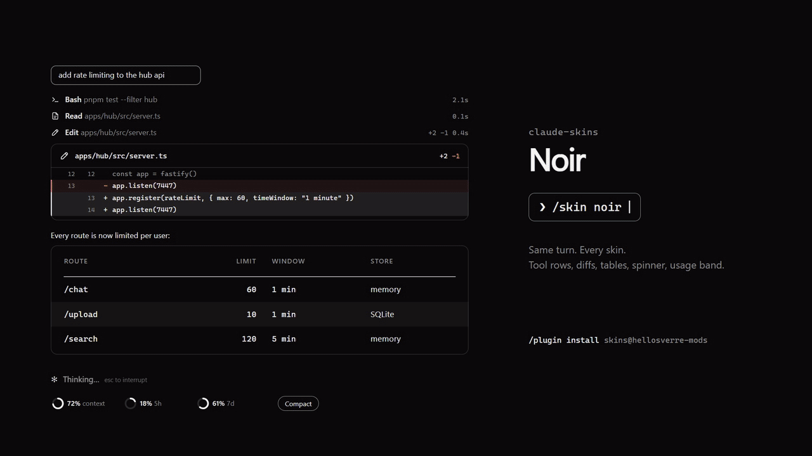

<h1 align="center">
  <picture>
    <source media="(prefers-color-scheme: light)" srcset="docs/brand/banner-light.svg">
    
  </picture>
</h1>

<p align="center">
  <a href="https://github.com/hellosverre/claude-skins/releases/latest"></a>
  <a href="LICENSE"></a>
  
</p>

<p align="center">Вызовы инструментов с иконками и временем, правки карточками diff, таблицы, код и диаграммы Mermaid карточками,<br>живая полоса расхода и шестнадцать скинов, которые можно перекрасить или попросить Claude придумать за вас.</p>



## Установка

Нужен Claude Code **2.1.287** или новее, в терминале или во вкладке Code приложения Desktop. Выполните обе команды внутри Claude Code:

```
/plugin marketplace add hellosverre/claude-skins
```

```
/plugin install skins@hellosverre-mods
```

Перезапустите Claude Code. Включён скин **noir**; введите `/skin`, чтобы сменить его.

Ищете другие моды? `/plugin install mod-store@hellosverre-mods`, затем `/mods` просматривает и устанавливает около 2 700 модов из панели, показывая заранее, к чему каждый имеет доступ.

## Обновление

skins раз в день проверяет новый выпуск и показывает уведомление, если вы отстали. Для обновления:

```bash
claude plugin marketplace update hellosverre-mods
```

```bash
claude plugin update skins@hellosverre-mods
```

Затем перезапустите Claude Code. Открытые сессии остаются на версии, с которой начались.

## Удаление

```bash
claude plugin uninstall skins@hellosverre-mods
```

Чтобы оставить установленным, но вернуться к собственной отрисовке Claude Code, выполните `/skin off`.

## Использование

`/skin help` перечисляет все команды в Claude Code; `/skin list` показывает все скины и настройки.

**Скины**

| Команда | Что делает |
|---|---|
| `/skin` | Настройки: выбрать скин с живым предпросмотром, включить или выключить части, перекрасить любой цвет |
| `/skin <name>` | Сменить скин (имена ниже) |
| `/skin list` | Все скины, включая ваши, и все настройки |
| `/skin help` | Все команды таблицей |
| `/skin off` · `on` | Вернуться к собственной отрисовке Claude Code или включить скины снова |
| `/skin gallery` | Все элементы, которые рисует скин, с номерами, чтобы указать на них |
| `/skin pin` · `unpin` · `share` | Задать этой папке собственный вид, убрать его или сделать по умолчанию |
| `/skin copy` · `copy code` | Скопировать последний ответ Claude или только его последний блок кода |
| `/skin calm` · `calm off` | Без движения, по одной строке на вызов инструмента, свёрнутый только для чтения вывод, ошибки всегда целиком; `calm off` возвращает как было |

Встроенные скины: `noir`, `tokyo-night`, `dracula`, `catppuccin`, `rose-pine`, `nord`, `gruvbox`,
`kanagawa`, `everforest`, `one-dark`, `solarized`, `night-owl`, `ayu`, `github`, `mono`, `terminal`.

**Параметры**

| Команда | Что делает |
|---|---|
| `/skin tables on/text/off` | Таблицы карточками, выделяемым текстом на Desktop или собственные у Claude Code |
| `/skin prompt left/right/plain` | В терминале — с какой стороны находится рамка вашего запроса, или простой маркер перед ним. Desktop сохраняет собственные сообщения Claude Code с копированием и откатом |
| `/skin words claude/skin` | Чьи слова показывают спиннер и подвал хода: Claude Code или скина (по умолчанию) |
| `/skin icons unicode/ascii` | Набор иконок и только ASCII-диаграммы в терминале |

**Части**, каждая включается через `/skin <part> on` или `off`:

| Часть | Что делает |
|---|---|
| `rail` | Цветная направляющая рядом со строками инструментов |
| `shimmer` | Полоса света по слову спиннера |
| `band` | Счётчики расхода над запросом |
| `countdown` | Оставшееся время до каждого лимита в полосе |
| `compact` | Кнопка Compact в полосе с напоминанием от 70% контекста (включено по умолчанию) |
| `clip` | Обрезать собственный вывод shell Claude Code до начала и конца |
| `markdown` | Отрисовываются оповещения и списки задач |
| `quiet` | Чтения, поиски и команды только для чтения сворачиваются в одну строку |
| `charts` | Блоки `mermaid` как диаграммы |
| `math` | Набор математики |
| `commands` | Вывод слэш-команд таблицами и карточками |
| `shell` | Вывод shell карточкой |
| `highlight` | Блоки кода с подсветкой цветами скина |
| `hints` | Сообщить Claude, что здесь рисуются диаграммы |
| `links` | URL и пути ссылками |
| `copy` | Кнопки копирования на карточках |
| `fold` | Длинные блоки сворачиваются за `▾ N more` |
| `expand` | Все серии чтений и поисков раскрыты вместо одной строки `Read 3 · Search 2 ▸`; по умолчанию выключено |

**Создайте скин с Claude.** Попросите «сделай мне скин, который чувствуется как закат». skins даёт Claude
инструмент `design`, так что он строит скин и применяет его у вас на глазах. Перекраска встроенного скина сохраняет
его как ваш `my-<skin>`. Выбор запоминается между сессиями.

## Предпросмотр

Нарисовано собственным кодом карточек мода (`scripts/previews.ts`), не скриншоты.

<picture>
  <source media="(prefers-color-scheme: light)" srcset="docs/previews/hero-light.svg">
  
</picture>

<picture>
  <source media="(prefers-color-scheme: light)" srcset="docs/previews/spinners-light.svg">
  
</picture>

<picture>
  <source media="(prefers-color-scheme: light)" srcset="docs/previews/terminal-light.svg">
  
</picture>

<picture>
  <source media="(prefers-color-scheme: light)" srcset="docs/previews/code-light.svg">
  
</picture>

<picture>
  <source media="(prefers-color-scheme: light)" srcset="docs/previews/usage-light.svg">
  
</picture>

## Что он перерисовывает

| Часть | Приложение Desktop | Терминал |
|---|---|---|
| Вызовы инструментов | Иконка по виду, спиннер во время работы, изменённые строки, затраченное время. `▸` открывает строку: полный ввод вызова и его ответ (текст чтения с номерами строк, совпадения поиска, карточка shell, diff); неудавшийся вызов открывается сам | Узел на направляющей хода с тем же `▸` |
| Правки | Карточка diff с `+N −M` и нумерованными строками | Собственный diff Claude Code |
| Команды shell | Карточка терминала со статусом, отдельно stderr, длинный вывод свёрнут; пути, числа и слова об ошибке, предупреждении и успехе окрашены | Карточка с командой, выводом, окрашенным так же, `✓` или `✗ exit N`, stderr красным под отдельной подписью, каждый поток свёрнут до 8 + 4 строк (`/skin shell off` для собственного вывода Claude Code) |
| Тихий вывод (по умолчанию выключен) | Чтения, поиски и команды только для чтения сворачиваются в одну строку; ошибка сохраняет свою строку | То же |
| Таблицы | Карточка с линией заголовка, через строку, цветными образцами | Сетка ячеек с полосой заголовка |
| Диаграммы | ` ```mermaid ` карточкой: flowchart, xy, pie, gantt, timeline, journey, kanban, mindmap, quadrant, radar, sankey, gitGraph, treemap, packet, block, architecture, C4 | Те же семнадцать, нарисованные ячейками, ASCII при `/skin icons ascii` |
| Математика | `$$…$$`, `\[…\]` и ` ```math ` карточкой с набором: дроби, корни, суммы и интегралы с пределами, матрицы, выровненные строки; `$…$` в строке превращается в Unicode | Дроби и пределы стопкой в ячейках, встроенное `$…$` как Unicode |
| Вывод команд | `/cost`, `/context` и вывод плагинов: таблицы, код и `key: value` карточками | То же сетками ячеек |
| Оповещения и списки задач | `> [!NOTE]` рамкой с заголовком, `- [ ]` с галочками и счётчиком сделанного | То же |
| Блоки кода | Карточка с языком, номерами строк, подсветкой; в блоках shell остаётся кнопка Run | В рамке, язык на рамке, подсветка цветами скина: TS/JS, JSON, оболочки, PowerShell, Python, Rust, Go, C/C++, C#, F#, Java, YAML, TOML, HTML/XML, CSS, SQL, diff, Markdown, Lua (`/skin highlight off` для собственной отрисовки Claude Code) |
| Спиннер | Анимированная иконка на каждую фазу | Слово скина с полосой света |
| Над запросом | Кольца контекста и лимита тарифа, кнопка Compact, напоминание от 70% | Блоки счётчиков, та же кнопка |
| Ваши запросы | Собственные у Claude Code, чтобы копирование, откат и выделение работали | Скруглённая рамка или простой маркер |
| Ссылки и файлы | URL — собственные ссылки приложения; строки инструментов окрашивают файлы, созданные (`ok`) или изменённые (`warn`) в этом ходе | URL в тексте — ссылки OSC 8, где терминал их рисует (`FORCE_HYPERLINK=1` или `0` перекрывает проверку), иначе обычный текст; пути с `:line`, числа и версии окрашены, файлы этого хода в `ok` или `warn` в строках и тексте |
| Блоки diff | ` ```diff ` карточкой diff с Copy и `new only` (код после изменения) | Пронумерованные старые и новые строки, `+` и `-` цветами скина, код с подсветкой по языку, который называет его путь `+++` или метка ` ```diff-fsharp `, те же два копирования |
| Рядом | Две или более таблиц или диаграмм в ряд делят его, если каждой достаётся 75 столбцов; иначе стопкой | Таблицы и диаграммы в ряд стоят рядом, пока их естественные ширины влезают; иначе стопкой |
| Длинные блоки | Карточки кода длиннее 24 строк обрезаются там, с `▾ N more` | Код длиннее 24 строк, таблицы длиннее 14 строк и вывод shell длиннее 8 + 4 строк сворачиваются за `▾ N more` / `▴ less` |

У каждой карточки есть кнопка Copy (таблицы также `as text` — таблица как нарисована; ответ из нескольких блоков заканчивается `copy reply`), и она один раз анимируется при первой отрисовке с учётом уменьшенного движения. Меняется только
отрисовка: сохранённая беседа и то, что читает модель, не тронуты. Агенты, режим плана
и запрос разрешения сохраняют собственную отрисовку Claude Code.

**Подсказки для диаграмм.** Пока диаграммы включены, Claude получает короткую только для модели заметку (около 130 токенов, оценено по 458 символам) о том, что блоки ` ```mermaid ` здесь рисуются, так что он тянется к диаграмме, когда она читается лучше. Никогда для headless-запусков `claude -p`. `/skin hints off` убирает заметку, оставляя отрисовку диаграмм.

**Светлая и тёмная.** У каждого скина есть обе, и он следует теме Claude Code. При `auto` он следует вашему
терминалу (`COLORFGBG`) или системе. Задайте принудительно через `SKINS_THEME=light` или `SKINS_THEME=dark`.

**Цвета вашего терминала.** Скин `terminal` красит терминал собственной палитрой из 16 цветов
(`ansi256(0)` до `ansi256(15)`), так что он следует любой теме терминала, светлой или тёмной. Основной
текст и полосы таблиц используют собственные цвета темы Claude Code; выберите ANSI-тему в `/config`, чтобы и
они следовали терминалу. В приложении Desktop нет палитры терминала, и оно рисует как `noir`.

## Для других модов

skins добавляет `$.skins.markdown` в `$`. Он рисует markdown так, как skins рисует ответ, в скине пользователя. Он возвращает дерево или `undefined`, когда skins выключен или в тексте нет того, что он рисует, и выбрасывает исключение на некорректный аргумент. У него нет кнопок копирования и сворачивания, поскольку нажатие не может перейти из дерева одного мода в другое. Укажите `skins` в `dependencies` вашего `plugin.json`, и Claude Code положит его типы в ваш `.claude-plugin/types/`.

```tsx
let drawn
try {
  drawn = await $.skins.markdown({ surface: e.surface, text, columns: e.props.bodyColumns })
} catch {}
return drawn ?? <Markdown text={text} />
```

## Совместимость

Проверено вручную на Windows (терминал и приложение Desktop, 0.3.0) и запускалось на Linux (терминал, 0.5.0,
Claude Code 2.1.288, 168 тестов движка). [CI](.github/workflows/ci.yml) запускает тесты,
проверки манифеста и типов на Linux, Windows и macOS. macOS, VS Code и мобильный
вручную не проверялись. Матрица поверхность × ОС и
время отрисовки на строку — в [docs/compat.md](docs/compat.md). Измерить у себя:

```bash
scripts/bench.sh
```

## Известные ограничения

| Что | Что вы получаете вместо этого | Где |
|---|---|---|
| Открытая строка чтения изображения, PDF или блокнота, фоновой команды или ответа, который нельзя прочесть | Собственная строка Claude Code, нарисованная в открытой строке | `bodyOf` в [`hooks/detail.ts`](hooks/detail.ts); тест «открытое изображение Read — собственная отрисовка Claude Code…» |
| Агенты, режим плана, задачи, запрос разрешения | Собственные строки и диалоги Claude Code | `kindOf` в [`hooks/tools.ts`](hooks/tools.ts); тест «инструменты, которые скин не может перерисовать верно, сохраняют свою строку» |
| Правки в терминале, неудавшиеся правки везде | Собственный diff Claude Code | [`hooks/register.tsx`](hooks/register.tsx) `ToolResult`; тест «на Desktop правка — карточка diff…» |
| Блоки кода в терминале на языке, которого подсветка не знает | Собственный markdown Claude Code | `languageOf` в [`hooks/highlight.ts`](hooks/highlight.ts); тест «блок на неизвестном языке сохраняет markdown Claude Code» |
| Блоки shell (` ```bash `) на Desktop | Собственный блок приложения, чтобы кнопка Run осталась | тест «на Desktop блок shell сохраняет блок приложения» |
| Диаграммы sequence, state, class и ER на Desktop | Карточка кода: только терминальная встроенная раскладка их рисует | `artKind` в [`hooks/mermaid-art.ts`](hooks/mermaid-art.ts), `parseMermaid` в [`hooks/mermaid.ts`](hooks/mermaid.ts) |
| Корейские, китайские, японские и другие широкие символы в идентификаторе узла или имени состояния терминальной диаграммы (`A[Начало] --> Запрос`) | Код: встроенная раскладка теряет такие узлы. Широкие подписи рисуются как арт | `drawsWide` в [`hooks/mermaid-art.ts`](hooks/mermaid-art.ts); тест «диаграмму, которую отрисовщик не может разложить с широкими символами, откатывает к коду» |
| Слишком широкая или длинная диаграмма (более 80 строк или 8 000 символов в терминале) | Строки для flowchart, xy и pie, иначе код | тест «слишком широкая для терминала диаграмма откатывается к строкам…» |
| Блок ответа более 9 000 символов, запрос более 4 000 | Собственная отрисовка Claude Code всего сообщения | `MAX_MARKDOWN`, `MAX_PROMPT` в [`hooks/register.tsx`](hooks/register.tsx) |
| Карточки кода длиннее 80 строк | Первые 80 и заметка `N more lines`; Copy берёт всё | `MAX_LINES` в [`hooks/svg-code.ts`](hooks/svg-code.ts) |
| Команды TeX, которых парсер не знает | Нарисованы как написаны, `\name` | [`hooks/math.ts`](hooks/math.ts) |
| Вывод shell в терминале против Desktop | Карточка терминала называет команду и сворачивает каждый поток до 8 + 4 строк; карточка Desktop говорит `Output` и сворачивает оба потока вместе до 6 + 6 | [`hooks/shell-rows.tsx`](hooks/shell-rows.tsx), [`hooks/svg-terminal.ts`](hooks/svg-terminal.ts) |
| Неудавшийся вызов shell, который вернул текст ошибки, а не свою запись | stdout и stderr приходят слитыми, поэтому весь текст рисуется как stderr | `shellResultOf` в [`hooks/shell.ts`](hooks/shell.ts) |
| Команда, отправленная в фон, или вывод-изображение | Собственная строка Claude Code, которая говорит, куда она ушла, или рисует изображение | `keepsOwnRow` в [`hooks/shell.ts`](hooks/shell.ts); тест «/skin shell off возвращает вывод shell…» |
| Карточки shell и время инструментов после `/resume` | В заголовке нет команды и нет времени: оба записываются во время вызова | `commandAtom`, `durationAtom` в [`hooks/register.tsx`](hooks/register.tsx) |
| Ошибки слэш-команд и собственный вывод `/skin` | Собственная строка Claude Code | тест «вывод слэш-команды со строками key: value — таблица, проза сохраняет строку» |
| `/skin calm` и спиннер Claude Code | Calm возвращает спиннер Claude Code, у того собственный спиннер всё равно движется | `Spinner` в [`hooks/register.tsx`](hooks/register.tsx) |
| Панель настроек на мобильном | Строка с просьбой использовать терминал или приложение Desktop | `Pane` в [`hooks/register.tsx`](hooks/register.tsx) |
| Пути файлов ссылками | Окрашены, не кликабельны: `Link` движка принимает только `https:` и `http://localhost` | `safeHref` в [`hooks/links.ts`](hooks/links.ts) |
| Сворачивание на Desktop | Карточки кода сворачиваются; карточки таблиц и shell сохраняют полную высоту или своё сворачивание 6 + 6 | [`hooks/fold.tsx`](hooks/fold.tsx) |
| Иконки и направляющая | Иконки только на Desktop (терминал не рисует `Svg`); направляющая только в терминале | `lookOf` в [`hooks/register.tsx`](hooks/register.tsx) |

## Сравнение

Другие моды, меняющие вид беседы, по их README от 2026-10-10. Пусто — про это в README не сказано.
| | skins | [Prismantis](https://github.com/NahumLitvin/prismantis) | [glint](https://github.com/manikosto/glint) | [tweakcc](https://github.com/Piebald-AI/tweakcc) | [claude-gfm-render](https://github.com/briangtn/claude-gfm-render) | [ccstatusline](https://github.com/sirmalloc/ccstatusline) |

| Как | Плагин function-hooks | Плагин function-hooks | Плагин function-hooks, форк Prismantis | Патчит JavaScript Claude Code; применять заново после каждого обновления | Мод function-hooks | Команда строки состояния |
|---|---|---|---|---|---|---|
| Claude Code | 2.1.287+ | 2.1.287+ | 2.1.289+ | Проверено на 2.1.162 | 2.1.286+ | |
| Названные платформы | Windows вручную, Linux тестами; CI на Linux, Windows, macOS ([compat](docs/compat.md)) | macOS-терминал вручную; CI на macOS, Linux, Windows | | Windows, macOS, Linux | Терминал и приложение Desktop | Руководство по Windows в их документации |
| Темы | 16, перекрасить любой цвет или попросить Claude придумать | 15 и `mono`, 20 слотов цвета | 15 | Свои для всего UI Claude Code | | Темы Powerline |
| Перекрашивает собственный UI Claude Code | Нет | Нет | Нет | **Да** | Нет | Нет |
| Строки инструментов | Иконки, время, направляющая; **открываются к вводу и ответу** | 4 стиля | | | Нет | Нет |
| Скрыт только для чтения вывод | `/skin quiet` | `toolOutput: quiet` | | | Нет | Нет |
| Diff правок | Карточка на Desktop; собственный diff движка в открытой строке в терминале | Собственный у Claude Code | | | Нет | Нет |
| Блоки ` ```diff ` | Карточка diff или нумерованные строки, копирование `new only` | | Нумерованные, `⧉ new only` | | | Нет |
| Вывод shell | Карточка на обеих поверхностях, окрашены пути, числа и ошибки | В рамках в раскрытых группах | | | Нет | Нет |
| Подсветка кода в терминале | 20 языковых семей цветами скина | Prism, около двух десятков языков | 20+ языков | | | Нет |
| Таблицы | Карточка или сетка ячеек, рядом с диаграммами | 4 стиля, рядом с диаграммами | | 4 формата | Нет | Нет |
| Mermaid | 17 видов; sequence, state, class, ER только в терминале | Flowchart, sequence, state, class, ER, xy; без pie | Flowchart, sequence, xy | | Flowchart, sequence, state, class, ER, xy; SVG на Desktop | Нет |
| Математика | Карточка на Desktop, стопка ячеек в терминале | Картинка с набором в kitty и Ghostty через RaTeX, текст в остальных местах | | | Не обрабатывается | Нет |
| Ссылки | URL ссылками OSC 8; файлы этого хода окрашены | Ссылки и простые URL кликабельны | **URL и пути файлов кликабельны**; изменённые файлы окрашены; полоса ссылок | | | Нет |
| Сворачивание длинных блоков | Код, таблицы, вывод shell (`/skin fold`) | | Код, списки, таблицы | | | Нет |
| Счётчики расхода | Контекст и лимиты тарифа над запросом | | | | Нет | **Много виджетов**, Powerline |
| Слова спиннера | Скина, с мерцанием | | | **Свои глаголы и анимации** | Нет | Нет |
| Счётчики расхода | Контекст и лимиты тарифа над запросом | | | | Нет | **Много виджетов**, Powerline |
| Слова спиннера | Скина, с мерцанием | | | **Свои глаголы и анимации** | Нет | Нет |
| Копирование | Карточки, таблицы как markdown или как нарисованы, `copy reply`, `/skin copy` | Кнопки, `/prismantis copy`, HTML-таблицы | Код, таблицы, диаграммы, списки, цитаты | | | Нет |
| API для других модов | `$.skins.markdown` | `$.prismantis.markdown` | | | | Нет |

Где они лучше: **tweakcc** перекрашивает весь Claude Code, а не только то, что может перерисовать хук, ценой патчинга бинарника. **Prismantis** работает с текстом справа налево, копирует таблицы в HTML и набирает математику картинками. **glint** делает пути файлов кликабельными и держит полосу ссылок последнего ответа. **ccstatusline** — намного более глубокая строка состояния.
**claude-gfm-render** рисует sequence и другие диаграммы как SVG на Desktop, где skins откатывается к карточке кода. Что skins планирует дальше — в [ROADMAP.md](ROADMAP.md).
## Конфиденциальность
skins рисует и запоминает, больше ничего. Он читает каталог сессии, ваше использование контекста и тарифа, настройку темы и `SKINS_THEME` / `COLORFGBG`, а свои настройки хранит в хранилище мода.
**claude-gfm-render** рисует sequence и другие диаграммы как SVG на Desktop, где skins откатывается к карточке кода. Что skins планирует дальше — в [ROADMAP.md](ROADMAP.md).
## Конфиденциальность

skins рисует и запоминает, больше ничего. Он читает каталог сессии, ваше использование контекста и тарифа, настройку темы и `SKINS_THEME` / `COLORFGBG`, а свои настройки хранит в хранилище мода.

Его единственный сетевой вызов — ежедневная проверка версии: GET [`plugin.json`](.claude-plugin/plugin.json) этого репозитория на `raw.githubusercontent.com`, без отправки данных. При `auto` он спрашивает ОС о светлом или тёмном режиме (`defaults` на macOS, `gsettings` в GNOME). Он сжимает или копирует только когда вы нажали кнопку. Проверьте сами через `claude plugin validate .`.
## Встроенный код
Раскладку терминальных диаграмм делает [beautiful-mermaid](https://github.com/lukilabs/beautiful-mermaid) (MIT), внедрённый в `hooks/vendor/mermaid-ascii.js` с лицензией в заголовке. Чтобы пересобрать его:
## Разработка
Сохранение файла перезагружает мод в работающей сессии. Тесты: `claude plugin test .`. Предпросмотры:
`npx tsx scripts/previews.ts`. Новый встроенный скин — один файл: скопируйте `hooks/themes/nord.ts`, поменяйте цвета и слова, добавьте строку в `hooks/themes/index.ts`.

## Больше модов

- [redgreen](https://github.com/hellosverre/redgreen): результаты тестов в панели рядом с чатом
- [smart-compact](https://github.com/hellosverre/smart-compact): сжимает после коммита, зелёных тестов, до истечения кэша подсказок или по просьбе Claude

```bash
cd scripts/vendor && npm install && npm run build
```

- [mod-store](https://github.com/hellosverre/mod-store): просмотр, поиск и установка 2 700 модов из панели

```bash
git clone https://github.com/hellosverre/claude-skins && cd claude-skins
```

```bash
claude --plugin-dir .
```

## Лицензия
MIT


## Источник и лицензия

- Оригинальный автор: hellosverre
- Оригинальный репозиторий: https://github.com/hellosverre/claude-skins
- Лицензия: MIT
- Русский перевод и локализация интерфейса: проект claude-code-mods-ru
