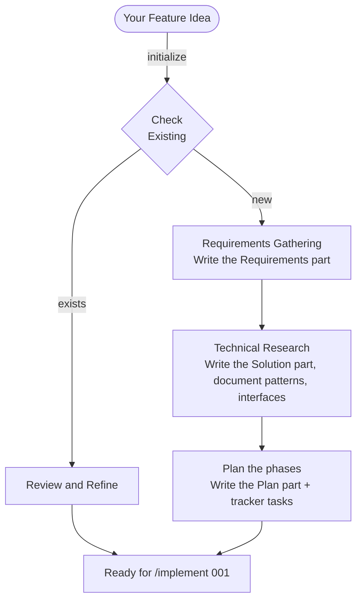
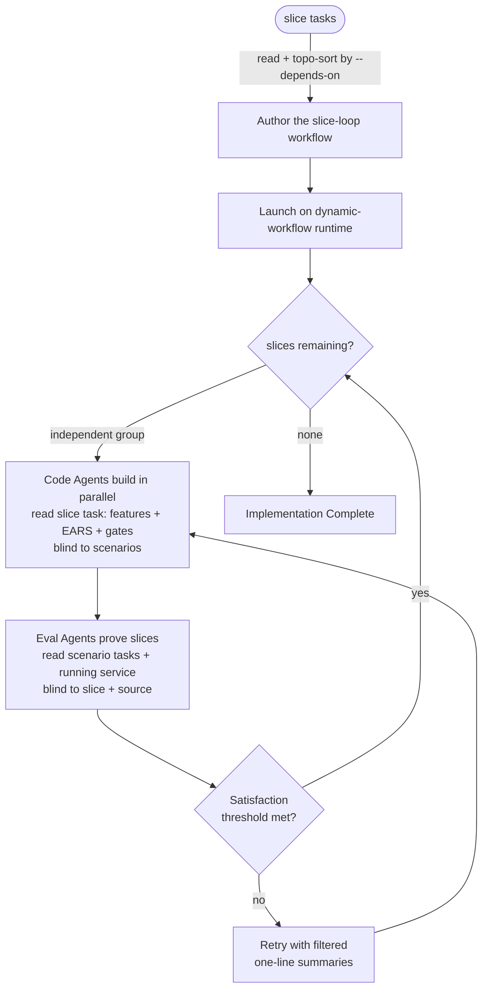
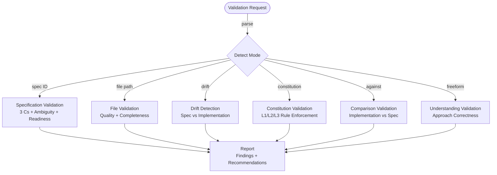
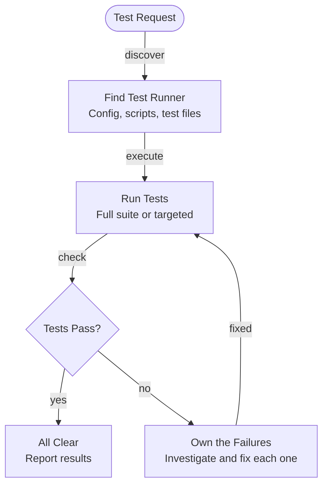
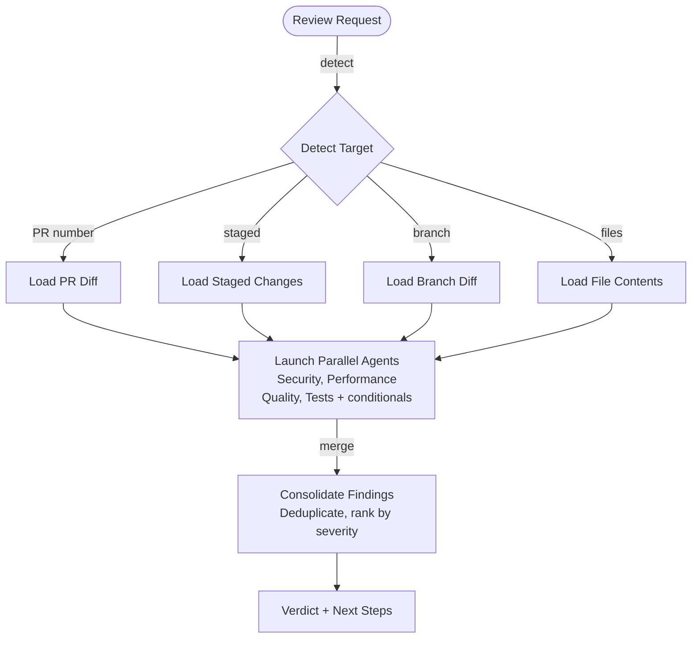
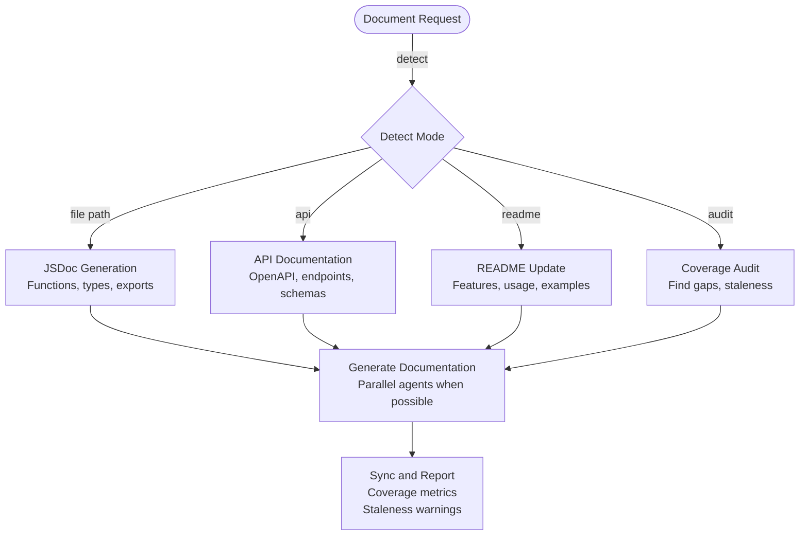
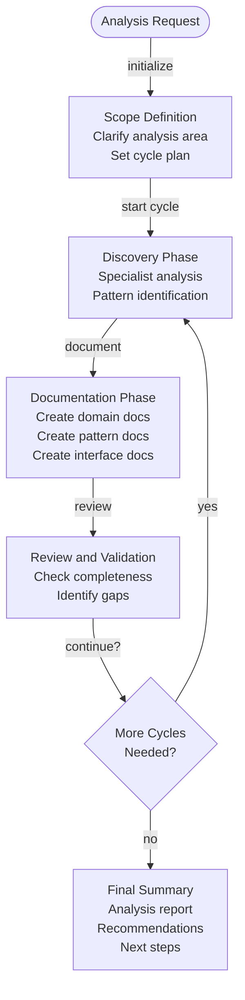
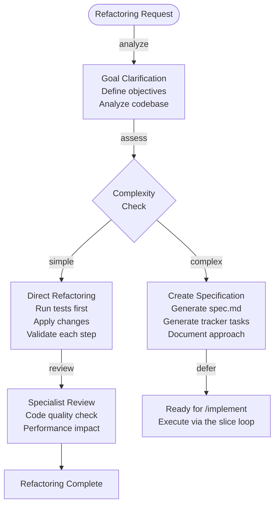
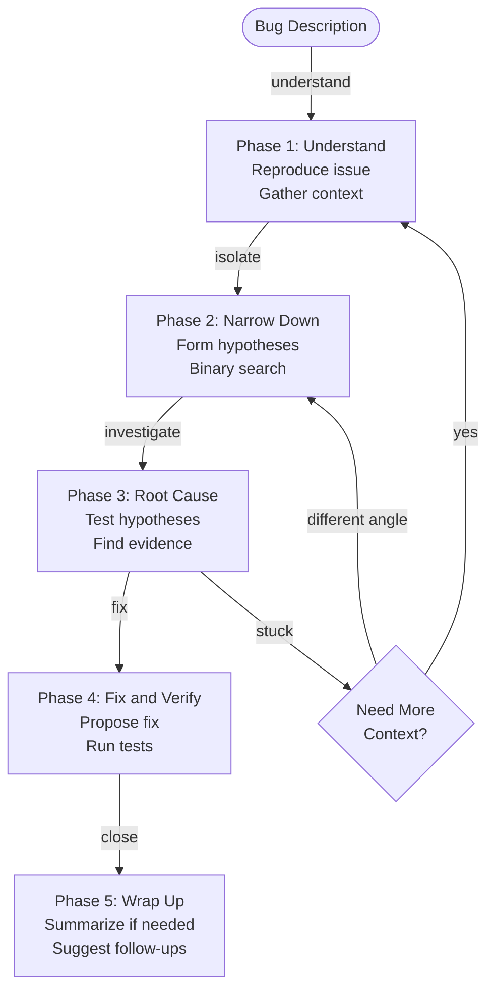
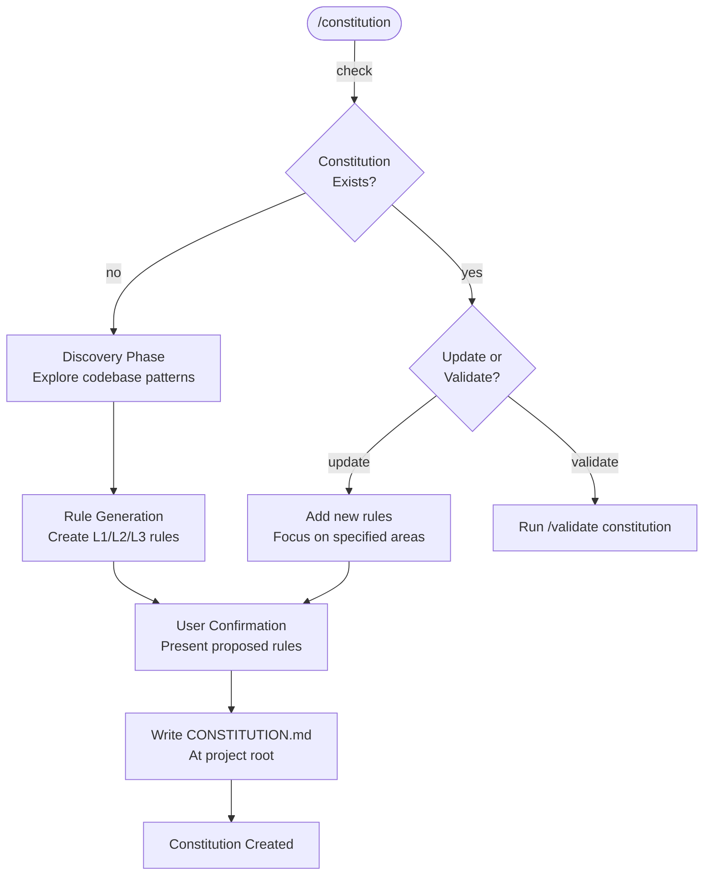

# Плагин Start — агентский стартап

**Плагин оркестрации рабочих процессов для разработки по спецификации в Claude Code.**

Плагин `start` предоставляет десять навыков рабочего процесса, вызываемых пользователем, пять автономных навыков и три стиля вывода, чтобы изменить то, как вы создаёте ПО с Claude Code.

**Быстрый старт, руководство по рабочему процессу и выбор навыков — в [главном README](../../README.md).**

---

## Содержание

- [Навыки, вызываемые пользователем](#user-invocable-skills) — specify, implement, validate, test, review, document, analyze, refactor, debug, constitution
- [Автономные навыки](#autonomous-skills) — 5 навыков, активируемых контекстом
- [Структура документации](#documentation-structure) — спецификации, домен, паттерны, интерфейсы
- [Стили вывода](#output-styles) — The Garage, The Startup, The ScaleUp
- [Типичный рабочий процесс](#typical-development-workflow) — основной поток и потоки поддержки
- [Навыки в деле](#skills-in-action) — примеры из реальной практики
- [Шаблоны](#templates) — PRD, SDD, Plan, Scenario
- [Философия](#philosophy) — принципы разработки по спецификации

---

## Навыки, вызываемые пользователем

Эти навыки вызываются пользователем через слэш-команды (например, `/specify`). В отличие от автономных навыков, которые активируются сами по контексту, здесь нужно явное обращение.

### `/specify <description>`

Создаёт подробные спецификации по кратким описаниям через глубокое исследование и координацию специализированных агентов, выдавая повествовательный план и задачи-слайсы, которые выполняет `/implement`.

**Назначение:** превратить идеи в готовые к реализации спецификации с продуктовыми требованиями, проектным решением и планом — один `spec.md` плюс задачи реализации в трекере

**Использование:**
```bash
/specify Build a real-time notification system with WebSocket support
/specify 001  # Resume existing specification work
```

**Ключевые возможности:**
- **Автоматическая нумерация id спецификаций** — автоматически создаёт пронумерованные каталоги (001, 002 и т. д.)
- **Возобновление** — можно продолжить работу над существующей спецификацией по её id
- **План по слайсам** — делит работу на самодостаточные задачи-слайсы, каждый связывает функции (AC), поведение EARS и Quality Gates, а контрольные сценарии — отдельные дочерние задачи
- **Порядок по зависимостям** — слайсы объявляют `--depends-on` друг друга; этот граф — контракт параллелизации для `/implement`
- **Документация паттернов** — автоматически документирует найденные паттерны в `docs/patterns/`
- **Документация интерфейсов** — фиксирует контракты внешних сервисов в `docs/interfaces/`
- **Документация домена** — записывает бизнес-правила в `docs/domain/`
- **Quality Gates** — требует одобрения пользователя между крупными фазами

**Код-бриф каждого слайса связывает три стороны:**

| Сторона | Источник | Роль |
|-------|--------|------|
| **Функции** (критерии приемки) | Часть требований | что даёт слайс |
| **Поведение** (EARS) | Часть решения | как должно работать |
| **Quality Gates** | производные | проверяемые условия |

Его **сценарии приемки** — отдельные дочерние задачи сценариев (контрольные доказательства) — то, как это доказывается.

<details>
<summary><strong>Показать подробности</strong></summary>

**Что вы получаете:** один документ `.start/specs/[NNN]-[name]/spec.md` из трёх частей, каждая закрывается своим одобрением:

- **Требования** — пользовательские истории, спецификации функций, критерии успеха, нефункциональные требования
- **Решение** — техническая архитектура, компоненты системы, модели данных, технологический стек
- **План** — целевое состояние и фазы с результатами; задачи реализации (фазы → слайсы → дочерние задачи сценариев) живут в **.tracker/**

Его часть Ledger хранит открытые вопросы, допущения, журнал решений и принятые компромиссы ревью.



</details>

---

### `/implement <spec-id>`

Выполняет спецификацию, запуская её задачи-слайсы на runtime динамических рабочих процессов Claude Code.

**Назначение:** превратить проверенные спецификации в работающий код одним циклом — каждый слайс строит code-агент и доказывает eval-агент, между ними информационный барьер, а повтор идёт до порога удовлетворённости.

**Использование:**
```bash
/implement 001
/implement path/to/custom/spec/
```

**Как это работает:**

`/implement` читает задачи-слайсы спецификации из трекера и сортирует их топологически по `--depends-on`. Затем он создаёт и запускает один динамический рабочий процесс:

| Шаг | Что происходит |
|------|--------------|
| **Чтение** | Читает задачи-слайсы (`task.js graph`); каждый несёт код-бриф (функции + EARS + гейты) со сценариями-контролями как дочерними задачами |
| **Запуск** | Пишет сценарий рабочего процесса из контракта цикла навыка и запускает его через инструмент Workflow; независимые слайсы идут параллельно |
| **Цикл** | На каждую фазу: code-агенты строят её слайсы — один агент на фазу, чьи слайсы связаны цепочкой зависимостей, по одному на слайс, которые можно параллелить (они читают задачи слайсов, не видя сценариев), → один eval-агент доказывает фазу контрольным сценарием, хранящимся вне проекта (читает задачи сценариев, не видя слайсов и исходников), → повтор с отфильтрованными сводками до порога или максимума итераций |

**Ключевые возможности:**
- **Один цикл, emerge-масштаб** — план на 1 слайс — короткий цикл; план на 40 слайсов разворачивается веером. Никаких уровней или стратегий на выбор
- **Структурный информационный барьер** — барьер в том, какую задачу читает каждый агент: code-агент → задача слайса; eval-агент → дочерние задачи сценариев
- **Возобновляемость** — runtime динамических рабочих процессов возобновляет завершённых агентов из кэша в рамках сессии
- **Обнаружение дрейфа** — запускает проверки дрейфа `Skill(start:validate)`
- **Соблюдение конституции** — нарушения L1/L2 блокируют завершение
- **Обновления в реальном времени** — `/workflows` показывает прогресс по каждому слайсу

<details>
<summary><strong>Подробности — цикл слайса</strong></summary>

Читает задачи-слайсы спецификации из трекера и сортирует их топологически по `--depends-on`. Запускает динамический рабочий процесс, написанный по контракту цикла навыка. Каждая фаза проходит цикл code→eval с барьером: code-агенты строят её слайсы (читают функции, EARS и гейты задач слайсов и AGENTS.md, но никогда их дочерние задачи сценариев), один eval-агент доказывает фазу по этим задачам сценариев контрольным сценарием, который он держит вне проекта (доступ к запущенному сервису, а для UI-сценариев к реальному браузеру, но никогда к слайсам или исходникам), а отфильтрованные однострочные сводки ошибок питают следующий повтор до порога удовлетворённости или максимума итераций. Фаза, чьи слайсы образуют цепочку зависимостей, строится одним code-агентом; слайсы, которые можно запустить параллельно, получают по агенту каждый, одновременно.



</details>

---

### `/validate <target>`

Проверяет спецификации, реализации или понимание через умное определение контекста и рамку 3 C (Completeness, Consistency, Correctness).

во время `/specify`

**Использование:**
```bash
/validate 001                                          # Validate spec by ID
/validate .start/specs/001/spec.md                      # Validate specific file
/validate Check the auth implementation against SDD    # Compare implementation to spec
/validate drift                                        # Check for spec-implementation drift
/validate constitution                                 # Validate constitution compliance
/validate Is my caching approach correct?              # Validate understanding
```

**Ключевые возможности:**
- **Умное определение режима** — автоматически определяет тип проверки по вводу
- **Рамка 3 C** — проверяет полноту, согласованность и правильность
- **Обнаружение неоднозначности** — ищет расплывчатые слова («должно», «различные», «и т. д.»)
- **Междокументная трассируемость** — проверяет соответствие требований, решения и манифеста
- **Обнаружение дрейфа** — проверяет соответствие спецификации и реализации
- **Соблюдение конституции** — проверяет правила управления L1/L2/L3
- **Только рекомендации** — даёт советы без блокировки
- **Сравнительная проверка** — сравнивает реализации со спецификациями

<details>
<summary><strong>Показать подробности</strong></summary>

**Шесть режимов проверки**, определяемых по вводу автоматически:

| Тип ввода | Режим | Что проверяется |
|------------|------|---------------------|
| Id спецификации (`005`) | Specification | Полное качество и готовность спецификации |
| Путь к файлу (`src/auth.ts`) | File | Качество отдельного файла |
| `drift` или `check drift` | Drift Detection | Соответствие спецификации и реализации |
| `constitution` | Constitution | Соблюдение правил управления |
| «Сверь X с Y» | Comparison | Реализация против спецификации |
| Произвольный текст | Understanding | Правильность подхода |

**Рамка 3 C:**

1. **Completeness (полнота)** — все разделы заполнены, нет `[NEEDS CLARIFICATION]`, чек-листы завершены
2. **Consistency (согласованность)** — междокументная трассируемость, согласованность терминов, без противоречий
3. **Correctness (правильность)** — ADR подтверждены, зависимости корректны, критерии приемки проверяемы



</details>

---

### `/test [target]`

Запускает тесты со строгим соблюдением ответственности за код — никаких отговорок про «уже падавшие до меня тесты».

обеспечивая

**Использование:**
```bash
/test                            # Run full test suite
/test all                        # Run full test suite (explicit)
/test src/auth/                  # Run tests for specific path
/test baseline                   # Capture current test state
```

**Ключевые возможности:**
- **Обнаружение тестов** — автоматически находит раннер, конфиг и файлы тестов
ими
- **Снятие базовой линии** — записывает текущее состояние проходящих/падающих тестов до изменений
- **Мультиагентный параллелизм** — может распределить наборы тестов по параллельным агентам
- **Адресный запуск** — конкретные файлы, каталоги или весь набор

<details>
<summary><strong>Показать подробности</strong></summary>

**Мандат ответственности:**

Когда тесты падают, навык требует строгой ответственности:
- Никаких «эти падения уже были раньше»
- Никаких «это вызвано не моими изменениями»
- Никаких «оставим падающие тесты пользователю»

**Режимы тестов:**

| Ввод | Режим | Что происходит |
|-------|------|--------------|
| (пусто) или `all` | Full Suite | Находит и запускает все тесты |
| Путь к файлу/каталогу | Targeted | Запускает тесты конкретной области |
| `baseline` | Capture | Записывает текущее состояние тестов для сравнения |



</details>

---

### `/review [target]`

Мультиагентное ревью кода с параллельной работой специализированных точек зрения.

**Назначение:** всестороннее ревью перед слиянием, когда разные агенты одновременно проверяют разные стороны

**Использование:**
```bash
/review                          # Review staged changes
/review 123                      # Review PR number
/review feature/auth             # Review branch changes
/review src/auth/ src/users/     # Review specific files/directories
/review staged                   # Explicitly review staged changes
```

**Ключевые возможности:**
- **Параллельные специалисты** — агенты безопасности, производительности, качества и тестов проверяют одновременно
- **Условные точки зрения** — конкуренция, зависимости, совместимость, доступность включаются когда уместно
- **Определение цели** — определяет номер PR, подготовленные изменения, путь файла или diff ветки
- **Оценка уверенности** — каждая находка имеет уровень уверенности HIGH/MEDIUM/LOW
- **Классификация серьёзности** — находки CRITICAL, HIGH, MEDIUM, LOW
- **Обычный или командный режим** — субагенты «отправил и забыл» или постоянные участники с координацией

<details>
<summary><strong>Показать подробности</strong></summary>

**Основные точки зрения (всегда активны):**

| Точка зрения | Область внимания |
|-------------|-------------|
| **Безопасность** | SQL-инъекции, XSS, захардкоженные секреты, обходы аутентификации, проверка ввода |
| **Производительность** | N+1 запросы, отсутствующие индексы, утечки памяти, неэффективные алгоритмы |
| **Качество** | Сложность кода, именование, принципы SOLID, обработка ошибок, дублирование |
| **Тесты** | Пробелы в покрытии, пропущенные граничные случаи, качество тестов, полнота проверок |

**Условные точки зрения (включаются когда уместно):**

| Точка зрения | Триггер |
|-------------|---------|
| **Конкуренция** | Обнаружены async/await, Promise, многопоточность |
| **Зависимости** | Изменения файлов зависимостей |
| **Совместимость** | Изменения публичного API или схемы |
| **Доступность** | Изменения фронтенд-компонентов |
| **Конституция** | В проекте есть CONSTITUTION.md |



</details>

---

### `/document [target]`

Создаёт и синхронизирует документацию, включая API-доки, README, комментарии JSDoc и аудит документации.

**Назначение:** держать документацию актуальной по коду, создавать недостающие доки и находить устаревшие

**Использование:**
```bash
/document src/api/               # Generate API documentation
/document readme                 # Update project README
/document src/utils/             # Add JSDoc to code files
/document audit                  # Audit documentation coverage
```

**Ключевые возможности:**
- **Несколько режимов документации** — Code, API, README, Audit, Module
- **Обнаружение устаревания** — находит устаревшую документацию
- **Метрики покрытия** — сообщает процент полноты документации
- **Генерация OpenAPI** — создаёт спецификации OpenAPI/Swagger из кода API
- **Мультиагентный параллелизм** — несколько агентов документации работают одновременно

<details>
<summary><strong>Показать подробности</strong></summary>

**Режимы документации:**

| Ввод | Режим | Вывод |
|-------|------|--------|
| Путь к файлу/каталогу | Code | Комментарии JSDoc/TSDoc |
| `api` | API | Спецификация OpenAPI, документация эндпоинтов |
| `readme` | README | Обновления README.md |
| `audit` | Audit | Отчёт о покрытии |

**Обнаружение устаревания:**

Навык автоматически определяет устаревание документации по:
- Сравнению времени изменения доков и кода
- Проверке, соответствуют ли задокументированные API реализации
- Поиску новых экспортов без документации



</details>

---

### `/analyze <area>`

Находит и документирует бизнес-правила, технические паттерны и системные интерфейсы через итеративное исследование.

**Назначение:** извлечь организационные знания из существующего кода и создать переиспользуемую документацию

**Использование:**
```bash
/analyze security patterns in authentication
/analyze business rules for user permissions
/analyze technical patterns in our microservices architecture
```

<details>
<summary><strong>Показать подробности</strong></summary>

интеграционной, области развёртывания и тестирования



</details>

---

### `/refactor <description>`

Улучшает качество кода, строго сохраняя всё существующее поведение через проверенные тестами инкрементальные изменения.

**Назначение:** безопасный системный рефакторинг с автоматическим откатом при падении тестов

**Использование:**
```bash
/refactor Simplify the authentication middleware for better testability
/refactor Improve the WebSocket connection manager
```

<details>
<summary><strong>Показать подробности</strong></summary>

Строго сохраняет поведение через проверенные тестами инкрементальные изменения. Все тесты должны проходить до рефакторинга и после каждого изменения. Автооткат при падении тестов. Для простых рефакторингов изменения применяются сразу с постоянной проверкой. Для сложных — создаются документы спецификации, и выполнение передаётся `/implement` по плану.



</details>

---

### `/debug <description>`

Диагностирует и устраняет баги через диалоговое расследование с систематическим поиском первопричины.

**Назначение:** собеседник по отладке на естественном языке, который помогает найти и исправить проблему диалогом, а не жёсткими процедурами

**Использование:**
```bash
/debug The API returns 500 errors when uploading large files
/debug Tests are failing intermittently on CI but pass locally
/debug Users report slow page loads after the latest deployment
```

**Ключевые возможности:**
- **Диалоговость** — естественный диалог, а не жёсткие чек-листы и процедуры
- **Постепенное раскрытие** — начинает с краткого, детали по запросу
- **Только наблюдаемые действия** — сообщает только о том, что реально проверил и нашёл
- **Управление у пользователя** — предлагает следующие шаги, направление задаёт пользователь
- **Отслеживание гипотез** — выдвигает и проверяет ранжированные гипотезы систематически
- **На основе доказательств** — никогда не выдумывает рассуждения; все выводы подкреплены доказательствами

<details>
<summary><strong>Показать подробности</strong></summary>

Использует диалоговый подход через пять естественных фаз: понять проблему, сузить её, найти первопричину, исправить и проверить, подвести итог. Отладчик сообщает только наблюдаемые действия («Я проверил X и нашёл Y») и никогда не выдумывает рассуждения. Пользователь может в любой момент спросить «что ты проверял?» и получить честный, проверяемый ответ.



**Четыре заповеди:**
1. **Диалог, не процедура** — это разговор, а не чек-лист
2. **Только наблюдаемое** — «я посмотрел X и нашёл Y», а не «наверное, это...»
3. **Постепенное раскрытие** — начинаем кратко, расширяем по запросу
4. **Пользователь у руля** — «Хочешь, я...?», а не «Сейчас я сделаю...»

</details>

---

### `/constitution [focus-areas]`

Создаёт или обновляет конституцию проекта с правилами управления через анализ паттернов на основе обнаружения.

**Назначение:** установить проверяемые правила проекта, которые соблюдаются при реализации, ревью и проверке

**Использование:**
```bash
/constitution                                    # Create new constitution via codebase discovery
/constitution security and testing               # Focus on specific areas
/constitution Add API patterns                   # Update existing constitution
```

**Ключевые возможности:**
- **Правила на основе обнаружения** — анализирует реальные паттерны кода, никогда не предполагает фреймворки
- **Система уровней L1/L2/L3** — L1 (блокировка + автоисправление), L2 (блокировка, вручную), L3 (рекомендация)
- **Трёхслойное применение** — проверяется на specify (SDD), implement и review
- **Правила «паттерн + проверка»** — поддерживает regex-паттерны и семантические проверки LLM
- **Мягкая деградация** — система работает нормально и без конституции

<details>
<summary><strong>Показать подробности</strong></summary>

Создаёт `CONSTITUTION.md` в корне проекта (как README, LICENSE, CODE_OF_CONDUCT). Конституция определяет проверяемые ограничения, которые находят нарушения в ходе разработки.

**Ключевое различие:**
- **CLAUDE.md** = описание проекта, указания для ИИ («Используй React с TypeScript»)
- **CONSTITUTION.md** = проверяемые правила, ловящие нарушения («Никаких barrel-экспортов»)

**Определения уровней:**

| Уровень | Имя | Блокирует | Автоисправление | Применение |
|-------|------|----------|---------|----------|
| **L1** | Должен | Да | ИИ исправляет сам | Безопасность, правильность, критическая архитектура |
| **L2** | Следует | Да | Нет | Важные правила, требующие человеческого решения |
| **L3** | Можно | Нет | Нет | Стилевые предпочтения, предложения |

**Пример формата правила:**

```markdown
### No Hardcoded Secrets

\```yaml
level: L1
pattern: "(api_key|secret|password)\\s*[:=]\\s*['\"][^'\"]{8,}['\"]"
scope: "**/*.{ts,js}"
exclude: "**/*.test.*, .env.example"
message: Hardcoded secret detected. Use environment variables.
\```

Secrets must never be committed to source control.
```

**Трёхслойное применение:**

| Фаза | Команда | Применение |
|-------|---------|-------------|
| **Планирование** | `/specify` (SDD) | SDD не должен нарушать принципы конституции |
| **Задача** | `/implement` | Порядок задач соблюдает приоритеты конституции |
| **Реализация** | `/implement` | Сгенерированный код проверяется; нарушения L1/L2 блокируют завершение |



</details>

---

### Установка

Установите фреймворк The Agentic Startup интерактивным установщиком:

```bash
npx the-startup
```

**Что он делает:**
- Поддерживает установку из маркетплейса Claude и установку файлами для других харнессов
- Запрашивает мультивыбор плагинов
- При файловом режиме запрашивает харнесс и путь установки
- Копирует артефакты файловой установки из удалённого репозитория GitHub

**Флаги:**
- `--help` — показать справку

**Примечание:** стили вывода выбираются через `/config` — см. [Стили вывода](#output-styles).

---

## Автономные навыки

Плагин `start` содержит пять автономных навыков, которые активируются сами по контексту. Их никогда не нужно вызывать явно — они работают, когда нужны.

### Навыки спецификации

| Навык | Назначение |
|-------|---------|
| `specify-meta` | Создание каталога спецификации, отслеживание README, переходы фаз |
| `specify-requirements` | Шаблон продуктовых требований, проверка, сбор требований |
| `specify-solution` | Шаблон проектного решения, архитектура, управление ADR |
| `specify-plan` | Автор повествовательного плана и задач слайсов/сценариев в трекере |

### Навыки реализации

| Навык | Назначение |
|-------|---------|
| `implement` | Запускает цикл слайсов как динамический рабочий процесс — барьер code→eval и повтор на слайс |

---

## Структура документации

Плагин поощряет структурированное управление знаниями:

```
.start/
└── specs/
    └── [3-digit-number]-[feature-name]/
        ├── spec.md                          # Requirements, Solution, Plan parts + Ledger
        ├── review.md                        # Solution review report
        ├── events.jsonl                     # Event log the dashboard replays
        └── .tracker/                        # Implementation tasks (phase → slices → scenarios)

docs/
├── domain/                                  # Business rules
│   ├── user-permissions.md
│   ├── order-workflow.md
│   └── pricing-rules.md
│
├── patterns/                                # Technical patterns
│   ├── authentication-flow.md
│   ├── caching-strategy.md
│   └── error-handling.md
│
└── interfaces/                              # External integrations
    ├── stripe-payments.md
    ├── sendgrid-webhooks.md
    └── oauth-providers.md
```

### Автодокументация

Точка зрения Capture навыка `document` автоматически создаёт файлы в нужном месте, когда в ходе работ находятся паттерны, интерфейсы или правила домена:
- Создание спецификации (`/specify`)
- Реализация (`/implement`)
- Анализ (`/analyze`)

### Дедупликация

Рабочий процесс capture всегда проверяет существующую документацию перед созданием новых файлов, не допуская дублей.

---

## Стили вывода

Плагин `start` поставляется с тремя стилями вывода — по одному регистру на стадию компании. Стиль меняет то, как Claude общается и сколько процесса применяет, а не то, что он знает. Все три сохраняют встроенные инженерные инструкции Claude Code (`keep-coding-instructions: true`), а стиль влияет только на основную беседу — субагенты и рабочие процессы плагина не затрагиваются.
Claude общается и сколько процесса применяет, а не то, что он знает. Все три сохраняют
встроенные инженерные инструкции Claude Code (`keep-coding-instructions: true`), а стиль влияет только на основную
беседу — субагенты и рабочие процессы плагина не затрагиваются.

Выберите регистр под то, для кого работа:

| Стиль | Регистр | Когда использовать |
|-------|----------|-------------------|
| **The Garage** | До стартапа — собрать минимальное работающее, меньше о нём говорить | Прототипы и наброски; пока ничего не несёт ответственности, выясняете, работает ли вещь |
| **The Startup** | В одиночку — один инженер, один агент, без церемоний | Это только вы; никаких делегирований, театра планов на одобрение, отчётов для третьих лиц |
| **The ScaleUp** | Координированно — работа проходит других людей | Кто-то, кого не было в беседе, прочитает написанное и тронет изменённое; делегируйте и оставляйте след |

### Активация стиля

Команда `/output-style` убрана в Claude Code v2.1.91. Сейчас выбирать можно так:

- **Интерактивно:** `/config` → Output style.
- **Напрямую:** `/config outputStyle=The Startup` (Claude Code v2.1.181+).
- **Закреплено за проектом** (делится с командой через git) в `.claude/settings.json`:

  ```json
  { "outputStyle": "The Garage" }
  ```

  Используйте `.claude/settings.local.json` для личного выбора на проект или `~/.claude/settings.json` для всех проектов. Приоритет: локальный > проектный > пользовательский. Изменение вступает в силу в следующей сессии (или после `/clear`).
Этот плагин намеренно **не** навязывает стиль (`force-for-plugin` не задан ни у одного из трёх): стадия — ваше решение, а принудительный стиль перекрыл бы и ваш выбор в `/config`, и любое закрепление в настройках, пока плагин включён.
## Типичный рабочий процесс разработки

### Настройка (необязательно)
### Основной поток: Specify > Validate > Implement > Review
*Если есть `CONSTITUTION.md`, правила автоматически проверяются на каждом этапе.*

---

**1. Создание спецификации**

**Что происходит:**

```
/constitution ──> Create project governance rules
                  L1/L2/L3 rules auto-enforced in BUILD flow
                  CONSTITUTION.md at project root
```

- Создаётся `.start/specs/001-notification-system/`

```
/specify ──> /validate ──> /implement ──> /review
   |              |              |              |
Create specs  Check quality  slice loop    Code review
PRD+SDD+Plan  3 Cs framework  code↔eval     Security+Perf
   |              |              |              |
Constitution  Constitution   Constitution   Constitution
checked on    mode available + drift enforced compliance
SDD

Optional: /document after implementation for documentation sync
```

- Генерируются spec.md и задачи трекера

- Документируются найденные паттерны/интерфейсы

```bash
/specify Add real-time notification system with WebSocket support
```

- Необязательно: создаётся ветка `spec/001-notification-system`
**2. Проверка перед реализацией (рекомендуется)**
**Что происходит:**
- Проверяются полнота, согласованность, правильность (3 C)
- Обнаруживаются неоднозначности и расплывчатые формулировки

- Сканирование безопасности на частые уязвимости

```bash
/validate 001
```

- Проверяется междокументная трассируемость
**3. Выполнение реализации**
**Что происходит:**
- Необязательно: создаётся ветка `feature/001-notification-system`
- Цикл слайсов запускается как динамический рабочий процесс

- По слайсу: code-агент строит его, eval-агент доказывает по контрольным задачам сценариев

```bash
/implement 001
```

- Повторы с отфильтрованными сводками ошибок до порога удовлетворённости
- Необязательно: создаётся PR по завершении
**4. Ревью перед слиянием**
**Что происходит:**
- Параллельное ревью специалистов (безопасность, производительность, качество, тесты + условные)
- Формируется сводный отчёт с ранжированием серьёзности

**5. Генерация документации (необязательно)**

```bash
/review
```

**Что происходит:**
- Добавляются комментарии JSDoc/TSDoc
- При необходимости обновляется README

- Сообщается покрытие документации

```bash
/document src/notifications/
```

### Потоки поддержки
**Понимание существующего кода**
Документирует находки в `docs/patterns/`, `docs/domain/`, `docs/interfaces/`
**Рефакторинг**

---

Для архитектурных изменений — создаёт спецификации, планирует миграцию, обрабатывает ломающие изменения.

**Исправление багов**

```bash
/analyze security patterns in authentication
```

Диалоговое расследование с наблюдаемыми доказательствами и направлением от пользователя.

**Аудит документации**

```bash
/refactor Restructure the authentication module for better testability
```

Сообщает покрытие документации и находит устаревшую или недостающую.

## Навыки в деле

```bash
/debug The notification system stops working after 100 concurrent users
```

### Пример: захват знаний через навык document

**Сценарий:** во время реализации агент находит паттерн

```bash
/document audit
```

**Что происходит автоматически:**

---

1. Активируется точка зрения Capture навыка document

2. Проверяет `docs/patterns/` на существующие паттерны повтора

3. Не найден — создаёт `docs/patterns/api-retry-strategy.md`

```
Agent output: "I implemented a retry mechanism with exponential backoff for API calls"
```

4. Использует шаблон паттерна
5. Сообщает: «Создано docs/patterns/api-retry-strategy.md»
**Вам не нужно было:** вручную просить документацию или указывать путь
## Шаблоны
Богатые шаблоны для структурированной документации, рядом со своими навыками:
**Использование:** автоматически применяются `/specify` и `/document` при создании документации

## Философия

---

### Разработка по спецификации

**Проблема:** функции без чётких требований ведут к техническому долгу, переделкам и непоследовательности.

```
plugins/start/skills/
├── specify-meta/template.md             # spec.md structure: Requirements, Solution, Plan, Ledger
├── specify-plan/templates/scenario.md   # Holdout scenario-task body template
└── document/templates/                  # Knowledge capture templates
    ├── domain-template.md               # Business rules
    ├── pattern-template.md              # Technical patterns
    └── interface-template.md            # External integrations
```

**Наш подход:**

---

1. **Сначала спецификация** — подробные спецификации до кода

2. **Ревью и уточнение** — проверка с заинтересованными сторонами

3. **Реализация уверенно** — выполнение проверенных планов

4. **Документация и обучение** — захват паттернов для переиспользования

### Основные принципы
- **Семь раз отмерь, один раз отрежь** — планирование заранее экономит время
- **Документация как код** — спецификации развиваются вместе с кодом
- **Параллельное выполнение** — несколько специалистов, чёткие границы

- **Quality gates** — DOR/DOD обеспечивают стандарты

- **Постепенное раскрытие** — детали загружаются только когда нужны
## Дополнительное чтение
- **[Главный README](../../README.md)** — обзор проекта и установка
- **Quality gates** — DOR/DOD обеспечивают стандарты
- **Постепенное раскрытие** — детали загружаются только когда нужны

---

## Дополнительное чтение

- **[Главный README](../../README.md)** — обзор проекта и установка

## Источник и лицензия

- Оригинальный автор: rsmdt
- Оригинальный репозиторий: https://github.com/rsmdt/the-startup
- Лицензия: MIT
- Русский перевод и локализация интерфейса: проект claude-code-mods-ru
