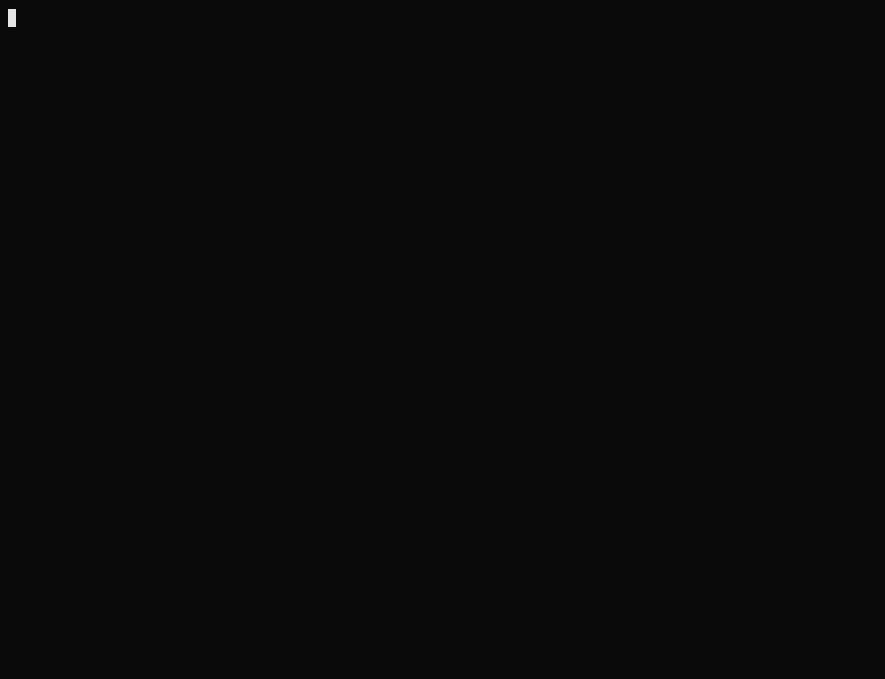

<p align="center">
  <picture>
    <source media="(prefers-color-scheme: dark)" srcset="docs/logo.svg">
    
  </picture>
</p>

<h1 align="center">tokendoctor</h1>

<p align="center">
  <strong>Тот же Claude Code до 38% дешевле</strong>
  <br>
  Он проигрывает ваши собственные прошедшие сессии, чтобы показать, сколько сэкономило бы каждое изменение, а затем меняет только то, что вы выбрали.
</p>

<p align="center">
  <a href="https://github.com/localixai/tokendoctor/actions/workflows/ci.yml"></a>
  <a href="CHANGELOG.md"></a>
  <a href="LICENSE"></a>
</p>

<p align="center">
  <a href="#install">Установка</a> &bull;
  <a href="https://tokendoctor.localix.ai/docs">Документация</a> &bull;
  <a href="https://tokendoctor.localix.ai">Сайт</a> &bull;
  <a href="CHANGELOG.md">Журнал изменений</a>
</p>

<p align="center">
  
</p>

**Решают ваши прошлые сессии, а не чужой бенчмарк.** То, что экономит настройка, зависит от того, как вы
работаете: как долго идут сессии, какие модели вы используете, в чём состоит работа. Число из чужих
сессий, включая мои, мало что говорит о ваших. Поэтому tokendoctor начинает с оглядки на
ваши собственные.

**① Оглянитесь на последние 30 дней.** `/tokendoctor:sessions` проигрывает каждую вашу сессию,
запрос за запросом, при окнах сжатия 200K, 300K, 400K и 600K и показывает, сколько стоило бы каждое.
Он только читает ваши транскрипты, не делает вызовов модели и ничего не меняет. Цифры — верхняя
граница: проигрывание не видит работу, которую модель переделала бы после сводки.

**② Меняйте только то, что ваши сессии показывают как выгодное, и отменяйте это.** `/tokendoctor:optimize` предлагает
изменения на основе этих чисел и сверяет ваши настройки с документацией Claude Code; применяет только
выбранные вами, каждое сначала показывая как diff. `/tokendoctor undo` возвращает любое из них.

**③ Необязательно: скольжение вместо сводки.** Когда Claude Code остановился бы, чтобы сжать
беседу, tokendoctor вместо этого отбрасывает старый вывод инструментов и сохраняет все сообщения.
Вызова модели нет, поэтому это занимает миллисекунды, а не минуту.

## Установка

```bash
claude plugin marketplace add localixai/tokendoctor
claude plugin install tokendoctor@tokendoctor
```

Перезапустите Claude Code и выполните `/tokendoctor:sessions`, чтобы увидеть, сколько стоили бы ваши последние 30 дней
при каждом окне. Ничего не меняется, пока вы это не выберете.

## Что он нашёл в моих сессиях

Каждый запрос отправляет моделью всю беседу. На моделях с окном 1M Claude Code
сжимает только около 967K токенов, поэтому конец длинной сессии — самая дорогая часть. У меня две
трети расхода основной ветви приходилось на запросы с более чем 400K в контексте.

Поэтому я поставил окно 400K и Sonnet для субагентов. Сравнив месяц до и неделю после,
примерно 23K и 19K запросов основной ветви, контекст на запрос упал с 412K до 219K, а стоимость
запроса — на 38% по прайс-листу API. Это один человек «до и после», не контролируемый
эксперимент.

Минус — больше сводок, и каждая — пауза: в среднем 79 секунд в моих сессиях. Для этого и нужен
slide. Ваши сессии могут показать что-то совсем другое — именно поэтому сначала стоит на них посмотреть.
## Что показывает бенчмарк

В [бенчмарке](bench/README.md) Claude Code собирает TypeScript-проект по тестам, которые

не может менять, поэтому прогон считается только при прохождении тестов. Стоимость за задачу на Haiku 5.5:


| Сравнение | Стоимость | Время |
| --- | --- | --- |
| Скольжение против сводки, день работы | −19% | −33% |
| Скольжение против сводки, eval-харнесс | −35% | −28% |
| Скольжение против сводки, короткая задача | +6% | −17% |
| Только советы по настройкам против Claude Code «из коробки» | дороже в 3 из 4 прогонов | |
| Советы и скольжение, неделя работы | −11% до −21% | |

Все тесты прошли в каждом прогоне. Одни советы здесь не окупились: эти задачи редко превышают 400K, где окно начинает иметь значение. Если и ваши сессии не достигают его, проигрывание покажет это, и окно лучше не трогать. Каждый прогон, включая проигрышные, — в
400K, где окно начинает иметь значение. Если и ваши сессии не достигают его, проигрывание покажет
это, и окно лучше не трогать. Каждый прогон, включая проигрышные, — в
[bench/HISTORY.md](bench/HISTORY.md).

<p align="center">
  <br>
  <sub><code>/tokendoctor:dashboard</code>: куда ушёл каждый токен, по дням, моделям, субагентам и проектам. Один локальный файл; этот — мой.</sub>
</p>

## Команды

| Команда | Что делает |
| --- | --- |
| `/tokendoctor:sessions [days]` | Проигрывает ваши прошлые сессии (30 дней или `days`) при меньших окнах: что сэкономило бы каждое и куда ушли токены. Только чтение. |
| `/tokendoctor:audit` | Проверяет ваши настройки, память и CLAUDE.md по документации, по уровню серьёзности. Только чтение. |
| `/tokendoctor:dashboard [days]` | Открывает локальную панель по всем сессиям на этом компьютере. |
| `/tokendoctor:optimize [focus]` | Предлагает до пяти изменений на основе ваших чисел и применяет выбранные. |
| `/tokendoctor [name] [value]` | Показывает, объясняет или меняет настройку без вызова модели. |
| `/tokendoctor undo [n]` | Перечисляет все изменения tokendoctor и отменяет одно. |

Ничего не покидает ваш компьютер: единственный сетевой вызов — к двум публичным страницам документации Claude Code
раз в день. Он сам никогда не переключает ваши модели.

## Документация

**[tokendoctor.localix.ai/docs](https://tokendoctor.localix.ai/docs)** содержит остальное:
[38 проверок](https://tokendoctor.localix.ai/docs/audit), каждую
[настройку](https://tokendoctor.localix.ai/docs/settings),
[как работает slide](https://tokendoctor.localix.ai/docs/slide) (и входы Team и Enterprise),
команды из оболочки, [измерения](https://tokendoctor.localix.ai/docs/proof)
и [ограничения](https://tokendoctor.localix.ai/docs/limits). Чтобы работать над самим tokendoctor, см.
[CONTRIBUTING.md](CONTRIBUTING.md).

## Лицензия

MIT

## Источник и лицензия

- Оригинальный автор: localixai
- Оригинальный репозиторий: https://github.com/localixai/tokendoctor
- Лицензия: MIT
- Русский перевод и локализация интерфейса: проект claude-code-mods-ru
